> MerthSloop firmware and MerthSloop Mobile for Android live on the `merthsloop` branch. Original Android work uses the Unlicense, with retained third-party obligations described in [Android licensing](android/LICENSING.md).

<b>A live groovebox firmware for the M-VAVE FM-1 — for any style.</b> 
Free and open source (GPL-3.0), based on <a href="https://github.com/hugelton/Felucca">Felucca</a> by Leo Kuroshita / Hügelton Instruments.

<a href="https://isod89.github.io/sloop-fm1/"><b>Upstream browser installer</b></a> ·
<a href="GUIDE.md">Complete guide</a> ·
<a href="SLOOP.md">Manual</a> ·
<a href="DEMARRAGE-RAPIDE-FR.md">Guide en français</a> ·
<a href="https://isod89.github.io/sloop-fm1/webapp/editor/">Web editor</a> ·
<a href="../../releases">Releases</a> ·
<a href="../../issues">Report a bug</a>

---

SLOOP turns the FM-1 into a four-track groovebox you play live: **three synths and a drum machine** with 16 sounds on the white keys, twelve synthesis engines, 171 sounds, 37 drum kits, your own samples, a song mode you play with your hands, USB audio, MIDI in on the jack and MIDI clock — and now **physical models** (guitars, sitar, bells, hand drums), a **noise** engine, **six-operator FM with DX7 patches**, **parameter locks**, **micro timing**, **fills**, a **quick chain** of sections and the **sequencer to MIDI out**. House, techno, hip-hop, trap, drum & bass, amapiano, synthwave, lo-fi, ambient, chiptune — it does not pick a style for you. Start from your own playing or optional native drum grooves and musical sequence starters.

> **Status:** beta. Please [report](../../issues) what you find. Projects, presets, samples and settings are kept during updates; see [Going back](#going-back) before downgrading.

> Upstream song, sample and settings formats are the compatibility baseline. Older experimental MerthSloop formats are not migrated.

## Contents

- [MerthSloop firmware and the one-minute workflow](#merthsloop-firmware)
- [Visualizers added in this fork](#visualizers-added-in-this-fork)
- [MerthSloop Mobile for Android](#merthsloop-mobile-for-android)

1. [Upstream capabilities](#upstream-capabilities)
2. [Screenshots](#screenshots)
3. [Features](#features)
4. [Install](#install)
5. [Your first beat in 60 seconds](#your-first-beat-in-60-seconds)
6. [The controls](#the-controls)
7. [The menu: settings of the FM-1](#the-menu-settings-of-the-fm-1)
8. [MIDI and USB audio](#midi-and-usb-audio)
9. [The web editor](#the-web-editor)
10. [Compatibility](#compatibility)
11. [Troubleshooting](#troubleshooting)
12. [Specifications](#specifications)
13. [Documentation](#documentation)
14. [Building and tests](#building-and-tests)
15. [Contributing](#contributing)
16. [Credits and thanks](#credits-and-thanks)
17. [Licence](#licence)

---

## MerthSloop firmware

This fork keeps SLOOP's synth engines and adds ways to build and perform a complete loop quickly on the FM-1. **No phone is required for these firmware features.**

Read the [illustrated MerthSloop feature guide](docs/firmware/MERTHSOFT-FEATURES.md) for the full branch additions, physical controls and fresh firmware screenshots.

MerthSloop builds on upstream SLOOP and Felucca. Firmware versions use upstream
`major.minor.revision` followed by our independent build number; see [branding and version policy](docs/BRANDING.md).

### A clearer instrument display

The native interface has four knob cards, a four-track overview, clearer page and
track/global labels, persistent action hints, and diagrams for envelopes,
modulation, filters and delay. **NEON** adds cyan, magenta, amber and violet accents:
hold **HOME → SCREEN → COLOR → NEON**. Existing saved palettes remain selected.
**PAGE HELP** in SCREEN explains the current page. Our playing and editing
shortcuts stay the same; native groove and sequence browsers show their controls
and preview/apply state directly. HOME shows the engine beside the preset in
the track color. The striped sun and horizon glow pulse gently with the beat while playback runs; sparse stars twinkle and a wireframe highlight advances on beats.

| Four-track overview | Envelope editing | Envelope wah |
| --- | --- | --- |
|  | 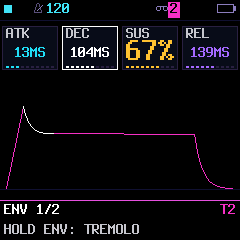 | 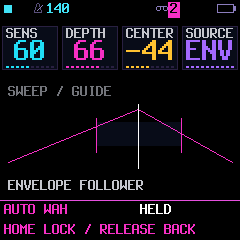 |

SONG, record-ready and count-in share the same knob-card layout and palette.
Running free takes keep a large timer, with matching header and footer spacing.

| Song order | Recording | Count-in |
| --- | --- | --- |
|  | 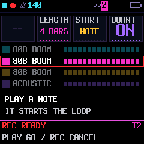 |  |

Settings include compact section tabs and contextual page help. Parameter summaries
retain complete values, and About includes fork attribution and source/license credits.
See the [UI refresh gallery and design](docs/firmware/UI-REFRESH-DESIGN.md) and
[screen-by-screen polish audit](docs/firmware/UI-POLISH-AUDIT.md).
These are actual firmware framebuffer captures; older screenshots elsewhere may
show the previous presentation of the same controls.

### Native note editing and LOFI characters

**SEQ → NOTES** selects one note within a chord and edits its pitch, sustain and strength. PRESETS zooms STEP/NOTES to 8, 16, 32 or 64 steps. **NOTE ACTIONS** adds selected-note move/copy/delete plus explicitly shared step timing, slide, accent and fill controls. The drum grid adds **HIT ACTIONS** for individual hit editing. Existing OCT-held tie/rest, octave and move brushes remain available.

**FX → LOFI** selects OFF, Vinyl, Tape, VHS, CD or Radio, with three controls tailored to the character. Vinyl has stronger irregular wow and sparse clicks/pops; Tape adds flutter, darkening and drive; VHS adds warble and damage; CD uses short captured-fragment stutters. Radio narrows the mix to a receiver band with drift, hiss and crackling static; its controls become audible well before their upper range. CD is a microstutter character, not a phrase-length delay. Settings save with projects and sections; all three amounts at zero bypass the effect. The **LOFI** punch temporarily intensifies the selected character. If TYPE is OFF it uses Vinyl, then returns to dry on release. Saved settings never change.
LOFI TYPE starts at and defaults to **OFF**: it fades to dry without changing the three stored
amounts. Selecting a character restores those amounts; LOFI punch remains
momentary over OFF and returns to dry on release. OFF is saved with the project
and section. Its inactive controls show the retained WOW/DARK/DAMAGE amounts.

On the drum track, **FX page 1** provides LEVEL / PAN / DELAY / REVERB, and page 2 provides its filter. INSERT 2 groups MIX, TYPE and the first two insert controls. MIDI CC11 expression and CC0 bank selection extend external-controller support without replacing saved track levels.

**MENU → FX** adds **FILTER RESO** for synth and drum track filters and **PUNCH FADE** for effect entry/exit. You can also hold **FX** and turn **SELECT** to adjust fade. HALF/DOUBLE remain immediate; the LOFI punch fades its temporary boost without changing your saved sound. **MENU → SEQ** controls automatic step advance and drum browsing preview. Noise-based drums respond to **TUNE** by shifting their filter brightness.

| Selected-note editor | Note actions | LOFI characters |
| --- | --- | --- |
|  | 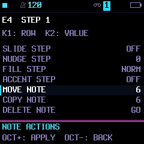 | 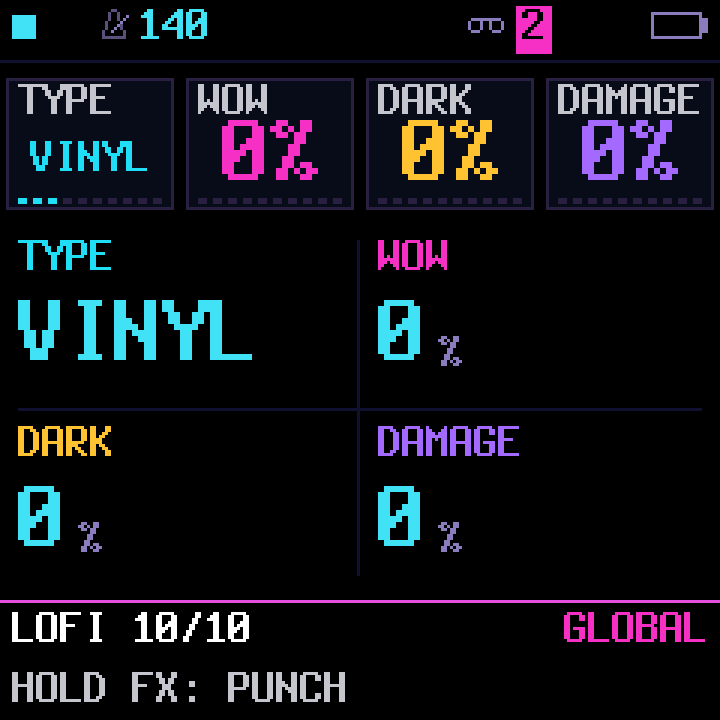 |

### Delay characters

**FX → DLY TYPE** adds **DIGI**, **TAPE**, **CRUSH** and **DUB**. DIGI is the original digital delay; TAPE softly compresses each repeat, and CRUSH adds a grainy, reduced-resolution echo. DUB gives stronger saturated, bass-trimmed echoes with TONE filtering the first repeat as well as feedback. Knob 1 selects TYPE. DIGI offers **TIME / FDBK / MIX**; TAPE and DUB offer **DRIVE / TONE / MIX**; CRUSH offers **BITS / RATE / MIX**. RATE runs from about 2.8 to 44 kHz; higher settings are cleaner. The preceding DLY page keeps **TIME / FDBK / COLR / MIX** for every type. This is a global delay shared by track sends; the dry instruments stay unchanged. The type saves with projects and sections.

STEP and NOTES show **PRESETS: ZOOM / OCT: TOOLS** in their footer. Turn PRESETS left to zoom in or right to zoom out.

### The one-minute workflow

1. With playback stopped, select the **drum track**, open its **GROOVE** page, and choose a beat. **OCT−** auditions it without replacing your pattern; **OCT+** applies it. Hold OCT+ for 700 ms or press it twice to confirm replacing existing material.
2. Select a **synth track**, then tap **SEQ** through STEP → NOTES → NOTE ACTIONS → PATTERN → RECORD → **SEQUENCES**. Choose **POP FOUR**, your root and scale, and **ARP NOTES** for an editable I–V–vi–IV arpeggio. Listen, then apply.
3. Select another synth and apply the same starter in **BASS** mode. The browser remembers your key, scale, octave and other choices across tracks until power-off. You now have drums, harmony and bass ready to develop with your own melody, sound design and performance.

The libraries are starting points: applying creates ordinary editable sequencer steps. Your selected sounds and tempo stay intact. Preview first, and use **EDIT + OCT−** to undo a replacement.

| Sweep following ties | Move the onset into its own ties | Start a new working project |
| --- | --- | --- |
| 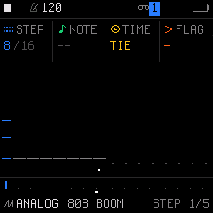 | 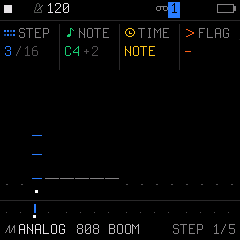 | 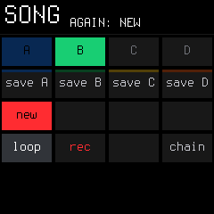 |

The [illustrated guide](docs/firmware/MERTHSOFT-FEATURES.md#record-and-correct-notes-quickly) includes before-and-after views for ties, rests and note movement, plus chord latch and song-load recovery controls.

| Native drum grooves | Musical sequence starters | Rhythm shaping |
| --- | --- | --- |
| 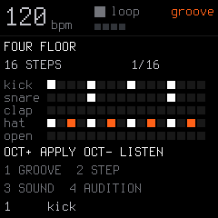 | 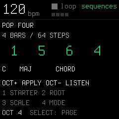 | 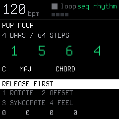 |

*Actual firmware framebuffer captures from the host UI harness.*

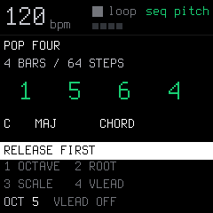

*Turn the SELECT knob twice inside SEQUENCES to reach seq pitch. Knob 1 sets octave and knob 4 VLEAD. Changing browser pages keeps audition playing.*

### What this fork adds to upstream SLOOP

These are the implemented MerthSloop additions; the upstream engine, preset and base groovebox features are described separately below.

- **Persistent scale lights:** hold physical **SEL** and press **OCT+** to toggle a dim keyboard guide matching the selected synth's SEL-page ROOT/SCALE. It replaces ordinary keyboard backlighting, so off-scale keys stay dark unless played. It follows key/scale changes, survives reboot, and leaves drum/step/FX controls clear. CHR lights every pitch class; it does not change the sound or quantize notes.
- **24 drum grooves:** four-on-the-floor, breaks, a four-bar Amen, funk, broken house, Afro clave, electro, boom bap and more. Preview using your current kit, then apply with complete pattern/metadata undo. The phone can browse and apply the canonical groove bank too.
- **27 musical starters:** standard progressions alongside soul sevenths, Dorian pockets, funk, offbeat stabs, gospel, disco, garage, Latin turns, rising/descending movement and Lydian colors. Choose **CHORD**, lower-root **BASS**, or **ARP NOTES**, which cycles chord tones at each attack (ORIGINAL adds eighth-note pulses while retaining starter syncopations). Turn **PRESET** to choose **RHY** independently: ORIGINAL or 17 named rhythms, from sparse bars to funk, offbeats and sixteenths. Rotate/offset/syncopate/feel modify that rhythm. A CHR track starts the browser in Major; its pitch page controls octave and optional voice leading independently of the physical OCT buttons.
- **Rhythm shaping:** rotate a pattern, offset drum lanes, move eligible attacks off the beat with syncopation, and add microtiming feel. Preview auditions the shaped result before replacement.
- **Fast ties and rests:** on STEP, select the starting note/chord, hold **OCT+**, and sweep **knob 1** clockwise to tie each following step. Hold **OCT−** instead to paint rests. The starting step stays intact; painting stops at the pattern's end. Backtracking moves without erasing, and the whole gesture has one undo.
- **Overlapping note sustains:** a note can keep ringing while another attacks on the same POLY track. Hold **OCT+**, choose **ALL** or a source pitch with **knob 4**, then extend it using **knob 1**. Release OCT+ and use **LEN** to shorten the selection, or tap **EDIT** to delete it and its continuations. Existing attacks and other voices stay intact; full steps and same-pitch retriggers are protected. [Controls and current limits](docs/firmware/PER-NOTE-TIES-DESIGN.md).
- **Recording and timing correction:** RECORD-page **SNAP** records to eighths or quarters while keeping the playback DIV intact. On STEP, hold either OCT button: **knob 2** shifts whole octaves and **knob 3** moves a note/chord by whole steps with its timing, conditions and locks. Moving into its own ties keeps the original end; other moves shift the complete tie chain. Occupied destinations are protected and gestures support undo/redo.
- **Playable latch:** hold **ARP** or physical **SEL** (labelled SCL in SLOOP) for 700 ms while holding notes to toggle latch without stopping your playing. It works with chord mode and manually played arpeggios. Non-CHROM chord modifiers toggle on latched chords; CHROM allows literal black-key roots.
- **Chord inversions and spread:** open **SEL → VOICING** for **INVERT / SPREAD / VLEAD / STRUM**. Rotate voices up or down, or choose CLOSE, OPEN and WIDE spacing without adding voices. Settings belong to the track, survive sound changes and save with sections/projects. Held or latched notes keep ringing until the next chord. [Controls and examples](docs/firmware/CHORD-VOICING-DESIGN.md).
- **Octave hold handoff:** while holding an ordinary keyboard note, change octave and press its newly lit key before releasing the original. It stays sustained without a fresh attack; releasing the last holder ends it. Held pitches light their current-octave keys even with NOTES display off.
- **Whole-pattern pitch tools:** hold **EDIT** and turn **knob 4** to shift a synth pattern by octaves, or knob 3 for semitones. Numeric shift/transpose/octave readouts follow the last gesture and undo/redo; uniform pitch bounds preserve chord intervals.
- **Scale-aware keyboard grids and MIDI:** synth EDIT shows key-signature guides with physical-key hints (E minor: **F♯**; C minor: **E♭, A♭, B♭**) while playing/erase behavior stays unchanged. SEL shows actual mapped pitches. Set **KEYS = WHITE** to play successive scale degrees. Optional **HOME menu → MIDI SCALE → KEYBOARD** applies that pitch mapping to incoming USB/TRS MIDI; default OFF keeps literal pitches. Held notes retain their original note-off mapping when settings change. See [scale/MIDI grid guide](docs/firmware/SCALE-MIDI-GRIDS.md).
- **Live vibrato and tremolo:** hold **LFO** for vibrato or **ENV** for tremolo on the selected synth only. Waveform panels show a live phase marker, pitch cents / volume percentage and a compact scale guide. They offer **free Hz / depth / waveform / beat sync** on knobs 1–4; release restores the previous screen and sound. **Hold LFO/ENV + tap HOME** to lock the panel and effect after release; HOME unlocks, and STOP/panic or track changes clear it. Knob 4 selects OFF or a division through triplets and two bars; turning knob 1 returns to free Hz. Quick taps open the normal pages, and saved patch settings stay intact. **MIDI CC1** and Android Perform's momentary strip also provide vibrato; STOP/panic clears modulation.

| Scale-aware SEL grid | Vibrato waveform | Tremolo envelope |
| --- | --- | --- |
|  | 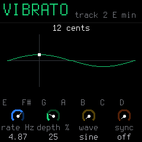 | 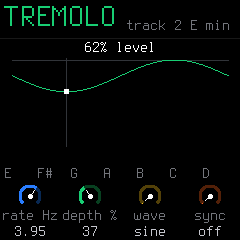 |

*Fresh renders from production firmware code in the host UI/audio harness.*

- **Track auto-wah and auto-pan:** hold **ENV+FX** for wah or **LFO+FX** for pan on the selected synth. Wah uses a vocal-range resonant band-pass sweep with a triangle LFO (free Hz or beat divisions) or follows the track’s own signal; pan offers waveform, depth and beat sync. **Hold the combo + tap HOME** to lock it until HOME/STOP/panic/track change. Keyboard playing and scale lights stay intact. These live effects leave saved parameters unchanged; see [controls](docs/firmware/AUTO-WAH-DESIGN.md).

| Track envelope wah | Track auto-pan |
| --- | --- |
| 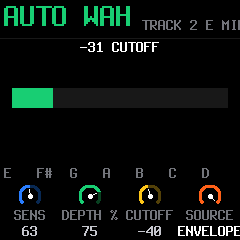 | 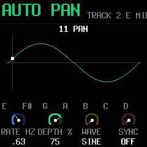 |

*Fresh production UI/audio harness renders.*

- **More chord and arp choices:** SUS2, ADD9, 6TH, SHELL, OCTAVE and explicit major/minor/seventh/diminished/augmented qualities; CONV, SHUF, ROOTALT, DNUP, UPDNREP, DIVG, WALK and PULSE arpeggios. See the [playing guide](docs/firmware/MERTHSOFT-FEATURES.md#play-chords-and-arpeggios) for ordering, latch and sequencer input.
- **Chord latch and literal roots:** SCL page 2 knob 4 exposes LATCH. In non-CHROM chord mode, modifier presses update the sounding latched chord immediately and remain toggled until pressed again. **KEYS/QNT CHROM** allows every piano key, including black keys, to be a literal chord root; the other keyboard modes keep their modifier controls.
- **Sequencer-fed arpeggios:** ARP 2 **ORD SNOTE/SPLAY** lets sequenced chords feed the arpeggiator, including sustained tie chains. Live and sequence input remain independent.
- **Expressive arpeggios:** incoming and sequenced velocity/accent survives arp modes, octave expansion, ties and latch across audio, MIDI output and recording. Overlapping live/sequence pitches use the stronger current velocity; PULSE merges octave collisions rather than doubling attacks. Physical keyboard attacks retain their fixed velocity.
- **Shared starter voice leading:** optional VLEAD uses the live chord inversion policy for generated CHORD/ARP NOTES sequences, anchored deterministically so Preview and Apply match. BASS stays on roots. This does not add semantic chord tracking or harmony-following tracks.
- **Undo accidental song loads:** while stopped, **EDIT + OCT−** restores the project preceding the latest saved-slot load, section selection or working-project backup restore; **OCT+** redoes it. This history is held in RAM and subsequent sequence edits or recording supersede it.
- **New project from SAVE:** the SAVE-held song menu includes **NEW**, with confirmation while stopped, so starting over does not require overwriting a saved slot.
- **Remote performance controls:** the phone can trigger held/next-bar fills and the negotiated punch-effect bank. Leases, panel priority, STOP and disconnect cleanup prevent abandoned remote controls from sticking.
- **Companion protocol and safe exchange:** hardware octave reporting, FM6/native-pattern editing, sample backup/upload/readback, persistent FM6 base-voice bank saving, and canonical drum-library discovery support the Android workstation below. INFO 15 keeps upstream SYN kit commands at 72–76 and LIVE at 77; remote performance uses 86 and the drum bank uses 87. Android and the web editor negotiate the supported mapping. Atomic live hardware scene switching remains future work.
- **Faithful live recording:** overlapping POLY notes end at their own releases; mono/legato/unison transitions preserve the recorded envelope handoff. Independent ties still support sustained notes under later attacks. Untouched factory/user arps follow a new preset; your edited arp stays. HOME identifies the A–D section currently playing.
- **More LOFI experiments:** TAPE combines cassette wobble, flutter and wear in one character; SMPLR blends old-digital rate reduction, bit crushing and compensated drive from subtle grit to heavy destruction. DUST KEYS, WORN PAD, TOY BELL and DUST BASS add four editable instrument presets in the LOFI bank. [Controls and details](docs/firmware/LOFI-MASTER-DESIGN.md).
- **Tap-toggle drones:** on **LFO → DRONE**, choose **DRONE** or **MOVE** with knob 1. Tap to add/remove pitches while the rest sustain; octave and track changes preserve them, and STOP clears them. Use POLY and sufficient ENV sustain for a chord bed. Selecting DRONE takes over live ARP/chord input without stopping transport; existing MIDI and sequence gates cannot cut a held drone. Mode and notes reset at power-off.
- **Slow ambient motion:** **LFO → DRIFT** adds independent smooth random movement to each synth track’s tone, shape, pan, or a combination of them, over 5–160 seconds. Amount and OFF fade smoothly; a live meter shows the movement, and LOFI tone wanders darker as well as brighter. The original sound stays editable. STILL WATER, WIDE SKY and DUSK add sustained progression starters. **LFO → DRONE → MOVE** can slowly replace one drone pitch at a time within the track’s scale; timed or tempo-synced cycles, chance and scale-step range control the wandering, with a live cycle bar. **DRONE 2 → LO OCT / HI OCT** bounds the whole pitch walk (defaults C3–B5); RANGE still sets each jump. Both features are runtime-only and reset at power-on. [Controls and design](docs/firmware/AMBIENT-PERFORMANCE-DESIGN.md).
- **Track sound morphing:** EDIT → MORPH keeps A/B sound states per synth track. Store two variations, then sweep between them while notes keep playing. Each pair is RAM-only; saving a section preserves the current sound. [Controls](GUIDE.md#track-sound-snapshots-and-morphing) · [Screenshot](assets/screens/merthsoft/neon/track-morph.png).
- **More room for drone layers:** HOME → AUDIO → VOICE BUDGET offers the default **8 / 12** or experimental **10 / 15** through **16 / 24** shared admission. Stolen POLY drone pitches can recover when a slot and budget are free, without generating extra MIDI notes. The budget is saved with device preferences; engine caps and CPU shedding remain. [Controls and qualification](docs/firmware/VOICE-BUDGET-EXPERIMENT.md).
- **Track sustain:** **ENV → SUSTAIN** offers PEDAL, PIANO, STRINGS and LOFI tails beneath new attacks, with half-second to 32-second/HOLD decay, DAMP and AMOUNT. PIANO fades treble faster, STRINGS darkens gently, and LOFI adds released-tail sample-and-hold grit. New attacks stay clean; ties and played MIDI/recording gates stay intact. Use POLY for overlapping voicings. Runtime-only. [Controls and implementation](docs/firmware/SUSTAIN-DESIGN.md).
- **More room for development:** shared temporary/effect state and lossless startup packing recover flash and RAM while preserving sound data and direct playback access. [Measured results](docs/firmware/OPTIMIZATION.md#first-ambient-headroom-integration).
- **More playable instruments:** fourteen extra factory sounds under CHIP and INST: NES-inspired pulse, pluck and triangle; Game Boy-inspired wave bass, hollow lead, organ and arpeggio; violin, clarinet, oboe, bassoon, harpsichord and oud. These reuse existing engines and remain fully editable. [Preset pack](docs/firmware/INSTRUMENT-PRESET-PACK.md).
- **Compact firmware storage:** packed bold fonts and a lossless factory-drum dictionary leave more room for instruments and workflows. Factory drum sounds keep their exact parameters; only a new hit decodes its sound. Startup shows the firmware title instead of the bitmap splash.
- **Track settings stay put:** changing instruments preserves POLY/MONO/LEGATO/UNISON, glide amount/mode, note priority/allocation, drive, chorus, delay/reverb sends, insert, slicer and track filter. On a normal FX page, press **OCT− and OCT+ together** to reset the selected track’s effects; playing preferences stay intact. Song loads still restore the saved song.
- **Swing eighth-note grooves:** hold HOME → TIMING → SWING GRID → 1/8, then use SWING8 on TRACKS. HALF TIME hats and sequenced eighth-note arps can shuffle on a 1/16 pattern; STEP retains the existing swing mode. [Controls and screenshots](docs/firmware/SWING-GRID-DESIGN.md).
- **Eleven chord modifiers:** every black key has a distinct gesture, including sus2/sus4, ninth/thirteenth, explicit major/minor sevenths, both inversion directions and open voicing. Hold them or toggle them over a latched chord/arp; SEL shows the physical-key guide.
- **Adjustable scale lights:** choose DIM/LOW/MID/HIGH in the main menu’s LIGHTS section; played notes stay bright. SEL shows the normal key guide with CHORD off and a black-key modifier legend with CHORD on.
- **Edit without stopping the groove:** adjust note pitch/length, move a mistimed note, use note actions, and undo/redo pattern edits during playback. Progression LIVE supports running transport, draft changes for the next chord, page navigation, and switching sustained chords to arp output.
- **Write your own progression:** choose CUSTOM in SEQUENCES, then turn SELECT to the CUSTOM page. Set 1–8 chord positions and their scale degrees, with adjustable duration. Use the same rhythm, voicing, preview and CHORD/BASS/ARP NOTES controls; applied notes save with the song.
- **Perform progressions live:** SEQUENCES → PERFORM maps your progression across all sixteen white keys, repeating each group another octave higher. Black keys use the ordinary chord modifiers; HOLD makes them toggles. Play sustained chords with ARP OFF or rhythmic output with ARP ON, alongside the other tracks, and record the result as editable notes.
- **Layer starter sequences:** in SEQUENCES, turn **ALGORITHM** to **ADD** instead of REPLACE. Existing timing, locks and fill survive; duplicates are skipped and a fifth distinct note rejects the operation without changing the track. EDIT undo/redo covers the complete change.
- **Three additional visualizers:** Note Trails, Groove and Song Journey show pitches, timing and song order. Seven styles are available, including Oscilloscope, Spectrum, Spectrogram and VU Meters; see the [complete gallery](docs/firmware/VISUALIZERS.md).

Note Trails shows played/held notes rather than released voices or delay tails, and displays
the master punch GATE rhythm by cutting trails during its fully wet closed phase.

Hold **LFO** or **ENV**, then tap **OCT+** to copy a vibrato/tremolo punch-in into the
track's saved shared LFO. Its rate, waveform, sync and destination depth carry with
the project; vibrato depth rounds to the normal PIT steps. **LOFI → MOTN → ARP**
also offers all SEL chord shapes alongside its original chip arpeggios.
The STEP move brush can merge a mistimed note into an existing chord, preserving
destination timing and dynamics, with a four-note limit and complete undo/redo.

| Locked vibrato | Locked tremolo |
| --- | --- |
| 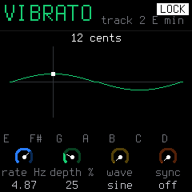 | 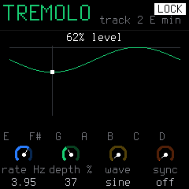 |

*Production-code framebuffer renders. Hold LFO/ENV, tap HOME, then release; HOME unlocks.*

### Visualizers added in this fork

On **TRACKS**, tap **HOME** to open the visualizer; turn **SELECT** to change style.
Tap HOME or a page button to leave. Playing, transport and held control layers still work.

| Note Trails | Groove | Song Journey |
| --- | --- | --- |
| 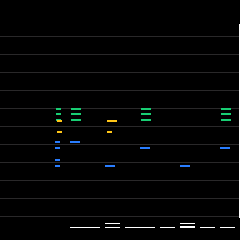 | 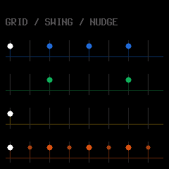 | 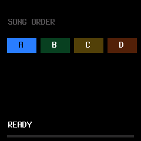 |
| Played/held notes, with drums below. | Swing, nudges, hit levels and ratchets. | Song or quick-chain order and remaining bars. |

*Framebuffer captures from the production UI/audio harness.*
See the [complete seven-style gallery](docs/firmware/VISUALIZERS.md) for the retained upstream styles, controls and capture details.

To install **this fork**, build its firmware and local browser installer with [`build-sloop.ps1`](build-sloop.ps1); see [building](#building-and-tests) for prerequisites. The upstream browser installer linked above installs upstream SLOOP. See the [guide](GUIDE.md), [musical starters](docs/firmware/SEQUENCE-STARTERS-DESIGN.md), [drum grooves](docs/firmware/DRUM-GROOVES-DESIGN.md) and [rhythm shaping](docs/firmware/RHYTHM-SHAPING-DESIGN.md) for the controls and limits.

Automatic GitHub Pages hosting is configured for pushes to `merthsloop`; enable GitHub Actions as the repository's Pages source to activate it. The workflow publishes the built installer/editor in `docs`, checking the firmware version and package hash first. See [Pages deployment](docs/firmware/PAGES-DEPLOYMENT.md).

## MerthSloop Mobile for Android

Bring the FM-1 and your phone: **MerthSloop Mobile** is a C#/.NET Android companion for touch performance, sequencing, sound editing, sampling and session management over USB. Connect using a USB data cable and a phone that supports USB host mode. SLOOP mode routes performance by selected synth; **generic MIDI mode** also drives other MIDI receivers.

**Import MIDI files:** in Sequence, choose **Import MIDI file…**, select a source part and destination track, then audition it. Import into the editable app pattern with undo, or review the FM1 conversion and explicitly replace its track with verified readback. Hardware conversion uses the track's current DIV and active length and reports quantization, truncated notes and chord limits before sending. Format 0/1 musical-time MIDI is supported; tempo changes, controllers and patch changes are not imported.

| Perform | FM6 sound editing |
| --- | --- |
| 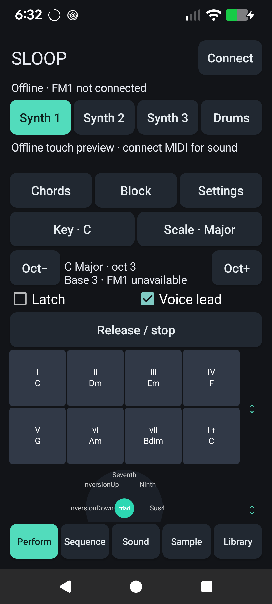 | 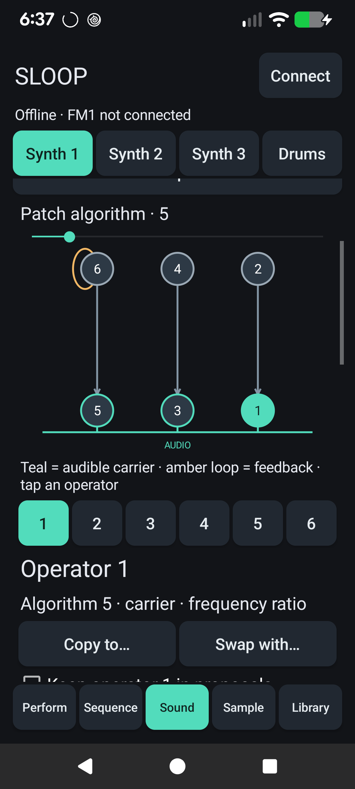 |

| Piano roll | Sampling and chopping |
| --- | --- |
| 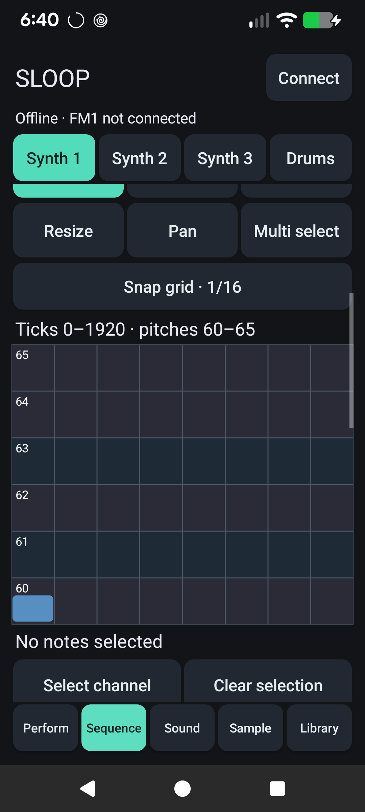 | 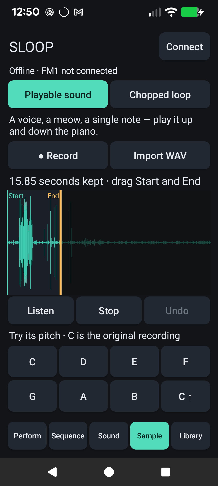 |

*Captures from the connected Pixel. The phone is connected to the PC for screenshots, so the FM-1 connection is shown offline.*

Chord mode offers **8/15/22 scale-aware pads**, **Thickness** with up to two extra
upper-octave layers, and two voicing choices: **Smooth voicing** minimizes movement;
**Part writing** favors independent voices, avoids parallel fifths/octaves where
possible, and prefers leading-tone/seventh resolutions. Explicit inversions and
selected octaves take priority. FM1 polyphony limits still apply to dense chords.

The companion also offers external MIDI device/output-port input in Perform (literal keys or bounded scale-root chords, sustain and lifecycle cleanup). FM1 arp output preserves incoming/sequenced velocities. See the [current feature status](<android/design docs/STATUS.md>) and [release evidence](<android/design docs/VERIFICATION.md>).

Perform also offers an **Accessible pads** section with named buttons that play
brief notes or chords and release automatically. Hardware gesture buttons support
bounded accessible activation too, alongside their normal touch controls.

The app has five workspaces:

| Playable sound | FM1 song library |
| --- | --- |
|  | 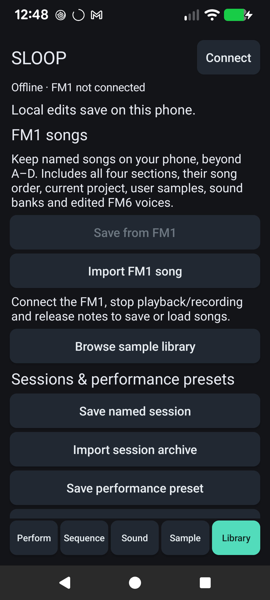 |

| Workspace | What you can do |
| --- | --- |
| **Perform** | Eight scale-degree chord pads including I ↑, a HiChord-style quality joystick, keyboard, scale grid, drums, ribbon and an XY MIDI CC macro. Play block chords, strums, arps or repeats; control key, scale, octave, voice leading and latch directly. Capture a performance into a loop. |
| **Sequence** | Draw, select, move, resize and quantize notes in a touch piano roll with multi-note edits and undo. Exchange native FM-1 patterns, loop MIDI, browse drum grooves, arrange scenes and add stepped CC automation. Generate, edit, save and exchange composition drafts. |
| **Sound** | Manually edit FM6 algorithms, operators and envelopes; copy/swap operators and exchange SysEx. Try offline sound recipes and reviewed prompt edits, audition a patch against the original, and save a base voice to the hardware bank with verified readback. |
| **Sample** | Choose **Playable sound** for a meow, voice or single note, or **Chopped loop** for a song phrase. Record/import, drag Start and End, listen, choose 4/8/16 chops if wanted, then Send to FM1 and choose slot/synth. Preparation and fitting happen automatically, with backup and verified readback. Advanced editor retains detailed pitch/gain, transient/tap chopping and export. |
| **Library** | **Save from FM1** keeps named hardware songs beyond A–D, including sections, song order, samples, sound banks and edited FM6 voices. **Load onto FM1** first saves a recovery song; import/export portable song archives. Also save phone sessions, performance presets and composition drafts, and browse/reuse samples across sessions. |

Prompts currently use **bounded offline procedural recipes and edit rules**. They produce notes, synth settings or reviewable edits; no audio-generation service or local language model is included. The app's MIDI performances use the connected instrument for sound, and USB sample preview can use the FM-1's audio output.

| Prompt an edit | Review the proposed change |
| --- | --- |
| 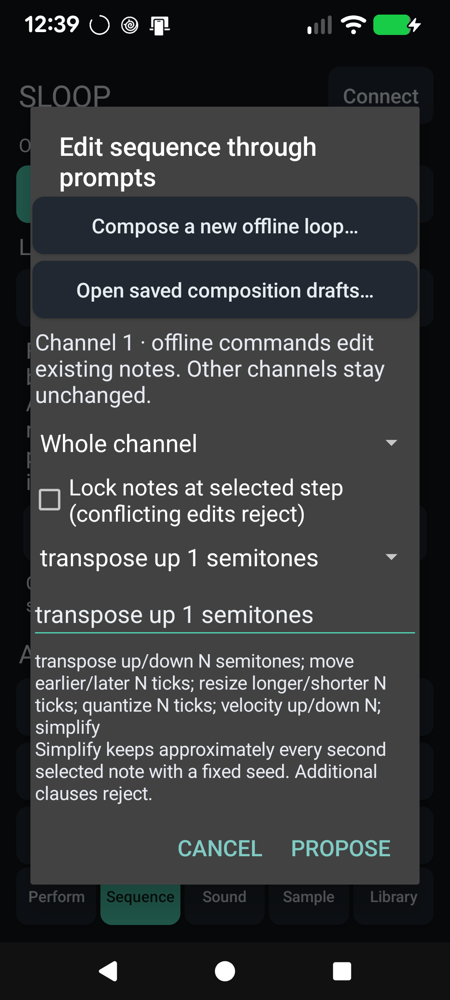 | 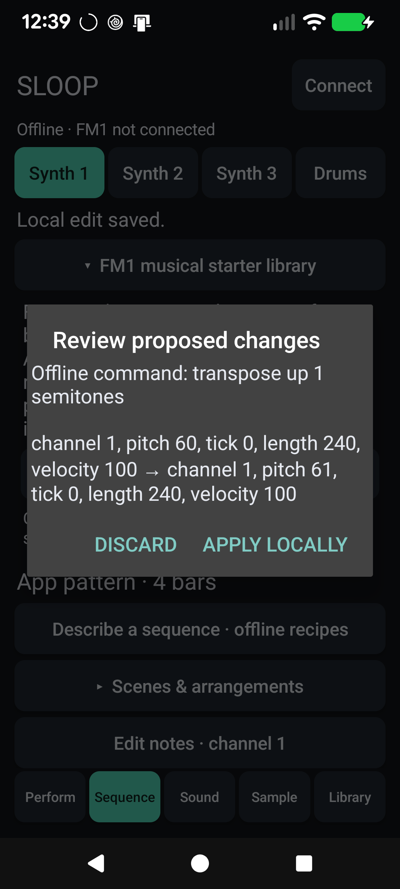 |

*Fresh connected-phone captures. This proposal was discarded after capture.*
In Sequence, **Describe a sequence · offline recipes** opens these controls.
See the [phone library and prompt walkthrough](docs/firmware/MERTHSOFT-FEATURES.md#find-libraries-and-review-prompt-edits-on-the-phone) for groove entry and prompt screenshots too.

Android is the current target. Windows/iOS, controller CC forwarding, time stretching, combined USR3+4 uploads and atomic live hardware scene switching remain future work. See the [current status](<android/design docs/STATUS.md>) for the full implemented/future split.

Build and install from [`android/src`](android/src/README.md) using .NET 10 and the Android workload; [`Install-Phone.ps1`](android/src/Install-Phone.ps1) builds, installs and launches on an authorized USB-debugging phone. The [design index](<android/design docs/README.md>) and [verification record](<android/design docs/VERIFICATION.md>) document the architecture and checks. Original Android work uses the **Unlicense**; retained GPL/Apache components keep their obligations, including when distributing the combined app. See [Android licensing](android/LICENSING.md). Firmware remains GPL.

## Upstream capabilities

SLOOP supplies the groovebox foundation: twelve synth engines including PHYS,
NOISE and six-operator FM, 171 factory sounds, sampled and synthesised drum kits,
DX7 patch exchange, parameter locks, microtiming, fills, song chains, MIDI and USB
audio. The [features below](#features) describe the current controls; the
[manual](SLOOP.md) retains upstream history and deeper reference material.

The integrated upstream features include dual-core audio, more arp modes and
keyboard HOLD, per-drum tune/decay, favorites, sample loops with release tails,
unquantized recording over held notes, MIDI remote controls and clock output,
themes, adjustable knob acceleration and USB recording-rate selection.
Our grooves, custom progressions, note editing, live modulation, visualizers and
Android workflows remain available alongside them.

### Performance, sound and MIDI controls

- **Transport HALF:** momentary half tempo with unchanged note pitch and saved BPM (internal clock only).
- **Punch combinations:** one existing effect plus LOW/HIGH/PHONE and GATE, with held-key fallback; HALF is independent.
- **Six reverb types:** FX → REVERB → TYPE selects the original STEREO, a wider dual-path SPRING, tight ROOM, dense bright PLATE, spacious HALL, or a dense muted DARK tail. They share the existing reverb memory; each track keeps its own send.
- **Upstream reliability fixes:** early OCT− USB rescue, better Windows update-loader discovery, macOS USB-audio compatibility, faster encoder tracking and steadier external-clock tempo estimation are retained alongside the custom UI and editing tools.
- **27 punch-in effects:** eleven more on the black keys (hold FX): KILL LOW / MID / HIGH, REWIND, DOUBLE TIME, FLANGER, AUTO-PAN, FREEZE, LOOP 8T, LOFI, FADE OUT.
- **From Felucca (Leo Kuroshita):** an **INSERT** effect on every track (SOFT, HARD, FOLD, FUZZ, CRUSH, PHASR, FLANG, CHOR, with dry / wet), **LFO 2** (tempo SYNC, TRIG NOTE / FREE, POL BI / UNI), **ENV SYNC** (attack, decay and release as note values), the **ANALOG filter** as LP, BP or HP, a note's **LEN** in steps and each step's **velocity**, **MIDI LEARN** (GLO + F#3), and the latched-arp fix (#191).
- **TEXTURE:** a looping bed under the mix (vinyl, tape, rain, wind, radio, room tone or your own sample), breathing slowly with the tempo, without taking a track (GLO → TEXTURE).
- **Live drum mutes:** EDIT + a black key, then the sounds' keys.
- **Sustain pedal and pitch bend** from a MIDI keyboard (the bend's range: GLO → MIDI 2).
- **Each track on its own MIDI channel** (GLO → MIDI: CH1, CH2, CH3, OTHER), in and out, for an external sequencer (drums 10, bass 2, pad 11, lead 8…). Thanks to the viewer who asked!
- **Step entry from a MIDI keyboard:** on the STEP page, the notes your keyboard plays write the step, as the FM-1's keys do.
- **Program Change, 1/4D delay, REV / ECHO THROW** (FX + OCT− / OCT+).
- **Erase a saved loop:** SAVE → PROJECT → ERASE (KNOB 2) empties a project slot, song section A–D. Thanks to the viewer who asked!
- **The web editor offline:** *Download the editor* saves it as one file that runs in Chrome or Edge without internet, or *Install the app* (Android too): the editor and the installer then open without internet.
- **MIDI IN on one channel** (GLO → MIDI 2 → IN = CH 1 … 16), for a sequencer driving other gear on the same cable.
- **A bolder screen:** Terminus Bold, all in capitals.
- **No more clicks** when loading a sound over held notes, or when a filter (track, drums, master FILT) starts to close.
- **A cleaner output:** the master limiter looks ahead, so loud kicks and basses no longer crackle with MASTER turned up (headphones especially).
- **Fixed in the web editor:** the same value set on a second track (DIV 1/8 on the drums, then on track 1) is sent again.
- **The installer finds an FM-1 running CLIPPER** (or another firmware naming its USB port its own way).

## Screenshots

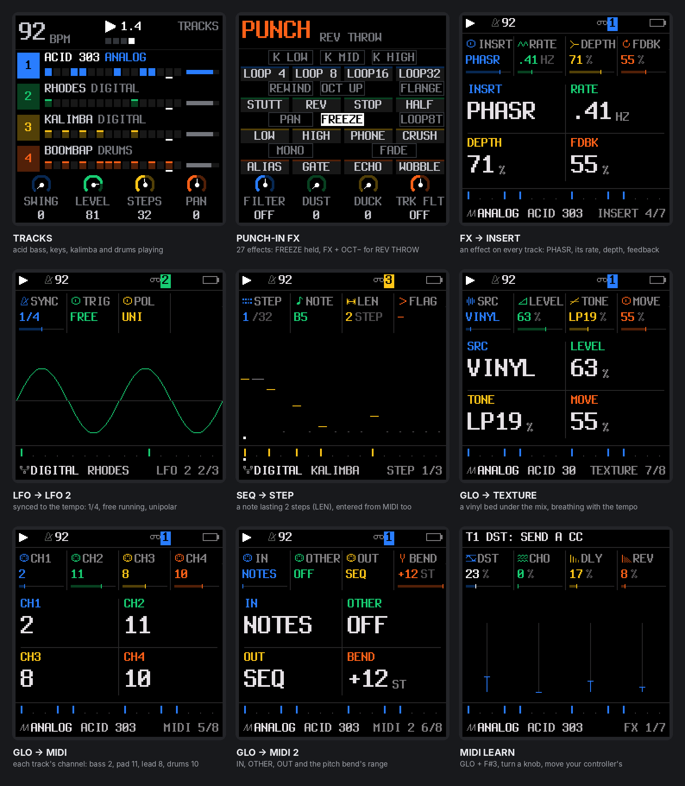

The upstream FM-1 screen, in its bold font: the tracks playing, the 27 punch-in effects (FREEZE held, REV THROW on), an INSERT on a track, LFO 2 synced to the tempo, a note's LEN on the STEP page, the TEXTURE bed, every track's MIDI channel (GLO → MIDI, MIDI 2) and MIDI LEARN.

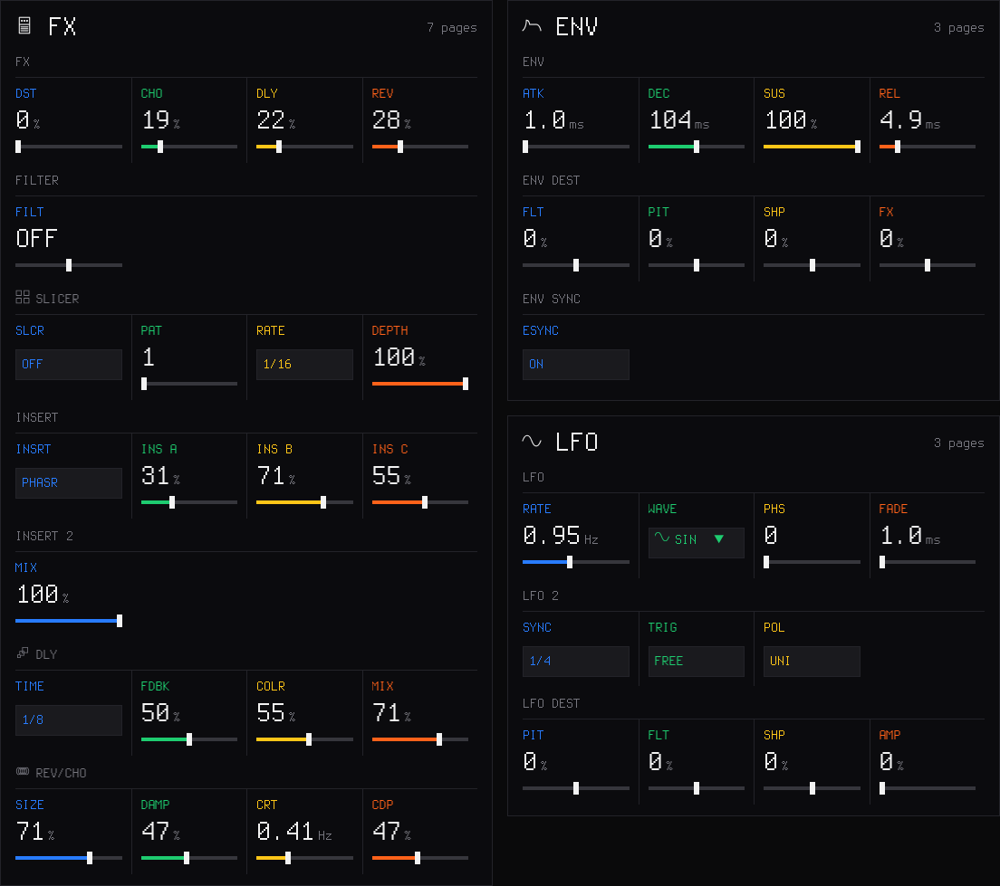

The web editor's Sound page: the INSERT and its dry / wet, ENV SYNC, LFO 2 (SYNC, TRIG, POL).

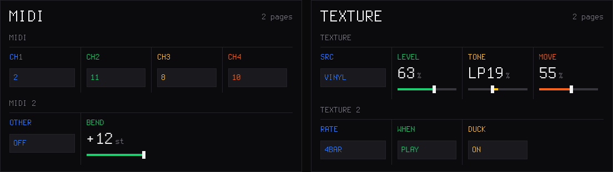

Settings: each track's MIDI channel, the other channels and the bend range; the TEXTURE bed.

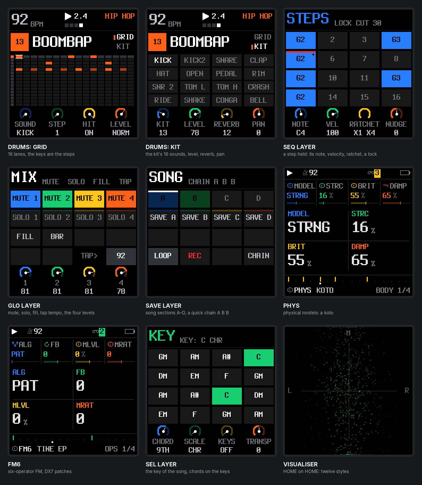

Other upstream screens: the drum grid and kit, a step held in the SEQ layer (its note, velocity, ratchet and a lock), the GLO mix layer, the SAVE layer's song sections and chain, PHYS, FM6, chords on the keys (SEL), the visualiser.

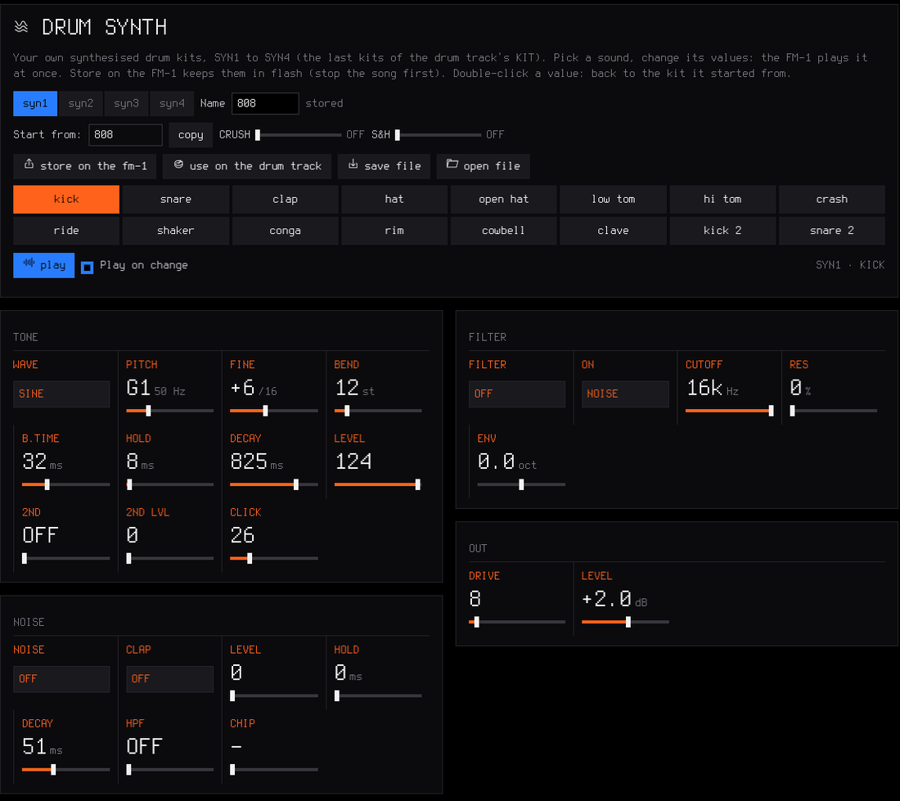

The web editor's Drum synth page: every value of every drum sound, heard on the FM-1 at once.

A 32-voice DX7 cartridge dropped on the FM6 panel: 27 voices ticked, into the bank in one write, and as user presets if you choose.

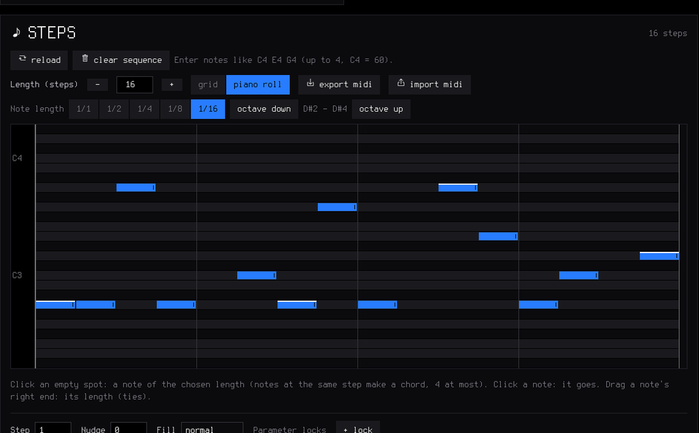

The piano roll: draw, delete and stretch notes and chords with the mouse; Export MIDI / Import MIDI next to it.

## Features

### Play it live: hold a button, touch a key

Every function button is a **layer**: hold it and the 16 white keys and the four knobs change job, and the screen shows how. Tap it and its pages open. Hold a layer button and tap HOME to **lock** it open, both hands free.

| Hold | Keyboard controls | KNOB 1 · 2 · 3 · 4 |
| --- | --- | --- |
| **FX** — punch | 27 punch-in effects on the whole mix. White keys: loops 1/4–1/32, stutter, reverse, tape stop, half speed, filter sweeps, phone, bit crush, alias, gate, echo, tape wobble. Black keys: kill low / mid / high, rewind, double time, flanger, auto-pan, freeze, loop 1/8T, LOFI, fade out | FILTER · DUST · DUCK · the track's filter |
| **LFO / ENV** — modulation | playable keyboard, track-only vibrato / tremolo waveform panel | Hz · DEPTH · WAVE · SYNC |
| **EDIT** — erase | erase a sound or a note as the loop plays (stopped: from the whole pattern); a black key: live drum mutes | SHIFT · LENGTH ×2 / ½ · TRANSPOSE · OCTAVE |
| **ARP** — roll | note repeat on the grid, recorded as ratchets | RATE (1/8 … 1/64) |
| **SEQ** — steps | the 16 steps of the page; a step held: a level, a ratchet, a nudge, parameter locks (PRESETS / ALGORITHM), a fill condition (OCT+) | SOUND / NOTE · DIV · SWING · LENGTH (a step held: SOUND / NOTE · LEVEL or, synths, VELOCITY · RATCHET · NUDGE) |
| **SEL** — key | the key of the song | CHORD · SCALE · KEYS · TRANSPOSE |
| **GLO** — mix | 1–4 mute, 5–8 solo, 9 fill (held), 10 fill on the next bar, 16 tap tempo; F#3: MIDI LEARN | the levels of tracks 1–4 |
| **SAVE** — song | 1–4 play sections A–D (several tapped while held: a quick chain), 5–8 save the loop into them, 13 loop / song, 14 record the song, 16 the chain | — |

Keys 1, 5, 9 and 13 glow dimly while a layer is held: the first key of each row of the 4 × 4 grid on the screen. **EDIT + OCT− / OCT+** is undo / redo.

### Drums

- **16 sounds on the white keys**, kick to cowbell; a black key doubles the white key on its left (fast rolls with two fingers).
- **Ghost and hard hits:** hold OCT− / OCT+ while you play. Every hit keeps its level (GHOST, SOFT, NORM, HARD) and a **ratchet** (x1–x4).
- **37 kits**, all level-matched: a sampled acoustic kit in 5 treatments (CC0 studio recordings) and 32 synthesised kits — 808, 909, 606, 80s, vintage, trap, drill, boom bap, lo-fi, phonk, house, deep house, techno, minimal, electro, disco, UK garage, jungle, dubstep, reggaeton, amapiano, afrobeat, latin, tribal, synthwave, chiptune, arcade, glitch, industrial, hyperpop, ambient, jazz brushes. Each synthesised sound is built like on the classic machines; softer hits are darker as well as quieter. **Your own kits** too: KIT USR1–USR4 (or USR3+4, about 15 s) plays sample slots you fill in the editor's Drum kit page, a sound of yours per lane. And **SYN1–SYN4**, synthesised kits you make in the editor's Drum synth page.
- **Grid and kit pages** on the FM-1 (EDIT or SEQ on the drum track): on the grid, the keys are the steps of the sound you pick (and you hear it); a 16-lane grid in the web editor.

### Synths and sounds

- **Twelve engines:** analog, 4-op FM, **6-op FM with DX7 patches (FM6)**, phase distortion, three-oscillator, tonewheel organ, formant voice, granular, lo-fi chip, sampler, **physical models (PHYS)**, **noise (NOISE)**.
- **171 sounds, browsed by kind** — basses (sliding 808s, acid 303, reese, FM, bass guitar), guitars, sitar and koto (physical models), keys (Rhodes, a real Steinway grand, house and afro keys), organs and accordion, pads (string machine, granular clouds), leads (supersaw, talkbox, pan flute, harmonica), plucks and bells (harp, steel drum, glockenspiel, celesta, xylophone), stabs and dub chords — every one level-matched. **32 slots** for your own presets.
- Envelopes (with a pitch punch for 808s; in note values with ENV SYNC), LFO (tempo-synced, free-running or unipolar), arpeggiator, glide and voice modes (POLY, MONO, LEGATO, UNISON), per-track drive, **INSERT effect** (soft / hard clip, wavefolder, fuzz, bit crush, phaser, flanger, chorus) and slicer, ANALOG's filter as LP, BP or HP, sends to a **stereo chorus**, a **tempo delay** (dotted 1/8 and 1/16 too) and a **stereo reverb**.
- **Key and chords (SEL):** the key of the song for all synths, 16 scales, one-key chords (triad, 7th, 9th, sus4, power), keys snapped to the scale or the scale on the white keys.

### Recording and the sequencer

- **Records as you play, no click needed:** while it plays, REC records at once and every pass is added on top (overdub). Notes land where you heard them: the ~12 ms of the keys are taken back.
- **The REC screen:** **mode** *free* — no tempo, no grid: play, press REC on the "1" after your last bar, and the loop's length sets the tempo — or *tempo* — record at the tempo you set; **length** 1, 2 or 4 bars; **start** on your first note, or after a one-bar **count-in**.
- **Hold REC ~2 s** to clear a track; **undo / redo** brings it back.
- **64 steps per track**, each track with its own length and division, 1/32 to two bars (polymeters stay in phase); chords up to 4 notes a step, ties, slide; **MPC swing**, 0 (straight) to 100; one sample-accurate clock for everything: no drift at any tempo.
- **Parameter locks, micro timing and fills:** hold a step to give it its own value of any sound parameter, to nudge it off the grid, or to make it play only (or never) during a fill.
- The PLAY light flashes on every beat (a visual metronome); an audible click is in GLO → GLOBAL → CLICK and is never recorded.

### Songs

Save up to four sections **A–D** (SAVE + keys 5–8), play them live on the next bar (SAVE + keys 1–4), and **record the song as you play it** (SAVE + key 14). Keep SAVE held and tap several sections for a **quick chain**. In song mode PLAY plays the whole chain. The SONG screen edits it by hand.

Stopped section saves write flash immediately. A store made during playback says
**QUEUED: STOP TO SAVE**: stop and release sounding notes, then wait for
**SECTIONS SAVED TO FLASH** before powering off. Explicit saves also commit
device settings, including the 1/8 swing grid.

### Effects and master

- **27 punch-in effects** (FX + a key, white or black), locked to the tempo: DJ kills, rewind, reverb freeze and more.
- **Master:** **DUST** (an old sampler and a record: bits, rate, crackle), **DUCK** (the kick pumps the synths), **FILT** (a DJ filter: low-pass ← off → high-pass), and an output limiter.
- **TEXTURE:** a looping bed under the mix: vinyl, tape, rain, wind, radio, room tone or one of your samples, with level, tone and a slow breath over 1–16 bars.

### Your own samples

- **Four slots** (USR1–USR4) of about 7.4 s each, played by a synth track or as a drum kit (USR3+4: one kit of about 15 s); up to 16 WAV files per slot, each on its own key.
- **CHOP** in the web editor: open or drop a recording (WAV, MP3, AIFF…) of **any length**, tap along while it plays (each tap snaps to its hit), or find the hits, a tempo grid, equal parts; keep the chops you want, shorten them or **Fit to slot**; send them to a slot, one per key, or download them as WAV files.

### MIDI

- **USB MIDI** in and out, class compliant.
- **TRS MIDI IN** (the 3.5 mm jack) for a keyboard or a pad controller.
- **MIDI clock in** (USB or TRS): tempo, START, CONTINUE, STOP.
- **MIDI CCs**: level, pan, filter, resonance, envelope, glide and the sends from a controller's knobs; **MIDI LEARN**: any knob of yours onto any parameter of a track.
- **MIDI out:** the keys always; the sequencer, the arp and the rolls too with GLO → MIDI 2 → OUT = SEQ.
- Details: [MIDI and USB audio](#midi-and-usb-audio).

### USB audio

The FM-1 is also a **USB audio input**: record its master output on a computer, no driver, over the same cable as MIDI and the editor. Details: [USB audio](#usb-audio-record-the-fm-1-on-a-computer).

### Lights for playing in the dark

Every button can glow so its label is readable on a black FM-1; the C keys or every white key can glow too; the notes playing can light their keys. Details: [The menu](#the-menu-settings-of-the-fm-1).

### Memory and safety

- **Autosave:** stop and leave it 2.5 s, your work is kept; at power-on SLOOP comes back exactly as you left it.
- **4 projects**, **32 user presets**, **27 FM6 patches**, **undo / redo**.
- **Full backup and restore** from the web editor.
- **Safe updates:** the installer checks the package (SHA-256) before writing it, the update loader checks it again (CRC) before starting it; an interrupted install finishes when you press Install again; **USB rescue** (OCT− at power-on).

## Install

### From the browser (recommended)

1. Open **[the SLOOP installer](https://isod89.github.io/sloop-fm1/)** in **Chrome or Edge** on a computer.
2. Connect the FM-1 by USB — a **data** cable, directly (no hub).
3. Press **INSTALL**, allow MIDI access, and wait for *Done*. The FM-1 restarts on the SLOOP logo.

Nothing to download or compile. Your projects, user presets, samples and settings are kept. After an install, **unplug and plug the FM-1 back in** once so the computer finds its USB audio input.

### Other ways

- **Python:** the `.fwsc` of a [release](../../releases) with `python tools/fm1_install.py sloop.fwsc` (needs `pip install mido python-rtmidi`).
- **Build it yourself:** see [Building and tests](#building-and-tests); on Windows, `INSTALL-SLOOP.bat` builds SLOOP and opens the installer locally.

### Going back

- **To an earlier SLOOP:** install its `.fwsc` from [releases](../../releases). Samples, user presets and settings stay, but older firmware may not understand newer project formats, engines or kits. An incompatible project can appear empty and be overwritten by autosave. **Save a backup before going back**, check format compatibility in the [manual](SLOOP.md), and restore only with firmware that supports that backup.
- **To the official firmware:** on the installer page, open **Return to the official firmware (V15)**. Save a backup with the editor first, download FM-1 V15 from m-vave.com and select its `FM-1.fwsc` — only that exact file is accepted. M-VAVE's updater, M-UPGRADE, works too. To come back, install SLOOP again and restore your backup.

### Rescue

- **The FM-1 no longer starts SLOOP:** hold **OCT−** alone while switching it on (*SLOOP USB RESCUE*), then install again.
- **An install was cut off:** the FM-1 stays in update mode; press INSTALL again and it finishes.
- If an FM-1 no longer starts at all, recovery needs [FM-1-transporter](https://github.com/kurogedelic/FM-1-transporter).

> Custom firmware is installed at your own risk. No warranty.

## Your first beat in 60 seconds

1. **ALGORITHM** to track **4** (orange, drums). The white keys are 16 drum sounds; **PRESETS** picks a kit (try *808* or *BOOMBAP*).
2. Press **REC** and play a beat freely, at your own tempo. Hold **OCT−** while you hit for ghost notes, **OCT+** for hard ones.
3. **Press REC on the "1" after your last bar.** The loop closes, its length sets the tempo, the hits snap to the grid and it plays at once. (Prefer a set tempo, or a count-in? Turn KNOB 1 and KNOB 3 on the REC screen before you start.)
4. **REC** again while it plays: you record on top. Hold **ARP** and hold the hat key for a hat roll.
5. **ALGORITHM** to track **1**, **REC**, play a bass line. Hold **SEL** and press the key of your song; on track 2, hold SEL and turn **KNOB 1** to *7TH*: every white key now plays a chord.
6. Hold **FX** and press a key (white or black) for a punch-in effect; still holding FX, turn **KNOB 2** for DUST, **KNOB 3** for DUCK.
7. A mistake? Hold **EDIT** and press **OCT−**: undo.

## The controls

| Control | What it does |
| --- | --- |
| **MASTER** | volume (and the USB audio level, if USB AUDIO is on MASTER) |
| **SELECT** | on HOME and inside a layer: tempo · on a page: the previous / next page of its group · DRUMS: grid / kit |
| **ALGORITHM** | the selected track: 1 · 2 · 3 (synths) · 4 (drums) |
| **PRESETS** | the selected track's sound, or the drum kit |
| **KNOB 1–4** | what the four dials at the bottom of the screen show, each in its colour |
| **OCT− / OCT+** | octave (both: back to 0) · on the drum track, held: ghost / hard hits |
| **FX · SEL · ENV · LFO · EDIT · GLO** (top row) | tap: their pages · hold FX, SEL, EDIT, GLO: a layer; hold LFO / ENV: temporary vibrato / tremolo. **SEL** is the second button of the top row, between FX and ENV (not the SELECT knob) |
| **HOME** | the TRACKS screen · on it: the full-screen visualiser (SELECT: 14 styles; HOME again closes it) · hold: the menu · tapped while a layer is held: lock it |
| **SAVE** | on TRACKS: the SONG screen · elsewhere: the SAVE pages · hold: the song layer |
| **ARP · SEQ** | tap: their pages · hold: note repeat · steps |
| **PLAY** | start / stop all four tracks; its light flashes on every beat |
| **REC** | playing: record now / stop · stopped: arm (the REC screen) · hold: clear the track |
| **EDIT + OCT− / OCT+** | undo / redo |

Colours: **blue** track 1 and KNOB 1, **green** 2, **yellow** 3, **orange** 4 (drums). White is what you touch; red is recording.

## The menu: settings of the FM-1

Hold **HOME**. The menu is in six sections: **SCREEN** (COLOR, ZOOM, KNOB ACCEL), **LIGHTS** (LIGHTS, KEYS, NOTES), **AUDIO** (LOWCUT, USB AUDIO, USB RATE), **MIDI** (MIDI SCALE), **TIMING** (SWING GRID), **SYSTEM** (2ND CORE, HARDWARE CALIBRATION, MIDI LEARN CLEAR, ABOUT). **SELECT** goes from one section to the next, **KNOB 1–4** set the section's rows (each row shows its knob's colour), **PRESETS** moves the cursor, **OCT+** steps the cursor's setting round or opens it (CALIBRATION, ABOUT), **OCT−** closes. These are settings of the FM-1, not of a project: loading a project or NEW PROJECT does not change them, and the backup keeps them.

| Item | Choices | What it does |
| --- | --- | --- |
| **COLOR** (SCREEN) | 5 palettes, then your theme  | the screen's colours; your own made on the editor's Theme page (and shared as one line of text) |
| **ZOOM** (SCREEN) | OFF / ON | a large readout of the value you turn |
| **KNOB ACCEL** (SCREEN) | ON / OFF | ON: a fast turn sweeps wider, progressively (after JIANT FM); OFF: one value a detent |
| **LIGHTS** (LIGHTS) | OFF / LOW / MID / HIGH | every button glows at that level; what is active stays at full light |
| **KEYS** | OFF / C KEYS / WHITE KEYS / ALL KEYS | the C keys, every white key, or every key glow too |
| **NOTES** | OFF / ON | the notes playing on the selected synth track light their keys (sequencer notes too, at least a tenth of a second each), on every page and in every layer |
| **SPEAKER LOWCUT** (AUDIO) | OFF / ON | a low cut for the small built-in speaker |
| **USB AUDIO** | MASTER / FULL | the level of the USB audio input: follows the MASTER knob, or a fixed full level |
| **USB RATE**  | AUTO / 44.1 KHZ / 48 KHZ | the rates the USB audio input offers; 44.1 KHZ if a phone records it distorted; at the next start |
| **HARDWARE CALIBRATION** (SYSTEM) | | the panel table, if a key or a knob answers wrongly |
| **MIDI SCALE** | OFF / KEYBOARD | optional incoming-note mapping to the receiving synth’s scale keyboard |
| **MIDI LEARN CLEAR** (SYSTEM) | OCT+ | forget learned CC mappings |
| **ABOUT** | | installed firmware identification and credits |

Two more settings of the FM-1 live elsewhere: **SYNC** (GLO → SYSTEM: INT, USB or TRS) and the REC screen's **mode** and **start**.

## MIDI and USB audio

### MIDI in

SLOOP takes MIDI from two places at once:

- **The MIDI IN jack** (3.5 mm TRS): a keyboard or a pad controller with a MIDI output, through a **TRS-to-DIN MIDI adapter**. If nothing plays, try the other adapter type (A / B).
- **USB**, from a computer or a phone (a DAW, a MIDI routing app) or a USB MIDI host box.

| MIDI channel | Plays |
| --- | --- |
| 1, 2, 3 | synth tracks 1, 2, 3 (GLO → MIDI → CH1, CH2, CH3 set any channel for each) |
| 10 | the drum track (the nearest of its 16 sounds; GLO → MIDI → CH4 changes the channel) |
| the others | the selected track: set your keyboard to channel 4 and it follows ALGORITHM (GLO → MIDI 2 → OTHER = OFF ignores them) |

**Your own channels.** For an external sequencer with its own channels (drums 10, bass 2, pad 11, lead 8…): GLO → **MIDI** sets each track's channel (CH1, CH2, CH3, CH4 the drums: OFF or 1–16, in and out; two tracks never share one) and GLO → **MIDI 2** the rest: **IN**, **OTHER** (SEL: the channels no track has play the selected track; OFF: ignored), **OUT**, **BEND**. Notes, CCs and MIDI out follow. Settings of the FM-1, kept through power-off.

Your sequencer uses the other channels for other gear? GLO → MIDI 2 → **IN = CH 1 … CH 16**: SLOOP then answers that one channel only, on the selected track, and ignores the rest.

A USB keyboard plugged **straight into the FM-1** cannot work: both are USB devices, and a USB link needs a host (a computer, a phone, or a USB MIDI host box). Bluetooth MIDI is not supported: SLOOP, like Felucca, never switches the radio on.

### MIDI out

What you play on the keys always goes out on USB MIDI, each track on its channel (1–3 the synths, 10 the drums). GLO → MIDI 2 (or SYSTEM) → **OUT** = **SEQ** sends what the sequencer, the arp and the rolls play too: every note is ended, STOP ends whatever was still on, and notes that came in from a computer or the jack are never sent back. Record the FM-1's MIDI in a DAW and you get your pattern as notes.

### MIDI clock in

GLO → SYSTEM → **SYNC** = **USB** or **TRS** (INT: SLOOP's own tempo). START plays from the top, CONTINUE carries on, STOP stops; the tempo follows the master and the steps follow its 24 pulses a beat, so SLOOP never drifts. When the clock stops for half a second, PLAY on the FM-1 plays at its own tempo again.

**Clock only:** GLO → MIDI 2 → **IN** = **CLOCK**: SLOOP follows the clock and ignores incoming notes (and CCs), handy when a DAW or a sequencer also sends notes to other gear.

### MIDI CCs

The knobs of a MIDI controller set the sound, on the track the channel plays (as the notes: 1–3 the synths, 10 the drums, 4–16 the selected track). A CC sets its parameter as a knob would, 0–127 over its range. The standard map of Felucca 1.1.5:

| CC | Sets |
| --- | --- |
| 5 | GLIDE |
| 7 | LEVEL (on the drum channel: GLO → DRUMS → LVL) |
| 10 | PAN |
| 71 | the engine's resonance (RES or Q: ANALOG, TRIO, VOICE, NOISE; the others ignore it) |
| 72 · 73 · 75 | release · attack · decay |
| 74 | the track's FILTER: 64 off, lower a low-pass, higher a high-pass (every engine, the drums too) |
| 91 · 93 · 94 | the reverb, chorus and delay sends (on the drum channel 91 and 94 are GLO → DRUMS → REV and DLY) |

This fork also supports **CC1 modulation** as transient vibrato, separate from saved patch depth; CC120/121/123 clear modulation.
The **sustain pedal** (CC 64) and **pitch bend** work too (the bend's range: GLO → MIDI 2 → BEND, 1–12 semitones).

**MIDI LEARN**: **GLO + F#3**, turn the knob of SLOOP you want, move a knob of your controller; GLO + F#3 again to finish. A learned CC sets that track's parameter on any channel, in place of the map above (up to 16; kept through power-off). HOME menu → SYSTEM → **MIDI LEARN CLEAR** forgets them. Details: [GUIDE.md](GUIDE.md#midi-learn-26).

### USB audio: record the FM-1 on a computer

On USB the FM-1 is also an **audio input named "Felucca"**: 44.1 or 48 kHz (including phones and apps that only take 48 kHz), 16-bit stereo, class compliant — no driver on Windows, macOS or Linux. Choose it in your DAW or in Audacity and record: you get the master output, exactly what the headphones play (after DUST, DUCK and FILT). MIDI, the web editor and the installer keep working on the same cable.

- **The level:** HOME menu → **USB AUDIO**. **MASTER** (default): the recording follows the MASTER knob, as the headphones do — keep MASTER well up while you record. **FULL**: a fixed level, as with MASTER all the way up, kept from clipping by the limiter; MASTER then only sets the headphones (the right choice for an interface with no level control).
- **The first time** (and after an install), the computer sets the FM-1 up again as a MIDI + audio device: unplug and plug it back in if the input does not show. The MIDI port keeps its name.
- The audio input comes from Felucca 1.0.

## The web editor

Open it from the [installer page](https://isod89.github.io/sloop-fm1/) (or the [editor link](https://isod89.github.io/sloop-fm1/webapp/editor/)) in Chrome or Edge, with the FM-1 on USB, and press **Connect**. It follows the device live: turn a knob on the FM-1 and the editor moves.

**Local audio preview.** Build the browser audio engine with `python3 tools/build_preview.py`
(Emscripten required; see [BUILDING.md](BUILDING.md#browser-audio-preview)), generate and serve the local site,
then open `http://localhost:8766/webapp/editor/?mock=1`. Press **Connect** and **Play loop**
to hear the current four-track loop. Presets, sound parameters, tempo, mixer, steps, locks, FM6 patches and
uploaded samples feed the actual firmware DSP compiled to WebAssembly, running in an AudioWorklet at 44.1 kHz.
The preview starts collapsed so the sound editor stays visible. Its compact bar keeps **Play loop** and
**Stop**, plus the selected sound and its live step/note. **Show preview** opens the piano/pads, volume
and sequence; **Hide preview** folds them again while the loop keeps playing. Sound parameters remain
editable during playback in either view.
Click the notes or play **A W S E D F T G Y H U J K**; **Space** toggles the sequencer, **Stop** releases all notes,
and **Volume** adjusts browser output. **Current sequence** shows all four patterns with the actual audio
engine's playing step highlighted, independently following each track's length and division. Patterns over
16 steps follow automatically. Click a synth step to enable or disable it: re-enabling keeps its previous
notes, velocity, levels and ratchets. Double-click a synth step to open a piano picker: click a key,
use **− / +** to browse octaves, then **Apply** to change the pitch (or **Cancel** to keep it).
**Listen on click** auditions the draft through that track's instrument without saving it to the sequence.
For chords, select a member above the piano and change its pitch. An empty
step uses the new note chosen beside its track or by playing its piano. Drum rows show individual percussion sounds: click a cell to toggle
that hit while keeping the other sounds on the same step. Drums start as a compact overview of hits per
step; **Show drum grid** (or clicking an overview step) expands the editable sound rows, and **Hide drum
grid** collapses them without changing the pattern or interrupting playback. Common and programmed sounds stay visible;
**Show all 16 sounds** reveals the rest. Edits reach the playing loop through the editor protocol.
**Follow playback** and the page arrows control which 16 steps are shown; paging pauses under the pointer
or keyboard focus so a click keeps its target. **Full editor** opens the detailed sequencer (including
chords and ties). **Hide keys/pads** saves space.
The simulated device stays still until you edit it; its changes are kept
only for the current page session. This mode makes no MIDI requests and does not connect to or update an FM-1.
It previews the current project loop; the saved Song section order and hardware recording are not emulated.
Audio preview requires the served site, rather than the downloaded single-file editor.

**Offline.** *Download the editor* (under Connect, or on the installer page) saves the whole editor as one file for a computer, an editor HTML file, also attached to each [release](https://github.com/isod89/sloop-fm1/releases). Double-click it: it opens in Chrome or Edge without internet (Chrome asks once to allow MIDI) and works as the online one. Its sound library (kept in the browser) is its own, apart from the online editor's: move sounds between them with Export / Import, or a backup.

**As a web app, also on Android.** Open the [online editor](https://isod89.github.io/sloop-fm1/webapp/editor/) or the installer once with internet, then *Install the app* (under Connect, or on the installer page; or Chrome's menu → *Install app* / *Add to Home screen*). From then on the SLOOP app opens the editor without internet, and its link to the installer works offline too (with the firmware it installs). It stays the online site kept by the browser, so it uses the same sound library as the online editor, and it takes each new SLOOP version by itself the next time it opens online. On Android, use the app rather than the downloaded file: Chrome on Android does not allow MIDI in a downloaded file.

- **Sound** — every parameter of the selected track, the engines and the presets; on an FM6 track the **FM6** panel: every operator, the bank, **Import / Export SysEx** (DX7 voices and banks).
- **Sequencer** — the steps, as tiles or as a **piano roll**, and the track's length (1–64 steps); on the drum track a grid of 16 sounds × the steps, with levels and ratchets, and the kit. Click a step for its nudge, parameter locks and fill condition. **Export MIDI / Import MIDI**: the selected track as a MIDI file, and back.
- **Tracks** — the four channel strips.
- **Song** — the order of the sections A–D (the SONG screen): which section, how many bars, how many times, and whether the song starts again at the end.
- **Library** — your user presets and preset files.
- **Samples** — the three user slots, files and **CHOP**.
- **Drum synth** — your own synthesised kits SYN1–SYN4: every value of every drum sound, heard at once.
- **Projects** — the four projects, and **Backup**: *Save a backup* writes everything on the FM-1 to one file (with the FM6 bank); *Restore from a file* puts it all back (stop playback first).
- **Settings** — global, master (DUST, DUCK, FILT, ROLL), drums.

The protocol is documented in [web/EDITOR_PROTOCOL.md](web/EDITOR_PROTOCOL.md).

## Compatibility

New saves use **FUN6**. Older projects, autosaves and backups are migrated on load; firmware that only reads FUN5 cannot open newly saved FUN6 projects. Keep a pre-update backup before downgrading. Channel-specific device settings use the fork’s marked settings layout; unmarked words retain legacy fork interpretation.

| | |
| --- | --- |
| Device | M-VAVE FM-1 (the official firmware can be put back at any time) |
| Installer and editor | **Chrome or Edge** on Windows, macOS or Linux (they use Web MIDI with SysEx) |
| Cable | a USB **data** cable, plugged directly (no hub) |
| USB audio | any computer that takes a class-compliant USB audio input (no driver) |
| MIDI IN jack | 3.5 mm TRS, through a TRS-to-DIN MIDI adapter (type A or B) |
| Not supported | Bluetooth MIDI; a USB keyboard plugged straight into the FM-1 |

## Troubleshooting

**The installer or the editor does not find the FM-1.** Use Chrome or Edge, a data cable, no hub, and allow MIDI access. Close every other app or tab that uses MIDI (a DAW, M-UPGRADE, another editor tab), then reload the page.

**An install stopped half-way.** The FM-1 waits in update mode: press INSTALL again. If SLOOP no longer starts, hold **OCT−** alone while switching on (*SLOOP USB RESCUE*) and install again.

**The black keys make no sound on a synth track.** That track plays chords or the scale on the white keys (in chord mode the black keys change the chord: CHORD+): hold **SEL** (between FX and ENV) and set **KNOB 1 CHORD** to OFF and **KNOB 3 KEYS** to OFF. The drum track always uses the black keys.

**Nothing plays from the MIDI IN jack.** Try the other adapter type (A / B); check the keyboard's channel (1–3 synths, 10 drums, the others the selected track; GLO → MIDI sets them).

**The USB audio input does not show.** Unplug the FM-1 and plug it back in (after an install the computer must find it again). On a Mac (macOS 13–15) in builds with USB SERIAL, check that HOME menu → **USB SERIAL** is OFF (the default), then restart the FM-1. In Audacity: Transport → Rescan Audio Devices. On Windows: Sound settings → Recording → show disabled devices.

**The USB recording is too quiet, or follows the volume knob.** Set HOME menu → **USB AUDIO** to **FULL**, or turn MASTER up.

**Recorded notes move to the grid.** SLOOP quantises what you record to the steps of the track (its **DIV**: 1/4 … 1/32, triplets). Set **QUANT off** on the REC screen (KNOB 4): your timing is kept as each step's nudge. Otherwise set DIV to 1/32, or hold the step and nudge it (KNOB 4); for groove, use SWING.

**Notes fade out on a dense part.** The processor is at its limit: SLOOP fades one voice at a time (never the bass or the lead) rather than glitching. Fewer held notes or a lighter engine help.

**An FM6 sound changed after loading a project.** A project keeps the track's patch slot (PTCH), not the patch itself: store a patch you edited in the bank (editor → FM6 → Store in bank) and set PTCH to it.

**The lights or SYNC went back to OFF / INT.** You went back to an earlier SLOOP, which does not keep them; set them again after reinstalling compatible firmware.

Something else? [Open an issue](../../issues): what you did, what you expected, what happened, and the version shown in HOME menu → ABOUT.

## Specifications

| | |
| --- | --- |
| Tracks | 3 synth parts (8 normal / 12 LOFI-WHEEL voices shared; optional up to 16 / 24 budget; 8 per-track maximum) + drums (16 sounds, 6 voices) |
| Sounds | 171 presets on 12 engines (browsed by kind, level-matched), 6-op FM with DX7 SysEx import and a 27-patch bank, 8 sampled sets (CC0), 4 slots for your own samples (USR1–USR4), 32 user presets |
| Drum kits | 37 (5 sampled, 32 synthesised, 16 sounds each), level-matched, plus your own: USR1–USR4 and USR3+4 (about 15 s) |
| Sequencer | 64 steps per track, own length and division each (1/32 to two bars); chords with a level and ratchet per note; drums with a level and ratchet per sound; ties, slide; per-step parameter locks (24 per track), micro timing (±½ step in 1/64) and fill conditions; swing 0 (straight) to 100 (MPC 75 %); one sample-accurate clock (no drift) |
| Recording | live, quantised as heard (latency-compensated), overdub; free take (the tempo follows you) or the tempo set; start on the first note or a one-bar count-in; 1, 2 or 4 bars |
| Performance | layers: punch-in FX, erase, note repeat, step entry, key / chords, mute / solo / fill / tap tempo, song sections and a quick chain of up to 8 |
| Effects | 27 punch-in effects; master DUST, DUCK, DJ filter, limiter; per track drive, slicer, sends to a stereo chorus, a tempo delay (dotted 1/8 and 1/16 too) and a stereo reverb |
| Memory | autosave, undo / redo, one song of 4 sections (more as backup files), 32 user presets, 27 FM6 patches, song of 4 sections × 16 steps × 1–64 bars, full backup / restore (editor) |
| Audio | 44.1 kHz, fixed-point DSP; USB audio input (the master output, 16-bit stereo at 44.1 or 48 kHz, class compliant) |
| MIDI | USB class-compliant in / out (the keys, or the sequencer too); TRS MIDI IN (3.5 mm); MIDI clock in (USB or TRS), clock only if you like (IN = CLOCK) |
| Lights | button backlight (3 levels), C keys / white keys, played notes |
| Update | over USB from the browser (SHA-256 and CRC checked), USB rescue, return to the official V15 |

## Documentation

- [GUIDE.md](GUIDE.md) — **the complete guide**: every button, combination, layer, page, engine and editor page, with a one-page cheat sheet
- [SLOOP.md](SLOOP.md) — the manual (every page, layer, sound and kit) and the history of each version
- [DEMARRAGE-RAPIDE-FR.md](DEMARRAGE-RAPIDE-FR.md) — guide de démarrage en français
- [BUILDING.md](BUILDING.md) — building, build options and tests
- [web/EDITOR_PROTOCOL.md](web/EDITOR_PROTOCOL.md) — the editor's SysEx protocol
- [LICENSING.md](LICENSING.md) — the licences of the code and the assets

## Building and tests

See [BUILDING.md](BUILDING.md). In short: the JieLi toolchain and three files of the AC79 SDK, then `./build.sh` (Linux / macOS) or `INSTALL-SLOOP.bat` (Windows with WSL), which builds the firmware and serves the installer and the editor on `http://localhost:8766`.

`tests/run_tests.sh` runs the host test suite with no hardware: audio renders against golden hashes, CPU budgets, the sequencer's timing (no drift, swing, ratchets, rolls, the REC modes and the count-in, MIDI clock), the UI pages and layers, the knobs, flash storage, the update loader, MIDI and USB audio, and the web pages (editor, backup, CHOP, installer).

## Contributing

- **Bugs and ideas:** [open an issue](../../issues) — what you did, what you expected, what happened, and the version in HOME menu → ABOUT.
- **Pull requests** are welcome. Keep the style of the code around your change, add a host test when you can, and make sure `tests/run_tests.sh` passes. Contributions are credited in the release notes and the manual.
- By contributing you agree that your code is released under GPL-3.0, like the rest of SLOOP.

## Credits and thanks

- **[Felucca](https://github.com/hugelton/Felucca)** by **Leo Kuroshita** (@kurogedelic) / **Hügelton Instruments** — the engines, the sequencer, the editor, the installer, the USB audio input, the MIDI clock, the knob reading and many fixes, the FM6 engine and its DX7 patch editor (Felucca 1.0 / 1.0.1), and the INSERT effects, LFO 2 (SYNC / TRIG / POL), ENV SYNC, the ANALOG filter types, note LEN and step velocity, MIDI LEARN, the live drum mutes, the latched-arp fix (#191), the 1/4D delay and REV / ECHO THROW . Thank you.
- **The Felucca community, who asked for those features first** (Felucca discussions and issues): **Wulgaren** (insert effects with dry / wet, #78; the arp report, #191), **etyrnal** (the lo-fi bit effect, #177; envelopes in note values, #175), **benjaminguerrer** (LFO sync, #154), **gospodindilly-ops** (the ANALOG filter types, #104), **Armstrong1980** (#178) and **oMauNaProducer** (#173) (note length, step velocity), **lostfictions** and **planist79** (MIDI LEARN, #170).
- **@renebohne** — the played-note key lights (pull request #11) and MIDI Program Change (Felucca pull request #179).
- **ChanceTheMaker** and **keremimo** — the TRS MIDI input fix (Felucca Salt) and contributions to the MIDI clock.
- **andrerezemini** ([sloop-lab](https://github.com/andrerezemini/sloop-lab)) — the sound on the FM-1's second core and 38 KB of RAM back (pull request #111), on the dual-core start of **Charles Vestal** ([X0X](https://github.com/charlesvestal/fm1-x0x)) and **keremimo** ([Melodee](https://github.com/keremimo/melodee)).
- **juanjiant-bit** ([JIANT FM](https://github.com/juanjiant-bit/JIANT)) — the progressive knob acceleration (KNOB ACCEL) and the LEVEL / PAN glide come from JIANT's.
- **renebohne** — MIDI CC 74 sweeps each engine's own cutoff or brightness, after his pull request #71 (Felucca 1.1.5's standard CC map).
- **@ordenador** (Mario Faúndez Vidal) — the web editor's local audio preview: the firmware's own engines and sequencer in the browser (WebAssembly), with the playable piano / pads and the inline sequence editing (pull request #120).
- **Everyone who installed SLOOP, made music with it, commented, reported a bug or asked for a feature** — most of each update comes from your messages: parameter locks, DX7 patches, dotted delays and longer steps; a MIDI channel per track, sustain and pitch bend, step entry from a MIDI keyboard, TEXTURE, the fixed crackles, the web editor bug with the same value on two tracks, and the MIDI learn backup. You asked, tested and reported them.
- Samples: Versilian Studios VSCO-2 CE and VCSL, Sonic Pi (all CC0). Font: Terminus and Terminus Bold (SIL OFL 1.1). Icons: Fukiai (MIT, Hügelton Instruments). PHASE engine after CrispyZebra (GPL); VOICE after klattsch (MIT); FM6: msfa from Dexed by Google Inc. and Pascal Gauthier (Apache-2.0).
- Interface ideas after teenage engineering's pocket operators and EP-133, Elektron's step entry and Akai's MPC (swing, note repeat, erase).

## Licence

Code: GPL-3.0-only (see [LICENSE](LICENSE), and [LICENSING.md](LICENSING.md) for the assets). No warranty. M-VAVE and FM-1 are trademarks of their owners; SLOOP is not affiliated with M-VAVE, teenage engineering, Elektron or Akai. Drum kit names describe styles, not products.

Master LOFI controls and the held LOFI punch are described in the MerthSloop additions above.

**Reverb controls:** On FX → REVERB, knob 1 selects TYPE, knob 2 SIZE controls decay, and knob 3 DAMP darkens the tail. SPRING adds knob 4 **TIME** for reflection spacing (20–80 ms), independently of SIZE’s nominal decay target. Other types leave TIME inactive. SPRING uses two unequal dispersive paths for stereo width; ROOM, PLATE and HALL tune the existing feedback network for contrasting spaces. Types save with projects and sections; FREEZE defers type changes until released.
