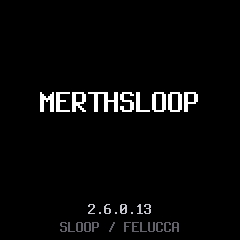
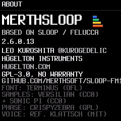
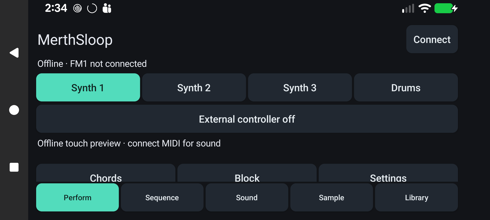

# MerthSloop branding and versions

MerthSloop is this fork's firmware and mobile companion. The Android launcher name
is **MerthSloop Mobile**. Upstream SLOOP and Felucca attribution and licensing remain.
Historical release notes and archived designs retain their original names/numbers.

Firmware versions are `<SLOOP major.minor.revision>.<fork build>`. The current version
is **2.6.0.13**. When upstream uses `2.6`, the missing revision is `0`. The final
build number increases independently and never resets when adopting upstream releases:
for example, adopting SLOOP 2.7 at this build would yield `2.7.0.13`.

`firmware/src/version.h` is the firmware version source. Startup, About and the editor
handshake use it; `build-sloop.ps1` reads it for packaging. Keep About attribution and
source links accurate. Firmware USB identity stays `FM-1_900`; Android application ID,
project names, stored file formats and protocol commands stay stable for compatibility.
The Android display version reads the same header, and its package version code
uses the independent fork build number. The app still reports the actual connected
device's firmware separately.

The startup wordmark is rendered with the existing font, avoiding bitmap splash overhead.
Web/README use `assets/logo/merthsloop-logo.svg`.

| Startup | About |
| --- | --- |
|  |  |

*Fresh production firmware UI harness renders.*

## Mobile

The renamed app was installed and opened on the Pixel; package version is 2.6.0.11,
code 11. This capture verifies the live branding; it does not claim FM1 USB round-trip testing.
