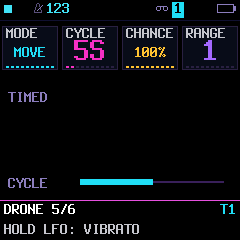
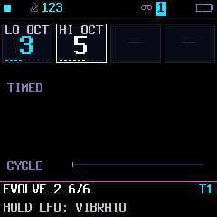

# Ambient and drone performance

## Direction and first slice

Keep MerthSloop's sequencer, engines, upstream project compatibility and ordinary
performance controls. Reuse its existing note ownership, starter rendering and
modulation boundaries. No new audio buffers or sample decompression.

The implementation adds a native DRIFT page, three ambient progression
recipes and tap-toggle DRONE keys. EVOLVE now adds slow scale-aware changes to drone notes. Scene morphing and shimmer remain later work.

## DRIFT

Tap LFO, then cycle its pages to DRIFT. Four knobs: MODE / CYCLE / AMOUNT / TARGET. MODE selects OFF, DRIFT, DRONE or BOTH.
CYCLE chooses 5S, 10S, 20S, 40S, 80S or 160S between random target values. Default
is MODE OFF, 10S, amount 64 (about 50%), TONE. The first segment begins at zero; each subsequent
segment interpolates continuously from its previous destination. Each synth
track owns independent phase, RNG and values. Target choices are TONE (filter
modulation), SHAPE (engine timbre/modulation) and PAN. Engine response differs.
The existing saved LFO and live vibrato/tremolo/wah/pan remain independent.

AMOUNT has a full-scale range of about ±63.5 parameter units (twice the first build’s range). It bounds displacement around existing edited values, without writing those
values back to the patch. Changing amount slews; OFF fades back to the unchanged
base sound. Changing target fades the prior target to zero before engaging the
new one. No pitch drift or note changes occur. PAN clamps to the existing pan
range. The drum track does not expose or run DRIFT.

The page shows the actual audio-owned value on a bipolar meter and the current
random segment’s cycle progress. It redraws as the value/phase moves, including
during knob focus; it neither runs a second oscillator nor alters RNG/audio state.
LOFI applies signed DRIFT around its TONE setting, with a safe lowpass floor;
its pre-existing unipolar envelope/LFO response is preserved. Set LOFI’s MOTN
page knob 4 TONE near 50% to leave room in both directions. Other engine
controls may also saturate at their limits.

Settings are runtime performance controls per synth track. They remain while
browsing sounds/sections, reset at reboot, and are not serialized or exposed as
new upstream P_/G_ IDs. Persistence is a separate design decision. OFF at boot
preserves previous renders and RNG sequences. All advancement happens once per
track render block, never inside an oscillator's per-sample loop. Power-of-two
cycle choices avoid a runtime divider. No wall-clock timing claim is made while
a track is not being rendered.

## Ambient starters

Append STILL WATER, WIDE SKY and DUSK to the native SEQUENCES list. All use one
chord onset per bar and the existing tie renderer for sustained chord mode.
Existing ROOT/SCALE, octave, voice leading, independent rhythm selection, preview,
merge and Apply remain authoritative. Try CHORD, VLEAD, a slow tempo and a long
attack/release; choose a contrasting rhythm for a second bell/pluck track.
These are recipes, not a new generator or automatic multi-track arrangement.

## DRONE: implemented ownership contract

DRONE and BOTH add/remove individual pitches by tapping,
without retriggering the other selected notes. Octave/track changes preserve
held pitch snapshots. Reuse existing note/pitch mapping and release/record/MIDI
boundaries, not a second chord builder. Preserve ordinary latch behavior.

The integrated tests prove physical/MIDI/common-note ownership: an incoming MIDI
note-off must not kill a selected physical drone, nor may toggling a drone emit
an unmatched output note-on. Capture output channel ownership; changes of route,
preset/engine, STOP/panic, project load and enabling ARP/chord/progression must
retire old owners deterministically. Explicitly address shared eight-voice budget
and engines whose mono/legato/decaying envelopes do not sustain multiple notes.
The existing KBD HOLD bitsets and remembered MIDI channel are reused; one mode-transition bitset fits existing RAM padding. No new voice or note array is allocated. The shared eight-voice budget and engine-specific polyphony remain authoritative. A mono/one-shot sound remains mono/one-shot: use POLY and sufficient ENV sustain for a chord bed.

## Acceptance

Keep all existing audio goldens with DRIFT off. Test long continuous segments,
per-track isolation, bounded modulation, amount/target/OFF fades, drum exclusion,
unchanged patch bytes, actual UI knob routing/redraw and old starter fingerprints.
Check native/WASM parity, real target placement, loop budgets and boot assets.
Hardware listening, stack and deadlines remain distinct from host assertions.

## Initial target and validation

Build 2.8.0.60: application **582,660 / 584,336 B**, **1,676 B free**;
664 B above .59. Main static RAM **86,432 / 98,304 B** (112 B added),
low RAM **28,928 / 29,496 B**, pool **331,852 / 344,064 B**. No new
audio buffer. All 200 default-off audio goldens are unchanged. Tests prove
actual rendered tone changes without patch mutation, smooth bounded motion,
independent RNG/track state, target/OFF transitions, real knob ownership and
drum exclusion. Original starter fingerprints, UI navigation/20,000-frame
fuzz, seven scenes × eleven delayed two-core splits, native/WASM parity,
target placement and hot-loop budgets pass. Hardware listening, stack and
real-time deadlines have not been measured for DRIFT.

## DRIFT refinement validation

Build 2.8.0.61 uses **583,180 / 584,336 B**, leaving **1,156 B flash**;
520 B above .60. Main/low/pool RAM remain 86,432 / 28,928 / 331,852 B.
All 200 default-off audio goldens remain unchanged. The LOFI test compares
both signed directions against equivalent manual TONE changes, verifies the
two directions differ audibly in rendered samples, preserves legacy negative
modulation and exercises the minimum tone bound. Tests cover doubled bounds,
continuity and OFF fades. The real framebuffer test checks moving marker
positions, redraw without knob movement and dirty/full redraw parity. UI fuzz,
shared UI refresh, delayed two-core splits, native/WASM audio parity and target
placement/hot-loop checks pass. Hardware listening remains pending.

## DRONE controls and integration

On **LFO → DRIFT**, knob 1 selects **DRONE** for tap-toggle keys alone or
**BOTH** for drone notes plus slow DRIFT. CYCLE/AMOUNT/TARGET affect DRIFT,
not the duration or loudness of the held notes. Tap any pitch to add it; tap
the same pitch again to remove it. Other selected pitches do not reattack.
Held-key lights follow the mapped octave independently of NOTES preference.

Entry runs the existing live-source takeover in the audio owner, retires the
track’s previous live holds, and switches its live ARP/CHORD modes off. The
transport and stored sequence steps are retained. Later enabling ARP or CHORD
ends drone ownership and leaves OFF or DRIFT selected. Selecting another track
or changing octave preserves captured pitches. MODE OFF/DRIFT, STOP, route
changes and preset/engine/project panic boundaries release owned notes. The
mode and selected notes are runtime-only; save formats/protocol IDs are unchanged.

MIDI owners remain momentary; their note-offs cannot cut a drone. The existing
sequencer can keep running; its attacks/releases for the same held pitch cannot
reattack or cut that drone. Removing a drone keeps any current MIDI/sequence
owner alive until its own release. Outgoing drone events use the captured track
channel and have balanced note-offs. Other track parts are not disarmed.

## DRONE target and validation

Build 2.8.0.62: **583,716 / 584,336 B**, **620 B flash free**, 536 B above .61.
Main/low/pool remain **86,432 / 28,928 / 331,852 B**. Tests cover actual physical
tap edges, add/remove, ordinary HOLD coexistence, octave/track snapshots,
MIDI and sequence pitch overlap, outgoing channel balance, source takeover,
STOP/panic and runtime-only DRONE not advancing the DRIFT RNG. Entry preserves
running transport and stored steps. Default-off audio goldens, native/WASM parity,
legacy scale/latch and progression ownership, UI redraw/fuzz, delayed two-core
rendering and target budgets pass. Hardware listening remains pending.

## EVOLVE: slow drone-note evolution

Implemented: a native LFO → EVOLVE page, with MODE OFF/ON, CYCLE (1–160 seconds or synced divisions),
CHANCE (0–100%) and RANGE (1–7 scale steps per change). Enable DRONE or BOTH on
DRIFT, tap notes to form a bed, then enable EVOLVE. It changes at most one held
pitch per cycle, up or down within the selected track ROOT/SCALE. RANGE limits
each change, not total wandering from the original chord. CHR means chromatic.

Timed cycles run in audio time, including while transport is stopped; synced
cycles follow transport and pause when stopped. Empty beds and
mode/source cleanup restart the waiting period. Turning EVOLVE off keeps the
current chord; it does not restore the initial pitches. Rate changes start fresh timing or wait for the next synced boundary. RNG is independent per track and consumes no global randomness.
No patch/sequence bytes change unless the normal recorder is active; recorded
output is ordinary note attacks/releases. No new voices or audio buffers.

Skip a change if it would exceed MIDI pitch limits, duplicate another held note,
or involve a physical/MIDI/sequencer owner outside the drone. Never steal or
release those notes. Other held voices do not retrigger. Reuse drone MIDI-channel,
key-light and lifecycle cleanup. Runtime controls reset at power-off; no saved
format/parameter-ID extension. UI help must explain DRONE dependency and scale-step
range. Validate scale/pitch bounds, collision/ownership, independent tracks, rate,
OFF/chance endpoints, MIDI balance, record playback and unchanged default goldens.

### EVOLVE validation and target

The integrated .67 uses **582,964 / 584,336 B**, leaving **1,372 B flash**.
Relative to .66, EVOLVE adds **752 B flash** and **48 B main static RAM**;
main static RAM is 89,456 / 98,304 B (8,848 B free). Low RAM and pool are
unchanged at 28,928 B and 331,852 B. No new voice/audio buffer or sample decoder.

Tests cover 300 one-note transitions, all 16 scales × 12 roots, MIDI boundaries,
range extremes, 0/100% chance, OFF, cycle/rate changes, independent track/RNG,
unchanged retained voice bytes, shared physical/MIDI/sequence ownership, balanced
MIDI, normal recorder note tracking/stored output and a full six-second audio-clock
recording cycle, patch/sequence preservation,
native knob/help routing and drum exclusion. Optimized and UBSan builds pass.
Existing drone/progression regressions, UI refresh and 20,000-frame navigation
fuzz pass; all 200 default-off audio goldens and native/WASM parity remain
unchanged. Target placement, DSP budgets and 24 inlining caps pass. Hardware
listening, physical timing/stack/deadline validation remain pending.

## Expanded EVOLVE cycles and live display

EVOLVE CYCLE now has 1S / 2S / 5S / 10S / 20S / 40S / 80S / 160S, followed by
16BAR / 8BAR / 4BAR / 2BAR / 1BAR / 1/2 / 1/4 / 1/8 / 8T / 1/16 / 16T.
Default remains 10S. This is independent of DRIFT's cycle options.

Timed choices continue in audio time while stopped. Synced choices use the real
transport's quarter-note/subdivision phase, including external sync and tempo
changes; they pause when stopped. Activation/rate changes wait for the next grid
boundary. Skipped boundaries never produce a catch-up burst; one boundary is
consumed once, even when chance/collision prevents a pitch change. Empty beds
reset scheduling. Controls are runtime-only, so no stored-index migration is needed.

The native page shares DRIFT's cycle bar renderer and reads scheduler phase,
not a second random oscillator or wall clock. TIMED / TEMPO SYNC / PAUSED,
ADD NOTES and NEEDS DRONE describe the current state. Phase and transport changes
invalidate its redraw cache; the bar stays visible during knob focus.

All eleven synced divisions are tested before/at/after boundaries, with repeated
same-phase calls, tempo changes, paused/resumed clocks and actual UI redraw parity.
Existing scale/ownership/recording tests remain. The combined sustain/.68 budget
is recorded in [SUSTAIN-DESIGN](SUSTAIN-DESIGN.md#target-and-verification).

## Configurable evolution register

Pitch movement belongs to EVOLVE; DRIFT itself still moves tone, shape or pan.
EVOLVE 2 adds LOW OCT (knob 1) and HIGH OCT (knob 2), each -1..9 in scientific
pitch numbering (C4 = MIDI 60). Defaults 3 / 5 permit MIDI 48..83. The top octave
is naturally capped by MIDI 127. Bounds are inclusive whole octaves; RANGE on
EVOLVE 1 remains the maximum number of scale steps per change.

The audio-owned walk rejects a candidate outside these bounds before releasing
its source pitch. A rejected move keeps the existing note and MIDI/recorder
owners unchanged. Changes do not immediately retune or truncate held notes;
manually held pitches outside a newly tightened range remain as played. Crossing
one endpoint moves the other endpoint to maintain LOW <= HIGH. The temporary
inverted pair possible between two UI stores fails closed in the scheduler.
These values are per-track runtime state, not upstream project/parameter IDs.
STOP, recording, scale/chance/cycle logic and source-sharing protection retain
their previous contracts. The second page keeps the existing cycle graph; unused
knobs resolve to null descriptors and cannot become locks or MIDI-learn targets.

Tests cover long walks within single/multiple octaves and MIDI endpoints, field
resolution, crossing endpoints, held-note preservation, outside-range candidates,
scale/source ownership, MIDI balance and recording. Normal UI fuzz covers the
new page alongside DRIFT and SUSTAIN's shared cold runtime-field resolution.

