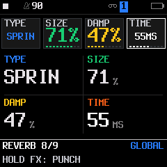
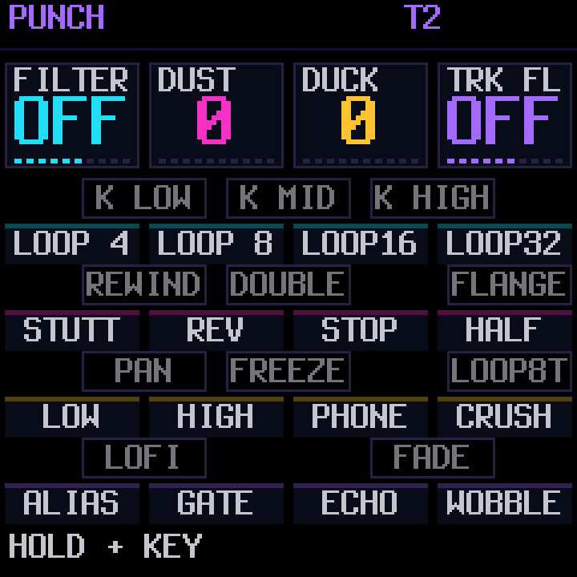

# Current delay/LOFI integration

The native DLY TYPE page selects DIGI/TAPE/CRUSH. Its other knobs follow the
type: TIME/FDBK/MIX, DRIVE/TONE/MIX or BITS/RATE/MIX. DLY keeps
TIME/FDBK/COLR/MIX for every type; shared rings, timing and sends are preserved.
Master LOFI defaults to OFF and retains its amounts for re-enable. Explicit
saved characters and older VINYL markers still load. STEP/NOTES footers name
PRESETS zoom and OCT tools. See [delay design and validation](LOFI-WET-EFFECTS.md).

Image 580,312 bytes in a 584,336-byte slot (4,024 free), main RAM
89,080/98,304, low RAM 28,280/29,496, audio pool 332,876/344,064.
[Architectural headroom](ARCHITECTURAL-HEADROOM.md) documents the RAM-for-flash
preset trade and unchanged physical update extent. Earlier figures are historical.

# Current reverb expansion

The current SPRING is dual-path and TYPE also offers ROOM, PLATE and HALL.
See [reverb expansion](REVERB-EXPANSION.md) for controls, persistence, measurements
and limitations. Earlier checkpoints below describe the first spring adapter.

# HALF, combinations and SPRING implementation

Unreleased workbench build, 2026-10-19. Implemented in the existing dirty
`merthsloop` checkout; unrelated user changes preserved. No commit, push,
public installer update or hardware flash performed. Built package:
`build/felucca.fwsc` (existing FM-1_900 development identity).

## Behavior

1. HALF is a momentary 0.5x musical clock, not captured audio. Note pitch,
   ordinary millisecond envelopes and reverb decay remain real-time. Saved BPM
   does not change. Internal clock output, sequencer/arranger/arp/gates/count-in,
   tempo LFO/envelopes, ducking, slicer and punch grids use the slowed rate.
   Delay taps crossfade on time changes. Fractional carries preserve exact odd-BPM
   transport and slicer advancement. External sync disables HALF and the panel
   explains why. STOP clears the gesture without restarting transport.
2. One existing main effect plus LOW/HIGH/PHONE plus GATE. HALF is independent.
   Source-ranked holds preserve fallback and physical priority by family. USB and
   TRS MIDI have separate holds; USB reset does not release a TRS/physical hold.
   Source cleanup compacts ranks so long sessions cannot wrap priorities.
   Ring capture runs exactly once per sample. New stages have independent fades.
   FREEZE excludes the new downstream stages until release. Throws and the remote
   single-effect contract remain. Leaving the FX layer releases physical holds.
3. Optional SPRING under FX / REVERB / TYPE, with STEREO the unchanged default.
   Adapted isolated Skiff algorithm with retained attribution (see LICENSING.md).
   Uses existing reverb line/diffuser storage, no new large buffer. Model changes
   fade out, clear/reuse storage, then fade in; they defer during FREEZE.
   FREEZE holds a lossless fixed-delay loop for SPRING rather than continuing
   lossy dispersion/damping. Project/section model selection uses a tagged unused
   G_LOAD action slot; file layout/size unchanged, untagged legacy files use STEREO.
   The parameter is appended, preserving old parameter IDs.

## Validation and practical limits

- Focused production-source tests cover exact phase at every BPM 40..240, odd
  block sizes, tempo changes, external-clock bypass, STOP, outgoing MIDI pulse
  counts/no extra START or STOP, and per-track slicer phase at odd BPM.
- All effect key pairs/source releases, held-key fallback, USB/TRS overlap,
  1,000 repeated source-clear cycles, 15 playback/filter/gate DSP chains,
  hot input, one ring pass and exact dry recovery pass.
- SPRING tests cover SIZE/DAMP corners, impulse decay, hot sends, a bounded
  12-second FREEZE, deferred switching, cleared tails and project/section/legacy
  compatibility. Original punch suite and panel keyboard coverage pass.
- Arithmetic sanitizers pass with signed-shift instrumentation excluded, as in
  the existing fixed-point tests. This excludes a claim of full strict-C UBSan.
  Hot-input checks found and fixed an unsafe new gate gain multiply; large ramps
  now use existing mulq16, and SPRING allpass states have explicit headroom guards.
- Broader suite: project, scale/MIDI clock, slicer, arp modes/expression,
  performance engine/remote, split render, UI pages/20,000-frame fuzz,
  UI refresh and song UI pass. All 182 audio goldens unchanged, no health,
  voice/routing or host CPU-budget failures. No golden/budget baselines relaxed.
- Resolved the pre-existing maximum-PULSE-pool MIDI-balance failure: playback
  cleanup had accidentally shrunk the USB MIDI output ring from 512 events to
  the input ring's 64. Three maximum expanded pools generate 312 off/on events
  at a retrigger boundary. Restored the separate 512-event output ring in both
  producer and USB consumer; input remains 64. The stress test now passes all
  ring wraps with 624 Note Ons and 624 Note Offs. This restores bounded-burst
  capacity, not a general recovery policy for a stalled host.
- Target static cost limits and all 24 helper-inlining checks pass. These are not
  physical deadline measurements. Existing target budget files are unchanged by
  this task. Logs: `build/effects-target-budget.log`, `effects-target-inline.log`.
- Eight-note FM6/GRAIN/TRIO + drums host comparison: baseline 141.1 ns/frame,
  SPRING 140.8, combinations 143.9, SPRING+combinations 163.6 (1.160x baseline).
  One/two-core output hashes match for all four cases. A single relative host run,
  not a stable device CPU figure or deadline guarantee. See `effects_cpu_test.c`.

Physical listening, switch feel and worst-case audio ISR deadline remain to be
checked on the FM-1 before publishing this as a release. The previous octave-down
pitch-dependent cancellation limitation is unchanged. Browser preview and Android
UI have not been rebuilt for the appended reverb parameter in this task.

## Target snapshot

Image 580,428 bytes, 1,136 bytes flash free. Main static RAM 85,624/98,304;
low RAM 22,772/29,496; pool 332,876/344,064 (unchanged). Package 609,912 bytes.
SHA256: 5c66f9706b50a82364012974cb9da0a4110c389afd87aaae0f54a29c628f2bf7

## Changed files for this task

Firmware: core.h, seq.c, voice.c, slicer.c, fx.c, punch.c, new spring.c,
params.c, project.c, ui_input.c, ui_layers.c; usb.c restores MIDI output capacity.

Tests: new effects_plan_test.c and effects_cpu_test.c; punch_test.c,
project_test.c, ui_pages_test.c, run_tests.sh. Guides: GUIDE.md, README.md, PUNCH-FX-DESIGN.md,
LICENSING.md, OPTIMIZATION.md and this handoff. The separate official-MVAVE
review imports no code and is in MVAVE-OPEN-REVIEW.md.

## Build 2.7.1.32: persistent VINYL and reverb TYPE crash

FX → VINYL provides independent WOW, TONE and CRACKLE, default zero (exact bypass).
An original fixed-point stereo delay follows 33⅓ rpm; tone darkens the full mix;
crackle/hiss fade at STOP. Controls persist in tagged, previously unused NAME/SET
project action slots, retaining the file size and old-project defaults. Includes
project/section round trips, DSP frequency response, stereo identity, hot-input,
STOP/noise and bypass tests. Arithmetic sanitizers pass excluding intentional
signed shifts. All 182 audio goldens unchanged; sequencer/UI/project/effects pass.
Eight-note FM6/GRAIN/TRIO + drums with all vinyl controls at maximum matches
one/two-core output in all eight reverb/punch/vinyl combinations. Host cost was
142.5 ns/frame with vinyl alone vs 128.3 baseline; all combined 172.7 ns/frame.
These are host measurements; physical audio timing and listening remain pending.

The device crash when TYPE was turned past SPRING came from a null third entry
in N_RMODEL. PE counts every array entry as a choice, so the terminator was an
invalid selectable label. Removed the terminator; TYPE is now only 0..1. Added
real UI encoder tests past both ends while audio renders between frames.
The installer at localhost:8766 serves .32; .31 was superseded before device
verification. No device flash or public release was performed by the agent.

## Device-feedback refinements

The original maximum WOW was about 3.3 cents, and full CRACKLE measured -52.8
dBFS RMS through the mixer. The revised range combines slow wow and flutter
(880 Hz input measures 867.73–892.03 Hz at maximum), stronger top-end rolloff
(10 kHz / 200 Hz power 0.007 at full TONE), and eightfold crackle gain
(-34.7 dBFS RMS, -13.4 dBFS peak in the silence fixture). Zero stays exact bypass;
WOW depth and bypass transitions are smoothed. Stereo remains linked without a
mono fold. VINYL replaces MONO on the held effect keyboard, with a temporary
WOW=96 / TONE=90 / CRACKLE=100 preset (raw 0–127 units). Existing persistent
values are never rewritten and return on release. The existing ring is reused;
one smoothed WOW value adds four bytes.

SPRING now has independent knob-4 TIME on REVERB, 20–80 ms round-trip spacing.
SIZE sets a nominal 0.4–5.48 second decay target; feedback uses the existing
physical-engine exp2 helper once per control block to compensate for TIME.
Actual decay remains frequency-dependent through damping/dispersion. The first
pickup moves from 441 to 1764 samples at the TIME extrema; FREEZE holds length.
STEREO keeps TIME inactive. A versioned G_LOAD action-slot tag packs model/time,
recognizes the earlier model-only tag, and leaves the drum-tuning checksum intact.
No additional delay buffer or project-format change is introduced. Default
STEREO/VINYL-off captures remain byte-identical to the canonical upstream fixture.

DOUBLE TIME integration is described in [its handoff](DOUBLE-TIME-DESIGN.md).
Host assertions are enabled explicitly; direct audibility thresholds, full-mixer
VINYL routing, stereo preservation, release restoration, TIME impulse/nominal-decay
checks, project/section round trips, upstream fixture equality and bounded FREEZE
are covered. Physical timing and listening for this refinement remain unmeasured.

Final target: 581,176 image bytes (388 free), main static RAM 85,656, low RAM
22,772, audio pool 332,876. Target budgets/inlining pass; 182 unchanged audio
goldens; one/two-core hashes agree across eight effects profiles. Combined host
profile 168.0 ns/frame vs 132.5 baseline in this run, not hardware CPU timing.

| Spring timing | Held effects |
| --- | --- |
|  |  |
