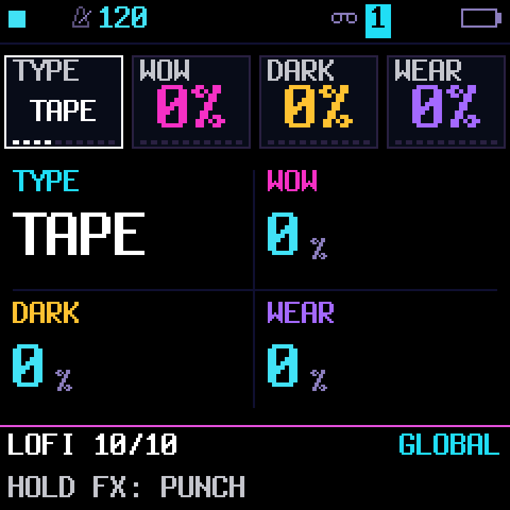
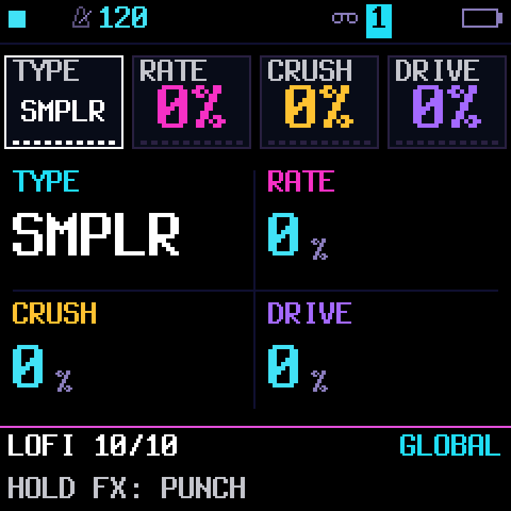

# Master LOFI implementation

## API and integration

`firmware/src/vinyl.c` remains an include-style DSP module. Its explicit entry is
`vinyl_process_mode(int32_t *l, int32_t *r, uint32_t n, unsigned mode)`.
Internal DSP modes: `VINYL_MODE_VINYL=0`, `VINYL_MODE_TAPE=1`,
`VINYL_MODE_VHS=2`, `VINYL_MODE_CD=3`, `VINYL_MODE_OFF=4`, `VINYL_MODE_RADIO=5`, `VINYL_MODE_SAMPLER=6`, `VINYL_MODE_COUNT=7`. OFF remains a bypass selector; its stored ID is unchanged.
Values at or above COUNT select VINYL. Legacy `vinyl_process(l,r,n)` explicitly selects
VINYL. The LOFI punch retains the selected character, falling back to VINYL
only for OFF. It floors the three local amounts at 96/90/100 without reducing
stronger saved values;
saved globals are untouched. Parent integration now adds G_LTYPE, the native LOFI selector, mode-specific labels and the single mixer call. FUN6 stores mode in an optional 0x5C00 tag (three bits, including OFF); the earlier 0x5A00 four-character tag remains readable. It is stored alongside the old amounts; absent tags select OFF; explicit old 0x5600 VINYL tags select VINYL. Project/section tests cover every character and old tags. Shared project sizes and default upstream bytes remain unchanged.

The native G_LTYPE selector is OFF=0, VINYL=1, TAPE=2, VHS=3, CD=4, RADIO=5, SMPLR=6.
OFF is both the first option and the default. lofi_mode maps it to the stable
DSP IDs above; storage retains its separate legacy mapping. Missing or invalid tags select OFF; explicit saved
characters, including old VINYL tags, retain their intent. The three amounts
are preserved while OFF. There is one master processing call.

| Character | G_VWOW / knob 2 | G_VTONE / knob 3 | G_VCRACKLE / knob 4 |
| --- | --- | --- | --- |
| VINYL | WOW | DARK | DAMAGE |
| TAPE | WOW | DARK | WEAR |
| VHS | WARBLE | DARK | DAMAGE |
| CD | RATE | LATCH | MIX |
| RADIO | DRIFT | BAND | STATIC |
| SMPLR (sampler) | RATE | CRUSH | DRIVE |

Amounts remain 0..127. All three zero is bit-exact bypass after the existing
control release settles. Mode alone does not activate processing. Control
slews are 32/256 amount units per sample (full travel ~23ms); wow wet fade is
~5.8ms. Mode transitions fade the processed contribution to dry, change mode,
and fade it up, ~11.6ms in each direction. They retain continuously captured
input/history and do not schedule, discard, or stop the mixer. CD glitches and
VHS dropouts intentionally alter audible content. Processing uses the same
256-frame stereo history; no extra audio ring, allocation, or mono folding.
The filter snaps residuals below 32 internal units to zero on zero input so
stopped silence reaches exact zero instead of retaining negative rounding residue.

RADIO adds a high-pass state per channel after the shared low-pass. BAND blends
into a receiver-like response within the first quarter of its range; the rest
narrows the low-pass further. STATIC combines the irregular events with a much
stronger hiss bed than the vinyl character, already audible at quarter strength.
DRIFT uses the shared pitch history with a concave response rather than a flat
upper half. Zero settings still retain exact settled bypass. No new
audio ring is added. The extra filter state adds 8 logical RAM bytes (16 linked
bytes with alignment). Residuals snap to exact silence. The selected-character
LOFI punch also supports RADIO.

## Character behavior and limits

VINYL combines 0.778Hz drift, 6.22Hz flutter and a separate ~0.259Hz phase.
Independent continuous phase avoids a discontinuity when the main phase wraps.
The delay center is 96 frames; maximum excursion is under 96 frames and stays
inside the existing 256-frame ring. Both channels share timing but keep their
own samples. Maximum 880Hz test tone measures 858.91..900.59Hz (roughly +/-42
cents); tone response 10kHz/200Hz power ratio is 0.0070.

Surface damage uses sparse, varied bipolar impulses and short decays with a
very low hiss bed. Maximum event probability is 63/65536 per sample (~42/s at
44.1kHz); quieter settings reduce event rate and magnitude. Noise fades with
PLAY/STOP; live audio still receives processing while stopped. Through the
real master mixer the four-second full-damage silence test measures -38.5dBFS
RMS, -8.6dBFS peak, crest factor 31.29, and 98.32% samples below magnitude 100.
Original RMS/peak audibility bounds remain; new sparsity/crest assertions were
added instead of weakening those bounds.

TAPE combines slow wow, stronger flutter, darkness, saturation and brief wear dips/hiss in a single character. The saturation uses fixed-point multiplies and clamps, with no per-sample 64-bit divide.
VHS runs the phase three times faster, darkens and creates decaying partial
signal dropouts, with surface noise at 1/128 VINYL level. Both are lightweight
character effects, not physical transport models or oversampled saturation.

CD follows the clarified CSIDMAN-inspired RATE/LATCH/MIX intent but is explicitly
**microstutter**, not phrase-length delay or full CSIDMAN emulation. RATE sets a
64..256-frame cycle (~1.45..5.80ms), increasing with the control. Each cycle
captures a 32-frame fragment (~0.73ms) already present in the same ring and
repeats it during LATCH. LATCH controls 0..(cycle-32) frames; the remaining
portion passes live input. MIX blends that fragment with input. Ring writes
continue throughout; the latch expires before its fragment can be overwritten.
There is no generic CD bit crushing, added noise, or generic mute. A longer
phrase/skip implementation needs an explicitly owned larger delay buffer;
recommend doing that in a future wet-delay feature, with the parent resolving
memory ownership and flash/CPU budget. Do not steal active delay/reverb memory.
CRUSH is omitted to keep the master scope compact; wet_color.c is independent.

## Validation and artifacts

Both tests compile against the real `tests/hostsim.c` and production mixer:

```
build/host/optimization-cc -UNDEBUG -O2 -fwrapv -fno-strict-aliasing -w -Ibuild/gen -Ifirmware/src -Ifirmware/hal tests/vinyl_test.c -o build/lofi-master/vinyl-test -lm
build/lofi-master/vinyl-test
build/host/optimization-cc -UNDEBUG -O2 -fwrapv -fno-strict-aliasing -w -Ibuild/gen -Ifirmware/src -Ifirmware/hal tests/lofi_character_test.c -o build/lofi-master/character-test -lm
build/lofi-master/character-test
```

Run via WSL Ubuntu from `/mnt/c/code/sloop-fm1`. Both PASS. Coverage includes
pitch range, tone attenuation, noise crest/quiet fraction, stereo alignment,
independent opposite-polarity stereo, hot +/-4M input, stopped silence, settled
exact bypass, every mode transition with constant-content continuity, distinct
mode responses, punch saved-value restoration and end-to-end mixer release.
The CD test verifies 2,229 repeated-fragment samples against a 32-frame-old
output, all different from live dry. Character fixture RMS values:
VINYL 6771.3, TAPE 6055.2, VHS 4828.5, CD 6455.3 (input uses 220/1760/4400Hz).

Private listening files are `build/lofi-master/dry.wav`, `character-0.wav`
through `character-3.wav`, and `comparison-dry-vinyl-tape-vhs-cd.wav` (five
seconds per segment in the filename order). These are deterministic audition
fixtures, not a claim of a subjective listening review or hardware validation.

`build/lofi-master/measure-size.py` compiles isolated before/after target DSP
objects with JieLi pi32v2 clang and production `-Oz -ffunction-sections
-fno-builtin` flags. External DSP primitives are held identical in both wrappers.
Before: text 736B, bss 2092B. After: text 1228B, bss 2116B. Delta **+492B text,
+24B bss**. This isolates the module only; inlining/linker/call-site effects and
integration can change actual image cost. No shared build output was touched,
no target fit or target cycle budget is claimed. Parent/space-audit must measure
the fully integrated firmware before shipping.

## Integrated validation

Native/WASM audio matches exactly across all four characters. Actual framebuffer tests check all character labels and forced/incremental redraw parity. The native labels fit the knob cards. Host-only abs calls were replaced by equivalent bounded integer operations for the freestanding target. Wet-color TAPE/CRUSH remains a separately tested foundation for the queued delay/reverb expansion; it is not an extra active master mode.

LOFI TYPE also offers **OFF**: it fades to dry without changing the three stored
amounts. Selecting a character restores those amounts; LOFI punch remains
momentary over OFF and returns to dry on release. OFF is saved with the project
and section. Its inactive controls show the retained WOW/DARK/DAMAGE amounts.

## Tape and early-digital coloration

TAPE incorporates the former cassette character: slower wow, stronger flutter,
the shared soft knee, wear dips and hiss. A separate cassette selector duplicated
that role and has been removed. Controls are WOW / DARK / WEAR.

SMPLR is a sample-and-hold ADC character, not sample loading or a new engine.
RATE blends toward power-of-two holds down to about 1.38 kHz. CRUSH blends
signed quantization down to a 4096-unit step. DRIVE blends compensated clipping
in the internal mix-bus domain. The previous unconditional 16-bit clamp clipped
loud input even at low settings; it is removed. Each control now blends its own
processing progressively. DRIVE uses a squared control curve, with clean lower
travel and full destruction at maximum. Gain above unity is split into integer
and fractional components: the shared mulq16 helper overflows fractional
products when misused for above-unity gain. The 20% drive test now preserves
unclipped loud-bus input to less than 3 internal units RMS error.
Both channels retain independent audio and share
timing. Coefficients are calculated per block only while entering/using SMPLR.
No new audio buffer or persistent DSP state is added.

Stored IDs remain VINYL=0, TAPE=1, VHS=2, CD=3, OFF=4, RADIO=5, SAMPLER=7.
Retired cassette ID 6 loads as TAPE. Sampler UI/DSP ID 6 saves as stored ID 7,
so existing sampler sections keep their meaning. All-zero controls still settle
to exact dry bypass. Punch boosts the chosen mode and restores saved controls.

Four appended LOFI-bank presets use the existing LOFI engine: DUST KEYS,
WORN PAD, TOY BELL and DUST BASS. They do not change master effects, so they can
be played clean or combined with any LOFI character. Existing factory IDs,
favourites and trim values are retained; combined user offsets move after the
expanded factory bank as in the previous pack. There are 171 factory sounds.

The integrated image is **583,388 / 584,336 B**, leaving **948 B flash**.
The addition costs **420 B flash** and **144 B low RAM** versus the preceding
build. Low RAM is **28,928 / 29,496 B** (568 B free); main static RAM and the
audio pool are unchanged. No features or sample content were removed.

Validation: 200 golden renders, all 196 existing hashes unchanged; eighteen
appended-preset range/velocity/release and mixed-playback checks; 171 raw versus
boot-restored records; browser identities; all seven project/section modes and retired cassette migration;
mode labels; all-character punch/release, overload, exact bypass and silence;
actual 32-frame hold and signed four-bit quantization; level-compensated drive;
33 native/WASM profiles; target render budgets and inlining. Low/mid/full control tests use loud mix-bus input, individually and in all seven combinations, and catch unintended low-setting clipping. Hardware listening
remains the subjective sound-quality check.




The subsequent headroom batch preserves this DSP and all sampler mechanism tests;
see [current combined memory measurements](HEADROOM-COMPARISON.md).
