# Playing the MerthSloop firmware

This guide covers the additions to upstream SLOOP in the `merthsloop` branch,
including the current scale guides and EDIT pitch tools. Everything below works without
a phone. The [complete player guide](../../GUIDE.md) also covers upstream features;
the [Android overview](../../README.md#merthsloop-mobile-for-android) covers the companion.

**SEL** is the physical button between FX and ENV, historically labelled SCL in
firmware. **SELECT** is the separate rotary encoder. They do different things.

## NEON and the refreshed display

Hold **HOME → SCREEN → COLOR** and choose **NEON**. New settings default to it;
existing saved colors and editor-created themes remain available. Four knob cards
follow the physical controls across ordinary editing, held-button maps, live
modulation and native library screens. The overview shows four track lanes, with
selected/muted tracks and sequencer position; the striped sun pulses gently
with the transport beat while playing. Page footers identify track/global
scope and the action available now. Existing shortcuts, scale-key LEDs, independent
ties, preview, merge and replacement behavior are retained.

**PAGE HELP**, the fourth SCREEN item, opens a reference for the underlying page.
Use PRESETS to select it and OCT+ to open; OCT− returns to the menu.
SONG and record-ready/count-in use the same knob cards, palette, transport header
and footer spacing. HOME identifies the selected drum kit by name alongside
the colored DRUMS label, just as synth tracks show their preset and engine.
Disabled controls show muted dashes. Running free takes keep
a large timer and the four-track overview. Existing recording/saving gestures
are unchanged.
PRESETS is the left control, ALGORITHM the right. HOME shows the engine name in
the selected track color beside the preset. LFO/ENV hold hints identify vibrato
and tremolo instead of a generic actions label.

Envelope and LFO diagrams, signed destination amounts, filter/delay guides, live
vibrato/tremolo traces, stereo pan and the wah sweep guide replace ambiguous empty
areas. The diagrams are setting/activity guides, not measured frequency responses.

| Overview | Modulation | Native libraries |
| --- | --- | --- |
| 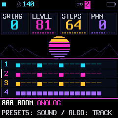 | 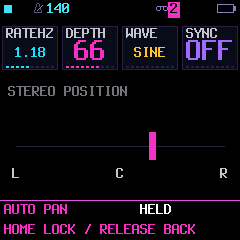 | 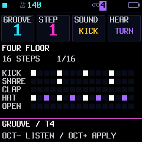 |

The [design and implementation record](UI-REFRESH-DESIGN.md) contains more actual
screens. Older detailed screenshots below may show the previous layout; controls
are unchanged.

## Saving sections safely

Hold SAVE and use SAVE A–D (keys 5–8); confirm a used section with a second tap.
When stopped, this now writes the section to flash before showing SAVED SECTION.
It also refreshes the startup working-loop snapshot and commits device settings,
including the 1/8 swing-grid preference. Track root/scale, levels, drum level and
global swing belong to the saved section. Explicit SAVE does not wait for the
background autosave interval before protecting the power-on state.

While playing, it captures a snapshot without interrupting audio and says
**QUEUED: STOP TO SAVE**. Stop playback, release sounding notes, and wait for
**SECTIONS SAVED TO FLASH** before powering off. The queued section and startup
snapshot flush as soon as playback stops and voices are quiet; routine settings
writes retain their idle delay. Failed writes remain pending
and retry; RAM-only storage is explicitly labeled. SONG-screen SAVE still saves
the arrangement order; REC stores its selected section.

## Build a loop in a minute

1. Select drums. Tap EDIT or SEQ to reach **GROOVE**, choose a beat, and press
   **OCT−** to listen through the current kit. Press OCT− again to stop preview.
2. Press **OCT+** to apply. Replacing existing material requires another press or
   a continuous **700 ms hold**. Playback and recording must be stopped.
3. Select a synth. Tap SEQ through **STEP → PATTERN → RECORD → SEQUENCES**.
   Select POP FOUR, your key and scale, and **ARP NOTES**. Listen, then apply.
4. On another synth, apply the same progression in **BASS** mode. Add a melody,
   choose sounds and develop the ordinary editable steps you have just created.

| --- | --- |
|  | 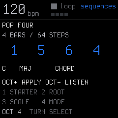 |

There are **24 grooves**, including funk, broken house, electro, Afro clave,
boom bap and a four-bar Amen break, and **24 musical starters**, including standard
progressions, soul sevenths, gospel turns, disco, garage, Latin and unusual pockets.
The libraries preserve your kit/preset, tempo and other tracks. Applied material
replaces the selected track's pattern and timing metadata; **EDIT + OCT−** undoes
the complete replacement and **EDIT + OCT+** redoes it while stopped.

## Swing eighth-note grooves

Hold **HOME → TIMING → SWING GRID**, then choose **1/8** with knob 1. Return to
TRACKS and turn **SWING8** to set the amount. This shuffles eighth-note hats such
as HALF TIME even when the pattern uses a 1/16 grid. **STEP** preserves the old
swing behavior, following each track's DIV. The choice survives power-off; both
global and local swing amounts follow it. Native previews and the GROOVE
visualizer follow the timing too. Live ARP retains its separate ARP 2 SWG control.

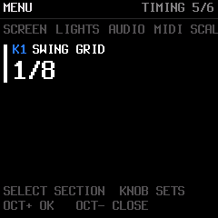

## Write a custom progression

In SEQUENCES, choose **CUSTOM** after the built-in starters with knob 1, then turn
SELECT to the fourth browser page, **CUSTOM**. Its controls are **1 COUNT** (1–8),
**2 SLOT**, **3 DEGREE** (1–7), and **4 SPAN** (4/8/16 sixteenth-note steps per
chord). The underline marks the edited position. Dial `5–1–2–4`, or choose three,
six or eight positions; changing count retains hidden slots for later reuse.
Editing count, degree or span selects CUSTOM automatically.

The 64-step limit applies to the whole phrase. More than four chords limits SPAN
to eight steps. Three chords at span 16 make 48 steps; six at span 8 also make 48.
The footer shows steps per chord. Root, scale, octave, rhythm, shaping, VLEAD,
CHORD/BASS/ARP NOTES, listen, ADD/REPLACE and undo work as for the factory starters.
Preview and REPLACE use the actual phrase length. ADD keeps the destination length.
The shared custom draft lasts until power-off; applied notes save with the song.

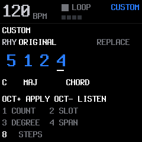
## Shape the rhythm and register

Turn **SELECT** inside SEQUENCES to visit its main, rhythm and pitch pages.
Key, scale, octave, starter, mode, VLEAD and rhythm choices stay shared across synth
tracks until power-off, so matching chord, bass and arp parts keep the same key.
Page changes preserve the audition; changing a configuration knob stops it.
The physical SEL button opens chord settings instead. Tapping SEQ leaves the
browser for SONG; that final screen belongs to the sequence family.

| Sequence rhythm | Sequence pitch | Drum RHYTHM |
| --- | --- | --- |
| 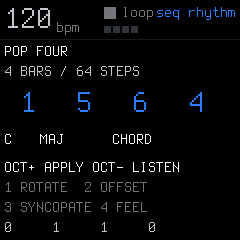 | 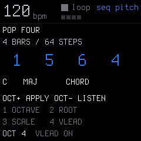 | 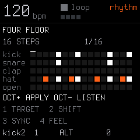 |

| Page | Knob 1 | Knob 2 | Knob 3 | Knob 4 |
| --- | --- | --- | --- | --- |
| SEQUENCES main | Starter | Root | Scale | CHORD / BASS / ARP NOTES |
| Sequence rhythm | Rotate | Offset | Syncopation | Feel |
| Sequence pitch | Octave | Root | Scale | VLEAD |
| Drum RHYTHM | Target lane/all | Shift | Syncopation | Feel |

Positive shifts move later, wrapping within the pattern. Syncopation moves eligible
on-beat attacks into the preceding empty step; occupied destinations stay intact.
Feel nudges timing early or late independently of swing. Drum lane shifts can
put hats behind the kick; drum feel uses the existing shared per-step timing.
Preview and Apply use the same configuration, rebuilt from the original starter.

The pitch page's **OCTAVE** is independent of OCT−/OCT+, which remain listen/apply.
**VLEAD** keeps later chords near the preceding voicing, anchoring the first bar at
your chosen register. It applies to CHORD and ARP NOTES; BASS stays on lower roots.
Preview loops do not drift in octave. Choose a polyphonic VOICE mode for full chords.

**CHORD** writes triads/sevenths with the selected rhythm; **BASS** writes lower
roots. **ARP NOTES** writes editable chord-tone pulses. ORIGINAL adds eighth-note
pulses and retains starter syncopations; an explicit RHY uses only its own attacks. It does not enable the live arpeggiator. A track set to CHR
opens this browser in Major without changing the track's scale settings.
Explicit CHR here means twelve chromatic degrees: stacked chord tones sound
unusual. Use MAJ/MIN or another tonal scale for conventional progressions.

See [musical starters](SEQUENCE-STARTERS-DESIGN.md), [drum grooves](DRUM-GROOVES-DESIGN.md)
and [rhythm shaping](RHYTHM-SHAPING-DESIGN.md) for bank and replacement details.

## Sustain individual notes through later attacks

Select a source note/chord on STEP. Hold **OCT+** and turn **knob 4** to choose
ALL or one source pitch; scrub **knob 1** forward to extend it. Other pitches can
attack underneath the sustained voice. Set **EDIT → VOICE → knob 1 to POLY**.
After releasing OCT+, **LEN** shortens the selected voice and **EDIT** deletes it
and its continuations without removing the other voices. Undo restores the edit.

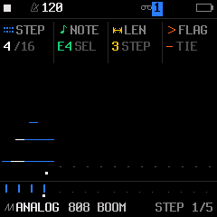

A full destination or a deliberate same-pitch attack stops extension safely.
Single-event move/transpose is guarded for independently tied patterns; whole-pattern
EDIT transpose remains available. Recording and phone/web duration authoring remain
follow-on work. See [per-note ties](PER-NOTE-TIES-DESIGN.md) for details.

## Record and correct notes quickly

For the whole synth pattern, hold **EDIT** and turn **knob 4** for octaves;
knob 3 remains semitones. SHIFT/TRANSPOSE/OCTAVE readouts follow the last gesture
and its undo/redo. The scale guide shows key-signature accidentals while small
physical-key hints preserve the existing erase controls.

| EDIT shift and pitch totals | E-minor vibrato guide |
| --- | --- |
| 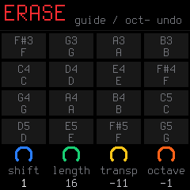 |  |

| RECORD snap | Sequencer-fed arp |
| --- | --- |
| 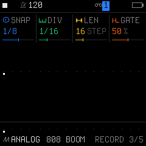 | 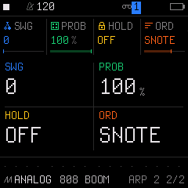 |

On **RECORD**, knob 1 **SNAP** can round recording to eighths or quarters while
the pattern keeps its own playback DIV. It is separate from changing track speed.

On the **STEP page**, select the starting note/chord, then:

| Gesture | Result |
| --- | --- |
| Hold OCT+ and scrub knob 1 clockwise | Paint following ties for as far as you advance |
| Hold OCT− and scrub knob 1 clockwise | Paint following rests |
| Hold either OCT button and turn knob 2 | Shift the selected note/chord by whole octaves |
| Hold either OCT button and turn knob 3 | Move its onset left/right by whole steps |

Tie/rest painting leaves the starting step intact, stops at the pattern end and
does not erase when backtracking. Moving into a note's own ties is allowed and
retains its original end; other moves shift the complete tie chain. Occupied
destinations are protected. Moves carry expression, timing, fill conditions and
parameter locks; gestures support undo/redo. These are STEP-page controls,
distinct from the held-SEQ layer. See [editing details](SEQUENCER-EDITING.md).

| Start with a chord on step 1 | Sweep ties through step 8 | Paint rests on steps 5–7 |
| --- | --- | --- |
| 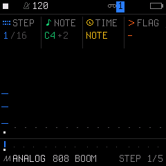 |  | 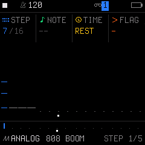 |

The thin horizontal segments represent ties. For the rest example, select step 4,
hold OCT− and advance knob 1 to step 7; step 4 stays intact.

| Original onset at step 1 | Onset moved to step 3 inside its own ties |
| --- | --- |
| 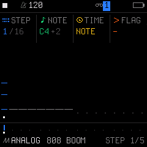 |  |

Hold either OCT button and turn knob 3 two steps right. Steps 1–2 become rests;
the chord begins at step 3 and still ends after step 8.

## Play chords and arpeggios

Added chord shapes are **SUS2, ADD9, 6TH, SHELL, OCTAVE, MAJOR, MINOR, DOM7,
MAJ7, MIN7, DIM, AUG, HALFDIM and DIM7**. They extend upstream's TRIAD, 7TH,
9TH, SUS4 and POWER. Fixed qualities are useful when every root should retain
the same chord type; scale-derived qualities follow the selected harmony.

Set **KEYS/QNT = CHROM** to use every physical key as a literal chord root,
including black keys. Other chord keyboard modes use white keys for degrees
and black keys for chord modifiers. CHR is a scale, while CHROM is a keyboard
mapping; legacy scale-derived live chords use minor harmony when SCALE is CHR.

While holding sounding notes, hold **ARP or SEL for 700 ms** to toggle latch
without interrupting your playing. This works for chord mode and manually held
arpeggio notes. **SEL page 2, knob 4** also controls chord LATCH. In non-CHROM
latched chord mode, black modifiers immediately reshape the sounding chord and
toggle until pressed again. Their state survives choosing another root and clears
when latch is disabled, CHROM is selected, STOP or panic is used.

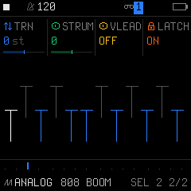

With C major selected, latch the C chord, release its root, then tap **F#**:
**C–E–G → C–E♭–G**. Releasing F# keeps the minor chord; tapping F# again returns
to major. You do not need to reapply the root. The image shows the LATCH control;
the modifier changes the sounding pitches, not the saved CHORD setting.

Additional arp modes are **CONV, SHUF, ROOTALT, DNUP, UPDNREP, DIVG, WALK
and PULSE**. NOTE/PLAY ordering controls sorted pitch versus playing order;
ORD keeps press order. ROOTALT alternates the lowest voiced pitch. PULSE plays
the expanded distinct tones together, merging duplicate octave pitches.

To arpeggiate a sequenced chord, enable an arp MODE and set **ARP page 2,
knob 4 ORD to SNOTE or SPLAY**. Store the chord on one step with ties after it
to sustain the arp pool. Live and sequence input remain independent. Source
velocity/accent is retained through arp modes, octave expansion, latch, MIDI
output and recording; shared pitches use the stronger current source velocity.
Physical keys still have fixed attack velocity. The FM-1's shared eight-voice
budget and four-note-per-step recording limit continue to apply.

See [arp expression](ARP-EXPRESSION.md) and the [chord/arp architecture](CHORD-ARPEGGIO-DESIGN.md),
which distinguishes the implemented features from future semantic harmony work.

## Keep the key visible

Hold **SEL + press OCT+** to toggle persistent keyboard scale lights. They follow
the selected synth's SEL-page ROOT/SCALE, with dim scale notes and bright played
notes. Off-scale keys stay dark until played. CHR lights all twelve pitch classes.
The guide is visual: it does not itself quantize or transpose your playing.

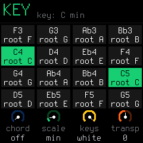

Held SEL shows mapped pitches and appropriate accidentals; LFO/ENV show modulation waveforms with a compact key guide.
**KEYS = WHITE** walks scale degrees. Optional **HOME menu → MIDI SCALE → KEYBOARD** (knob 1) maps incoming USB/TRS synth pitches by that receiving track's
keyboard settings. It defaults OFF, useful for phones/DAWs already sending the
desired pitches. Note-offs retain their original mapping across setting changes.
This option maps individual pitches; it does not generate chord voicings or turn
incoming black keys into modifier commands. See [scale/MIDI grids](SCALE-MIDI-GRIDS.md).

## Vibrato and tremolo while playing

Hold **LFO** for vibrato or **ENV** for tremolo. After 140 ms a temporary panel
appears for the selected synth only; release returns to your previous screen.
Quick taps still open the normal saved patch pages. The keyboard remains playable
and retains its scale lights.

| Locked vibrato | Locked tremolo |
| --- | --- |
|  |  |

**To keep it on: hold LFO/ENV, tap HOME, then release LFO/ENV.** LOCK appears and
the effect and knobs stay active. Tap HOME to unlock. Another function button
also unlocks; press it again to open its normal page. STOP, track panic, menus
and selected-track changes clear the effect and dismiss the locked panel.
Unlock before selecting another track through the panel buttons. One panel locks
at a time; a lock lasts only for this performance, not across a project save/reboot.

The waveform shows one cycle and a live phase marker, with pitch cents for vibrato
and volume percentage for tremolo. Track/key context and a compact scale guide
remain visible; the keyboard keeps its existing mapping.

Knobs 1–4 are **free Hz, depth, waveform, beat sync**. SYNC offers OFF, 1/4, 1/8,
1/16, 1/32, 8T, 16T, 1/2, 1BAR and 2BAR. Turning knob 1 returns to free Hz.
Synced modulation follows transport phase when playing and current BPM when stopped.
The settings are independent of saved LFO/envelope parameters and remembered across
holds until reboot. Both buttons can be held together; LFO takes visible knob priority.

**MIDI CC1** also supplies vibrato through the saved track LFO, with source-aware
USB/TRS cleanup. Android Perform's momentary wheel strip sends it too. The hardware
panel overrides the wheel on its captured synth, then restores the current wheel
on ordinary release. Details: [performance modulation](MODULATION-WHEEL.md).

## Punch effects, fills and project safety

Hold **FX** and a keyboard key for one of **27 mix-wide punch effects**. The
sixteen white keys retain their loops, stutter, reverse, tape stop, half speed,
filters, phone, crush, alias, gate, echo and wobble. Eleven black keys add
**KILL LOW/MID/HIGH, REWIND, DOUBLE TIME, FLANGER, AUTO-PAN, FREEZE, LOOP 8T, VINYL
and FADE OUT**. FX + held **OCT− / OCT+** adds reverb / echo throws. Release returns
the normal mix; HOME can lock the FX control panel open, freeing the FX-button hand.
These act on the mix, whereas LFO/ENV modulation acts on one synth.
See the [physical effect mapping](../../GUIDE.md#punch-in-effects).

The old black-key modifier controls and their screenshot are historical. Current
black keys select effects directly, as in upstream; they do not toggle effect latch.
The phone's established performance protocol continues to address the sixteen
original effects. See [punch design and historical context](PUNCH-FX-DESIGN.md).

Held GLO's **FILL** key enables existing fill-conditioned steps; **FILL BAR** queues
the next bar. They do not invent a new drum beat. The phone can control these and
punch effects through renewable leases; physical controls take priority and expired
remote owners release cleanly.

After an accidental saved-song load, section selection or working-project backup
restore, stop playback and press **EDIT + OCT−** to restore the preceding project.
OCT+ redoes it. The one-level RAM snapshot is superseded by subsequent edits or
recording. The held SAVE menu also offers **NEW**, with stopped-only confirmation.

| Undo a load | SAVE menu's NEW | Confirm NEW |
| --- | --- | --- |
| 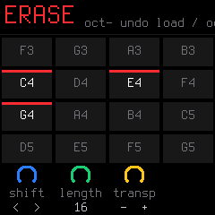 | 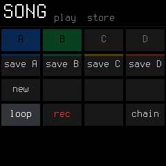 |  |

For NEW, keep SAVE held and press the **ninth white key** twice within the
confirmation window. Releasing SAVE cancels confirmation. Creating a new working
project leaves saved flash slots intact.

## Visualizers, USB and the companion

On TRACKS, tap HOME to open the visualizer and turn SELECT to choose among **seven
styles**: Oscilloscope, Spectrum, Spectrogram, VU Meters, Note Trails, Groove
and Song Journey. The last three are fork additions. The [complete illustrated gallery](VISUALIZERS.md)
describes all available styles. Performance layers and transport remain usable.

Note Trails captures played/held notes rather than continuing released voices or
delay tails; the fully wet master punch GATE cuts its current synth/drum column.

**Apply modulation:** while holding LFO/ENV, tap OCT+ to copy rate, waveform, beat
division and PIT/AMP depth into the track's saved shared LFO. The temporary effect
stops. Other destination depths stay, sharing the new timing; vibrato depth rounds
to existing PIT steps. Save the project normally. See [modulation](MODULATION-WHEEL.md).

**LOFI chip arp:** MOTN → ARP retains its original four choices and adds every SEL
chord shape, using the track's root/scale and the existing chip cadence. See
[LOFI chord arpeggios](LOFI-CHORD-ARP.md).

**Phone song library:** Library → FM1 songs saves named current-project/A–D snapshots
with arrangement, samples, sound banks and edited FM6 voices. Load retains a phone
recovery song before replacement; device preferences and MIDI mappings stay.
See [song library](<../../android/design docs/FM1-SONG-LIBRARY.md>).

USB audio records the instrument into the phone/computer. App sample previews use
phone audio; playback into the FM-1 speaker/headphones is unavailable.

Companion protocol 15 provides hardware octave reporting, native pattern and FM6
editing, sample backup/upload/readback, persistent FM6 base-voice bank saving,
and canonical drum-library discovery. Upstream SYN-kit commands retain IDs 72–76;
remote performance uses 86 and the drum bank uses 87. Atomic live hardware scene switching remains future work.
Original Android code is Unlicensed with retained dependency obligations; firmware
remains GPL. See [current delivery status](<../../android/design docs/STATUS.md>).

### Find libraries and review prompt edits on the phone

In Android **Sequence**, select Drums to find **FM1 groove bank**.
Musical sequence starters remain available directly on the FM-1. Connect the phone directly to the FM-1
and stop playback before browsing/applying. The banks come from firmware rather
than duplicated app presets. Native listen/apply and replacement undo remain
available on the instrument.

Tap **Describe a sequence · offline recipes** to edit existing notes with a
supported command. Choose the channel scope and optional note locks, then press
**Propose**. Review exact before/after changes before **Apply locally**, or
**Discard** to leave the pattern untouched. The example transposes the existing
channel-1 C note up one semitone; timing, length and velocity stay unchanged.

| Enter a supported edit | Review before applying |
| --- | --- |
|  |  |

Prompts use bounded offline edit rules. **Compose a new offline loop…** in the
same dialog generates a separate editable draft. Neither workflow generates WAV
audio; the connected instrument supplies sound. The pictured proposal was
discarded after capture.

Packed one-bit fonts keep the refreshed bold lettering compact. Factory drum
sounds share losslessly identical parameter bases, with each sound’s exact level
retained separately. Only note-on expands a factory record; audio rendering reads
a stable record belonging to that voice. Six 22-byte records add 132 bytes of RAM,
while the bank representation saves 5,158 bytes before decoder code. Editable SYN
kits, downloaded sounds and saved projects retain their existing expanded formats.
Startup uses a firmware-title screen instead of the bitmap splash. No additional
full-pattern buffer is needed for ROM starter libraries or modulation locks.

Native images in this guide are fresh **production-code framebuffer
renders**; Android images are fresh captures from the connected Pixel. Both were
visually reviewed October 10, 2026. The native renders use host panel/storage ports,
not photographs or redesigned mockups. No hardware scale-light photo is included.
Build/host regressions are recorded in the
[verification log](<../../android/design docs/VERIFICATION.md>); they do not measure
physical hardware audio deadlines or remaining stack margin.

### Mix any starter progression with any rhythm

Turn **PRESET** in the SEQUENCES browser to select RHY. ORIGINAL preserves the
starter behavior; 17 explicit masks apply to any progression in chord, bass or
arp-note mode. The rhythm choice persists across tracks, with shared Preview/Apply.
FEEL is a uniform early/late nudge; it does not randomize or swing notes.

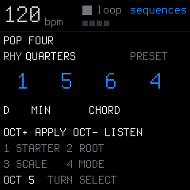

## Layer sequences and retain the effects you set

In SEQUENCES, turn ALGORITHM to ADD instead of REPLACE before applying. ADD keeps
track timing, locks/fill and existing dynamics; it skips duplicate pitches and
rejects overlaps over four distinct notes without changing the track. Ties from
both layers are resolved, with shared whole-chord attacks when either changes.
Preview plays the starter alone; EDIT undo/redo restores the complete change.
The phone's existing Apply remains a replacement.

Changing a track's instrument preserves its voice mode (POLY/MONO/LEGATO/UNISON),
glide amount/mode, note priority/allocation, drive, chorus, delay/reverb sends,
insert, slicer and filter. On a normal FX-family page, press OCT− and OCT+ together
to reset only effects on the selected track; playing preferences stay intact. Song loading still recalls
the saved effects; INIT SOUND remains an explicit complete sound reset.

## Track auto-wah and auto-pan

Hold **ENV+FX** for auto-wah or **LFO+FX** for auto-pan; physical keys still play and
scale lighting stays intact. Wah knobs are rate/sensitivity, depth, base center,
and source (free LFO, beat division or ENVELOPE). Pan knobs are rate, depth,
waveform and beat sync. Hold the combo and tap HOME to lock the effect; HOME,
STOP/panic or track changes clear it. Saved patch parameters stay intact.
See [the full controls](AUTO-WAH-DESIGN.md) and [branding/version policy](../BRANDING.md).

| Track envelope wah | Track auto-pan |
| --- | --- |
|  |  |

*Fresh production UI/audio harness renders.*
