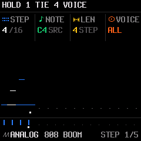

# Independent note ties

## Goal

Let a guitar-style part ring across later attacks on the same synth track. A step
may contain both newly attacked notes and continuations of earlier notes, with at
most four pitches sounding from the sequencer at once. Existing whole-step ties
continue to work. This is sustain, not a long release tail or a pitch slide.

Example on a sixteenth-note grid:

| Step | Stored pitches | Continue without attacking | New attacks |
| --- | --- | --- | --- |
| 1 | C | — | C |
| 2 | C, E | C | E |
| 3 | C, E, G | C, E | G |
| 4 | E, G | E, G | — |
| 5 | G, C | G | C (a fresh attack) |

An omitted pitch ends at its normal gate unless a continuation on the next step
keeps it alive. A full REST ends everything. STOP, mute/solo, scene changes, failed
fill conditions and transport resets must keep their existing cleanup guarantees.

## Representation and saved songs

Keep `step_t` at ten bytes and projects at their existing size. Its `flags` byte
already uses bits 0 and 1 for accent and slide; use upstream bits 3–6 for four incoming
continuation flags, one for each `note[]` slot. Pitches remain plain MIDI values.
No extra pattern buffer or per-track runtime array is required. The flags fit
one seven-bit MIDI/SysEx flags byte; bit 2 remains reserved for the upstream legacy tie marker; a fourth-note continuation must not use bit 7.

Only an ST_NOTE entry uses these flags. ST_TIE still continues the entire sounding
set and ST_REST still ends it. Empty slots' flags are ignored. Slots, continuation
bits, levels and ratchets form one logical record and must move together when
notes are sorted, deleted or merged.

Existing saved songs have zero continuation bits and retain their behavior. The
current project capture/apply copies `flags`, so project size and format do not
change. Older firmware will read the same pitches but reattack continuations;
it cannot reproduce their independent sustain. This limitation must be documented
before exporting a song for older firmware. Audit phone/web import, merge and
editing code before claiming end-to-end support: flag preservation alone does not
make those editors understand independent lengths.

## Playback

At a mixed step boundary, retain an already sounding pitch only if its incoming
continuation flag is set. Release other previous pitches, then attack new entries.
A repeated unmarked pitch is a deliberate retrigger. A marked pitch with no active
predecessor attacks normally, so starting playback mid-phrase remains audible.
Continued pitches retain their attack velocity and envelope state and emit no
extra MIDI note-on/off pair. A tied entry never ratchets; other notes retain their
own ratchets.

Look ahead one step to protect pitches needed by that step's continuations from
the current gate timer. At gate expiry release only the unprotected pitches,
compacting the existing runtime note/velocity arrays. Legacy slide and ST_TIE
chains keep their current whole-step behavior. Independent continuations take
priority over slide on mixed steps. Unmarked legacy patterns use the old path.

Loop boundaries use the same next-step lookup. A continued note may cross the end
of a pattern, but STOP always releases it. SNOTE routing initially keeps its
existing whole-chord harmony publication; independent arp harmony transitions need
a separate integration pass and must not be advertised as completed.

## Native editor interaction

Keep OCT+ + knob 1 as the extend gesture. The gesture remembers its source onset,
instead of changing its source whenever the cursor crosses an occupied step.
Extending adds continuation slots to subsequent cells and preserves new attacks
already in them. A full four-note destination refuses the extension with CHORD
FULL; it must never overwrite an existing voice. Preflight the requested range so
a single scrub increment either succeeds completely or changes nothing.

While OCT+ is held, knob 4 selects ALL or an individual source pitch. ALL extends
the source chord; selecting C extends only C through later E/G attacks. Show the
selected pitch and continuation status on STEP, and keep the held-control help
visible. Backward scrubbing retains its current non-destructive cursor behavior.
Shortening/deleting one note removes its continuation chain without deleting
other onsets. Undo/redo restores both notes and their continuation flags.

The existing destructive OCT− rest brush remains a whole-step operation. Octave,
move, LEN, transpose and merge operations need explicit continuation-aware rules:
pitch edits must follow a selected chain, and collision checks must consider its
full extent. Do not silently move only its attack and leave disconnected ties.

The initial native implementation guards single-event pitch/octave edits and
move/merge while a pattern contains independent continuations. It says USE EDIT
TRANSPOSE or TIED VOICES: NO MOVE. Whole-pattern semitone/octave transposition is
safe and remains available. Moving a selected independent voice, with collision
review, is still follow-on work. Ordinary whole-step tie moves remain available.

Use POLY for overlapping pitches. Attempting to extend into an occupied step in
MONO/LEGATO/UNISON asks for POLY instead of silently changing the playing mode.
Changing instruments now preserves voice mode, glide amount/mode, note priority
and allocation as track preferences; the FX reset shortcut leaves them intact.

## Recording and MIDI import

Live recording must track independent held pitches rather than ending every hold
at the next onset. MIDI import must represent each overlapping duration as marked
continuations plus its attack. Capacity conflicts need review, not silent dropped
notes. These are follow-on work after native playback and editing; current import
and held recording retain their existing limitations until that integration lands.

## Delivery and validation

1. Foundation: representation, actual synth/MIDI playback, gate/ratchet behavior,
   unchanged legacy patterns and project round trips. No new UI is promised here.
2. Native editing: selective extend/shorten, display, undo and safe structural edits.
3. Recording, MIDI import, phone/web editor and visualizer integration.
4. Target flash/RAM measurement, full regression and emulator/hardware audition;
   only then publish a firmware package and user controls.

Tests must cover C → held C + E → held C/E + G, independent gate expiry,
same-pitch retrigger versus continuation, pitch-slot reorder, orphan continuations,
wraparound, zero/full capacity, live ownership skips, ratchets, stop cleanup and
save/load. Audio voice identity and MIDI event counts must verify that a tied note
does not merely get retriggered with the same pitch. Flash is already tight; do not
increase project or track structures to obtain this feature. Measure target cost
before deciding what optimizations are needed.

## Status

The playback/persistence foundation and native selective extend, shorten, delete
and undo controls are implemented. The gesture retains its source through later
onsets and refuses an entire increment at capacity or a same-pitch reattack.
Moving the cursor normally clears voice selection; after releasing OCT+, LEN
still edits the selected source. Track/page changes cancel the selection.
Live recording, phone/web duration creation and individual linked-voice moves
remain planned. The packaged local build includes native controls; publishing it
to GitHub Pages is a separate deployment step.

`tests/seq_note_ties_test.c` runs the actual mixer/sequencer and checks retained
voice identity, preserved attack velocity, balanced MIDI, independent gates,
ratchets, reordered/full four-note steps, skipped entries, failed fill conditions,
orphan ties, loop crossings, legacy retriggers and saved-project round trips.
It is registered in `tests/run_tests.sh`. Existing sequencer/arp/project regressions
also pass. The native groove selection test now traverses all 24 entries with
actual knob input; the reported selector issue was the separate RHYTHM page.
The new tests also pass the project's divide-by-zero sanitizer check (trap mode
with the local Zig host compiler); broader undefined-behavior validation is not
claimed for the existing fixed-point DSP.

The initial foundation target build passed with a 581,464-byte image, 100 bytes of
remaining flash, 82,100 bytes of static RAM and 332,876 bytes of pool RAM.
That foundation included 592 measured bytes recovered by preventing code expansion at four
UI boundaries: MIDI step entry (224), physical step entry (16), groove drawing
(32) and column drawing (320). These are UI call-boundary changes, not DSP or data
format changes. Native control development additionally shares exact icon rows,
removes padding from cold ROM lookups and shares note deletion logic; see
[optimization notes](OPTIMIZATION.md) for the final native build measurement.
The native build measures 581,512 image bytes, 52 flash bytes free, 82,116 static
RAM bytes and 332,876 pool bytes. Browser audio and opaque step transport now
preserve the four continuation bits; phone/web duration-authoring UI remains pending.

`tests/note_ties_ui_test.c` drives the actual knobs/buttons with mixer blocks
between frames: crossing attacks, source retention, selecting one chord voice,
shortening/deleting it, legacy-tie materialization, capacity/same-pitch refusal,
metadata preservation, held help and undo/redo. Existing native move/edit tests
and the full 20,000-frame UI fuzz pass. Screens below are fresh firmware renders.

| Extending through later attacks | One voice selected for independent length |
| --- | --- |
|  |  |

## Native display audit

The roll resolves every legacy whole-step TIE to all sounding pitches, including
at the start of a 16-step bank. Incoming independent ties join the preceding
stroke; attack cells remain visibly separate. REST/TIE stale note payload does
not affect the pitch range. Redraw signatures include all four pitch slots.
STEP suppresses the enlarged knob overlay so it cannot cover upper voices.
NOTE and LEN describe the anchored source while scrubbing (`SRC`, or `SEL` for
one voice), rather than mixing a destination note with the source duration.
LEN remains anchored when shortening leaves the cursor on a rest.

The native UI test checks rendered pixels for four-note chords, bank crossings,
legacy and independent ties, continuous strokes, stale payloads, cached third/
fourth-pitch edits, forced-versus-incremental redraw equivalence and knob zoom.
It also exercises shortening then extending again with the cursor beyond the end.
Playback, step editing, move/merge and the full UI fuzz regression remain passing.
