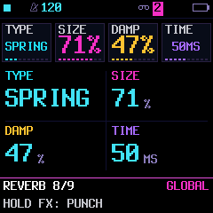
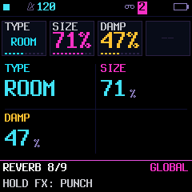
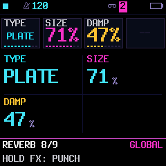
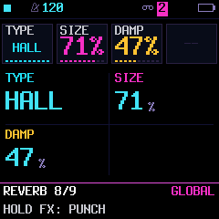

# Reverb expansion

## Goals

Improve the spring's width and texture; add compact ROOM, bright PLATE and spacious HALL choices. Keep the original STEREO model byte-identical, the shared track sends, model-switch fade, FREEZE, and upstream-compatible project layout. Reuse existing reverb delay/AP storage rather than allocate more audio buffers.

## Sound design

- SPRING: two unequal dispersive paths, different allpass coefficients and slow pickup modulation, with a high-pass and damped feedback. Eight stretched allpasses per path. TIME sets reflection spacing; SIZE sets nominal decay independently. The two paths should create genuine stereo difference, not duplicate a mono tail.
- ROOM: short, unequal delays with lower diffusion/feedback for tight early reflections.
- PLATE: denser input diffusion, medium delays, bright and longer feedback.
- HALL: longer unequal paths with smoother diffusion and a longer tail.
- STEREO: retain upstream lengths, coefficients, rounding and output exactly.

ROOM/PLATE/HALL are variations of the existing four-line feedback delay network, not physical simulations. Their fixed tunings must produce measurably distinct impulse responses. SIZE and DAMP retain their roles; TIME applies only to SPRING. Switching types fades out, clears incompatible state, and fades in; FREEZE defers the switch until release.

## Persistence

Keep the default upstream bytes unchanged. Preserve the prior model-only and SPRING/TIME tags on reading. A new tagged unused LOAD action word stores 3 model bits and the existing 7 TIME bits without changing the file size or touching drum tuning. Save/load, section adoption and Android opaque file backups retain the type. Invalid tagged model IDs fall back safely.

## Budget and validation

Baseline: firmware 2.7.1.34, 581,208 bytes, 356 bytes free; static main RAM 85,656. More code cannot fit in that margin by assumption. Measure target output; prefer shared coefficient tables and loops. The previously authorized text boot logo fallback may recover the bitmap's space if necessary; do not remove engines or change sample decoding.

Checks: old STEREO audio goldens, independent upstream project fixture equality, model/tag round trips, impulse decay and damping, stereo correlation, genuinely different modes, bounded overload and FREEZE, model-switch clearing/defer, UI parameter routing, target RAM/flash and DSP cost/inlining. Capture identical-input before/after and per-type listening examples. Host cost is comparative evidence, not physical deadline validation.

## Implemented and measured

Firmware 2.7.1.35 implements all five types. Original STEREO's 182 golden audio renders remain unchanged. Native and browser WASM output agree sample-for-sample across all 12 engines and all five reverb choices. The preview oracle now reads an explicit supplied-global count instead of assuming the editor sends every appended fork global; omitted values keep initialization defaults.

Two spring paths use 8 dispersive stages each, with unequal lengths, different coefficients and quadrature pickup modulation. Shared delay/allpass buffers are unchanged. Fixed FDN partitions use per-type active lengths and diffusion/feedback/modulation coefficients; this is a voicing of the existing FDN rather than a separate physical plate/room simulator.

At DAMP 20/127, noise-floor-corrected impulse RT60 fits (-5 to -25 dB, extrapolated) at SIZE 20 / 100 are:

| Type | Short SIZE | Longer SIZE | Tail L/R correlation |
| --- | --- | --- | --- |
| STEREO | 0.56 s | 1.60 s | -0.036 |
| SPRING | 0.84 s | 2.63 s | -0.003 |
| ROOM | 0.15 s | 0.37 s | 0.069 |
| PLATE | 0.42 s | 1.42 s | 0.022 |
| HALL | 0.75 s | 2.25 s | -0.053 |

These are one impulse fixture, not universal decay specifications. Damping shortens/high-cuts the measured tails. Spring's nominal loop decay remains independent of TIME at its extrema; damping/dispersion affect the audible decay. Tests subtract a terminal fixed-point noise-floor estimate before fitting decay; they also require a reduced absolute high-frequency tail-energy proxy rather than assuming every broadband spectral ratio decreases monotonically.

All five types pass overload, FREEZE/deferred-switch and cleared-tail checks; the old 12-second spring hold test and independent TIME test pass. A trap-enabled arithmetic sanitizer passes with signed-shift instrumentation excluded for the codebase's fixed-point idioms. Project and section adoption, checksummed file imports, both old spring tags and unknown-model fallback pass. The independent upstream FUN6 fixture remains byte-identical with default effects. The real UI verifies full STEREO/SPRING names, all five labels, inactive TIME controls and cached/full redraw parity; the normal 20,000-frame UI exercise passes.

Target image: **580,112 bytes**, **1,452 free**; main static RAM **85,656/98,304**, low RAM **22,772/29,496**, pool **332,876/344,064**. The complete build is 1,096 bytes smaller than 2.7.1.34 with unchanged measured RAM totals. The shared table-driven FDN compiles compactly; no engine, sample decoder or splash removal was needed. Hot DSP budgets/inlining pass. Host full-mix profiles give approximately 117 ns/frame for STEREO, 153 SPRING, 124 ROOM, 122 PLATE, 137 HALL in this run; dual-core hashes match for every profile. This is comparative host cost, not an FM-1 deadline measurement. Physical listening/timing remain to be evaluated.

Listening examples and reproducible host fixtures are under `build/reverb-lab/`; the combined MP3 plays old SPRING, new SPRING, ROOM, PLATE, then HALL, using the same plucked/noise bursts and gain. Five seconds of input is followed by seven seconds of tail per take. Chapter timings accompany it. These are direct DSP renders, not microphone captures.

| Dual-path SPRING | ROOM | PLATE | HALL |
| --- | --- | --- | --- |
|  |  |  |  |
