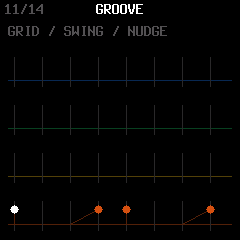

# Swing grid

## Controls

Hold HOME to open MENU. Turn SELECT to TIMING, then knob 1 SWING GRID:
**STEP** retains the existing per-track DIV behavior; **1/8** shuffles eighth
notes even on finer straight grids. Back on TRACKS, the amount knob reads
**SWING 8** in eighth mode. Set that knob to taste (0 straight,100 strongest).
The choice is a saved device preference, shared across tracks and songs.

For HALF TIME at 120 BPM, the hats previously stayed at 0/250/500/750ms at every
amount: all its hits are on even sixteenth indices. Eighth mode at 100 moves the
hats to 0/375/500/875ms. Quarter boundaries stay fixed. First-half subdivisions
lengthen and second-half subdivisions shorten; gates remain positive and events
stay ordered at maximum swing. It supports straight 1/8,1/16 and 1/32 tracks.
Quarter, triplet and longer divisions stay straight in eighth mode. Amount is
still the clamped sum of global and per-track swing; STEP timing is retained.
Live ARP retains its independent ARP 2 swing behavior.

Straight SLICER rates follow the same step lengths. Recording SNAP uses the
selected grid. Native groove/sequence auditions honor global swing; preview
micro offsets account for changing step widths. A separate three-bit preview
phase keeps an uneven-length groove in the transport's swing cycle across loops.
Eighth-mode early events, gate lengths and ratchets use their target step's width.
The GROOVE visualizer uses the same timing and absolute cycle phase; grid lines
are drawn first so shifted markers are not overwritten by later cell guides.

## Persistence and memory

Settings word bit 24 is the eighth-mode flag. Existing MerthSloop words have it
clear and retain STEP. Project and preset layouts do not change. This preference
must be migrated explicitly during upstream 2.7 integration; its settings word
uses conflicting bits (see UPSTREAM-2.7-INTEGRATION.md).

To fit the feature, each ROM groove keeps its seven masks in an aligned array
of uint16_t, uint32_t or uint64_t according to pattern length. Descriptors retain
names, stable IDs, length and division. A frozen hash from the old definitions
verifies all 24 entries. Tables shrink from 1536 to 736 bytes before small alignment
padding; the target mask accessor is 38 bytes. Ordinary drum-hit playback reads
already-applied steps and does no groove decoding. With swing and preview fixes,
the complete image is 581,360 bytes (204 free),200 bytes smaller than the custom
progression build. Static RAM is 82,116 bytes and pool 332,876, both unchanged.

## Verification

swing_grid_test.c covers legacy grid equivalence, exact boundaries at multiple
amounts and divisions, local/global amount sources, positive step lengths,
quarter alignment, odd loop phase, old/new settings and real menu controls.
It uses the actual mixer to check HALF TIME's moved hits and neutral/early/late
FEEL preview-versus-Apply parity for HALF TIME and 14-step SEVEN SKIP. Pixel tests
verify the drum markers at 0/50/100. SLICER tests compare both timing modes across
four playing tracks; the original groove, project, recording and arp tests remain.
Hardware audition is user testing.

| Timing preference | HALF TIME with eighth swing |
| --- | --- |
|  |  |
