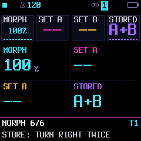

# Track sound snapshots and morphing

The native EDIT → MORPH page keeps two parameter states, A and B, for each
synth track. It is a performance tool for changing the sound of an existing
part while its notes keep playing. It does not capture or replace a sequence.

## Controls

- Knob 1 MORPH: 0% is A, 100% is B. Continuous parameters interpolate in their
  native control units; named choices switch at the midpoint.
- Knob 2 SET A: turn right twice to capture the current sound as A.
- Knob 3 SET B: turn right twice to capture the current sound as B.
- Column 4 STORED: EMPTY, A, B or A+B; read-only.

Capture A, edit the sound on the other pages, capture B, then turn MORPH.
Each track keeps its own pair when switching tracks or leaving the page.
Both endpoints are required before morphing. Capture and morph work during
playback and recording without disarming the track.

## Scope and lifetime

Captured controls are level, envelope and its modulation destinations/trim,
LFO and its destinations/sync, eight engine values, distortion/chorus/delay/reverb
sends, glide amount, pan, unison detune, track filter, insert and ANALOG filter type.
The canonical track descriptors classify common controls; in particular envelope
times remain numeric even when ENV SYNC displays a list of divisions. Engine
selectors are visited before their dependent fields, whose dynamic labels can
identify named controls such as the LOFI wave table or PHYS chord choice.

Pattern notes/ties/locks, timing, root/scale, transpose, chord/arp routing, mute,
voice mode and allocation are excluded. Global effects, live punch settings,
DRIFT/EVOLVE/SUSTAIN runtime settings, uploaded audio and edited FM6 operator
payloads are not duplicated. An engine's existing sample/patch selector is an
ordinary discrete engine control, using its existing loader/polling behavior.
This is parameter interpolation, not an audio crossfade between two engines;
discrete changes can be abrupt.

Loading a factory/user sound invalidates the pair. STOP and track selection do
not. Section SAVE persists A/B, readiness and manual blend alongside the current
sound; loading that section restores its pair. Working-project autosave also
checks A/B-only changes, after the existing stopped/idle gates. Queued live saves
remain RAM-only until STOP flushes them. DRIFT can animate the pair at runtime;
its runtime mode is not made persistent by this extension.

## Execution and locks

Manual capture/apply runs in the UI's existing IRQ exclusion, never in a sample loop.
Every explicit knob move computes
from immutable endpoints, so scrubbing back and forth does not accumulate rounding
error. Unchanged endpoints reproduce exact parameter values.

For a currently active parameter lock, capture reads its underlying base if the
instantaneous value is still the lock's value. Morph updates that base while
leaving the lock audible. Leaving the locked step restores the new morphed base.
A knob override follows the existing lock ownership test. Voice state, gates,
MIDI output, RNG and pattern memory are untouched by the operation.

## Space and validation

The pair uses 852 bytes for three tracks × two complete 71-value arrays, plus
24 bytes of per-track controls. Only the documented subset is applied. Target
alignment/global layout determines final occupied RAM.

To fund the feature, ANALOG's previously duplicated LP and BP/HP bodies now share
one out-of-line renderer. Its per-sample helpers remain inline. The target budget
now follows `analog_body` with the original 638 weighted-instruction allowance;
the measured shared loop scores 640 and has zero loop calls. The tiny dispatcher
is not treated as evidence of a speed improvement. Hardware deadline/stack
qualification remains required; host timings do not establish target cycles.

`tests/track_snapshot_test.c` exercises all engines at every morph position,
exact endpoints, dynamic/named controls, missing endpoints, locked bases,
voice/pattern/MIDI/RNG preservation, invalidation, isolation and native controls.
Audio goldens, engine/filter coverage, dual-core/timeout parity and the full UI
navigation/fuzz suite supplement these checks.

## Automatic DRIFT target

DRIFT TARGET MORPH shares DRONE's eight timed and eleven transport-synced cycles.
The manual position is the center; maximum amount permits approximately ±64 of
127 position units, clamped to A/B. The MORPH readout shows the effective position.
Synced cycles pause on STOP; timed cycles continue. Mid-cycle sync entry freezes
the current value until the next boundary. Each track retains its private RNG.

The mixer computes a temporary parameter overlay once per control block, using
its existing per-core preset-fade scratch buffer. It restores the base after
rendering, including sends and inserts. No extra static RAM is allocated. Active
locks override automatic motion; their saved bases remain unchanged. Saves retain
the base sound. A/B captures remain immutable, and no MIDI or gate events are emitted.
Manual and automatic morphing share snapshot.c's parameter and interpolation rules.

Automatic morph requires both captures. SAMPLE/GRAIN source, FM6 patch and PHYS
model must match between A/B and the current base, because those selections also
control allocation/loading outside rendering. Incompatible pairs show MATCH SOURCES.
Preset crossfade rendering takes precedence over the temporary overlay.

MORPH tracks whose A/B LFO rate or sync differs from the current base remain on
core 0, including target-change fades: worker prediction cannot anticipate their
global RNG wraps. Timing-stable morphs, including vowel-only changes, use the
ordinary worker eligibility rules. Unchanged overlay values skip descriptor and
lock lookup; equal endpoints skip interpolation division. Hardware deadline
qualification is still required. drift_morph_test covers overlay/lock/source rules,
all timing choices, private RNG and dispatch exclusion; mix_split_test adds synced
morph/LFO coverage across core masks, chaotic scheduling and worker timeout.

## Persistent A/B storage

The existing settings A/B sectors have an optional fork trailer at byte 2048.
No partition or upstream payload length changes: existing settings/SYN/MIDI
bytes retain their format, and samples and the SDK key/MAC sector are untouched.
The 1,348-byte bank contains a magic, four section records, one working record
and a CRC. Each record stores the associated project CRC, three readiness/blend
pairs and two signed-byte sets of the 43 captured controls per synth track.
Tests verify that the captured descriptor ranges fit signed bytes.

A settings write programs and verifies this trailer before publishing its
commit header. A failed write retains the previous complete settings copy and
retries. Project and settings commits are separate: if interrupted between them,
a project CRC mismatch discards stale captures instead of applying them to a
different sound. Missing trailers from upstream writes are treated as empty.
Upstream-format backups do not carry this fork trailer.

Section records occupy 1,072 bytes of pool RAM; staging reuses project scratch.
Startup literal packing now allows 5,500 bytes in main RAM (pool limit 2,500),
funding persistence without adding any audio-path decoding. Current .85 image:
584,268 bytes, 68 flash free; main 97,324/98,304, low 28,928/29,496, pool
335,424/344,064, leaving 448 bytes beyond the existing 8,192-byte pool reserve.

`snapshot_persistence_test.c` exercises cold restart, saved/queued sections,
A/B-only autosave, unchanged upstream prefix, trailer write/drop/corruption
failures, retry, absent trailers and mismatched project rejection. Hardware
power-cycle verification remains required.
