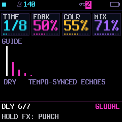
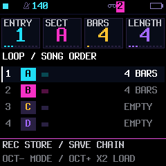
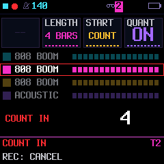
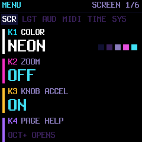
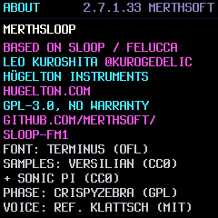
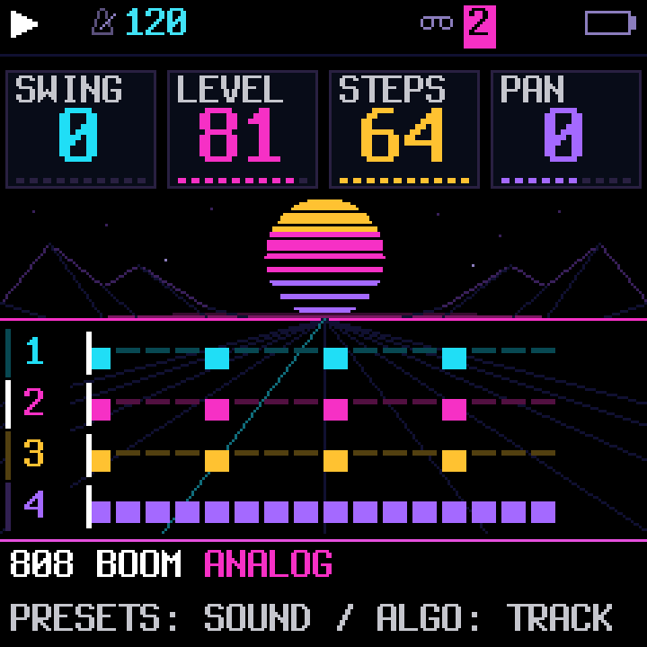

# MerthSloop firmware UI refresh

Status: the shared-layout consistency pass is implemented. Native knob cards,
NEON colors, four-track HOME, ordinary/held pages, SONG, recording, libraries,
contextual help and parameter guides are integrated. Engine-specific graphics
are deferred; ordinary engine pages show their parameter summary. The former
FM6 routing prototype is withdrawn at the user's request.

Current measured build: 575,160 image bytes (6,404 free), 81,592 main static
RAM bytes, 22,772 low-RAM bytes and 332,876 audio-pool bytes. The static-analysis
cleanup recovered 1,040 RAM bytes and 32 image bytes; the shared-layout consistency phase
recovered another 1,944 image bytes. The subsequent screen polish and octave-down
change add 160 image bytes. Explicit-save startup durability adds another 144
image bytes, with no RAM growth. The user reports the
preceding layout looks good on hardware; exact frame timing and LCD contention
remain unmeasured. Captures use the actual renderer on the host.

## Implemented screen gallery

These are real 240 × 240 framebuffer captures from `tests/ui_refresh_test.c`,
not generated concepts. The video tour uses the same firmware renderer and DSP.

| HOME | Envelope | Auto-wah |
| --- | --- | --- |
|  |  |  |

Hold HOME, open SCREEN and choose COLOR → NEON. Saved palettes are preserved;
fresh settings default to NEON. Existing user themes retain their colors and
light/dark background handling. PAGE HELP is the fourth SCREEN item: select it
with PRESETS and press OCT+. OCT− returns to the menu, following ABOUT's existing
navigation. Help describes the underlying page's knob controls.

The initial implementation uses one shared layout with palette-driven accents,
including HOME's striped sunset and wireframe mountains. NEON is an appended palette, not a new saved
style object. There is no alternate font, framebuffer or runtime asset decoder.
SONG and record-ready/count-in use the shared layout. Running free takes and
confirmation screens retain action-specific layouts; their gestures are unchanged.
Engine pages retain their large parameter summary; no algorithm diagrams are
currently shipped.

Vibrato/tremolo show modulation shape and live position, pan shows stereo position,
and wah shows a labeled sweep guide. The wah graph is not an audio analyzer or a
calibrated filter-response measurement. LFO pages use a fixed two-second guide
that follows free/synced rate, phase, polarity and fade. Delay spacing follows its
musical division, and destination pages show signed amounts. The DLY guide
starts at the top of the graph and reserves a full caption height, avoiding clipping
against the footer. A framebuffer test searches for its complete glyph stripe,
independent of its vertical position.

While playback runs, the sun gently fades between beats and returns to full
brightness on each beat. It reads the transport clock, so tempo changes and
external sync follow naturally; stopped restores the static scene. The existing
HOME cache includes the brightness step even when track positions are unchanged.
The pulse adds no persistent state or framebuffer. Compact equivalent card
borders and shorter hints offset most of its code: the pulse checkpoint was four image
bytes larger than the preceding engine/help checkpoint. Hardware redraw timing
remains unmeasured.

The HOME scene uses a round amber/magenta/violet striped sun and mirrored
wireframe mountains. The four track lanes share the remaining space without
changing their controls or note data. The richer scene adds 192 image bytes
compared with the initial refresh, without additional RAM or bitmap assets.

The implementation replaces the obsolete vertical track renderer and ring dials.
It does not retain a second whole UI. `ui_refresh_test.c` verifies incremental/full
redraw parity, all built-in palettes, drum-cell hashing, modulation state isolation
and help navigation. The existing UI suite exercises 20,000 random frames. Only seven visualizers
remain; see [their gallery](VISUALIZERS.md). Section saves now distinguish durable
stopped saves from queued live snapshots; see the player guide.
Hardware display latency, LCD contention and physical readability remain unmeasured
until an FM1 is available. Host tests are not a substitute for those measurements.

### Shared screen treatment

HOME places the engine name next to the preset, in the selected track color.
PRESETS is shown on the left and ALGORITHM on the right in help, matching the
physical controls. Footer/help hints describe actual hold gestures. Engine-page
help and the footer use the same visible page title.

SONG now has the same four cards at y26 as ordinary pages: ENTRY, SECT, BARS and
LENGTH. Section colors follow TE_COL/TE_DIM and the selected theme. Its rows fit
inside the 124-pixel graph band, with the action footer at y202. Save/load/record
controls are unchanged. Shared header messages replace the old separate white
message panel; SONG help describes the same four controls as the cards.

Record-ready and count-in use the shared transport header, cards at y26 and
footer at y202. Four track rows remain visible; disabled knobs show muted dashes.
Count-in keeps a large countdown value. A running free take keeps its large
seconds/bar estimate and four track rows, with the shared header/footer. The
recording state machine and knob/button handlers are unchanged.

The card primitive is shared by ordinary and specialized screens. All card
strips use one 44-pixel path; the obsolete 56-pixel bottom strip and message
suppression wrappers are removed. Confirmations, menus and visualizers retain
layouts suited to their actions, with the active palette and existing gestures.

| Song order | Record ready | Count-in |
| --- | --- | --- |
|  |  |  |

Tests cover dirty/full redraw parity across record/count-in/free-take transitions,
all built-in SONG palettes, maximum song length/bars, the complete DLY caption,
state isolation and the 20,000-frame interaction fuzz. Existing song-input tests
still verify independent order/section saving and stopped-only edits.

Engine-specific diagrams will return as a separately reviewed visual design,
after consistency and a measured space pass. They should replace redundant
summaries, read main-loop state only, and preserve the same card/footer geometry.

## Screen-by-screen polish

The [screen audit](UI-POLISH-AUDIT.md) records the families reviewed and deferred
ideas. Settings tabs fit the screen; custom theme names retain all five color
swatches. About gives the version a Merthsoft attribution and keeps complete,
spaced credits. The shared header separates the tape icon and track badge.
Parameter summaries preserve full values with adaptive type sizing, and signed
modulation bars stay within the guide at their extrema.

| Settings | About |
| --- | --- |
|  |  |

## Purpose

Make the FM1 easier to understand while playing. The screen should explain the
sound being edited, identify the target of each control, and make our fast
workflows discoverable. Borrow Skiff's coherent cards, contextual graphics and
help approach, while retaining MerthSloop's controls and upstream compatibility.

This is a native firmware project. Android can adopt the visual language later;
it does not need matching implementation or navigation.

## Decisions

- Keep four tracks, existing audio behavior, page families, parameter IDs and
  upstream project formats. Six tracks and a pattern-pool redesign are separate.
- Preserve every existing tap, hold and combination, including ARP latch,
  SEL scale lights, OCT editing brushes and our live modulation popups.
- Keep SELECT's current behavior. Do not introduce Skiff's HOME-as-SHIFT model.
- Four knob cards always run left to right in physical K1–K4 order.
- Use the existing Terminus font assets and strip renderer. No new font family,
  full-screen framebuffer, widget framework or per-page heap allocations.
- Ship one coherent layout first. Add one decorative style only after measuring
  its incremental cost. Keep upstream palettes and editor-created themes usable.
- Replace existing presentation code as pages migrate; avoid shipping two entire
  UIs behind a mode switch.

## Screen anatomy: 240 × 240

Use the current region geometry to limit integration risk:

| Region | Pixels | Content |
| --- | --- | --- |
| Header | y 0–19 | Transport, tempo, selected track, essential status |
| Gap | y 20–25 | Breathing room; no text |
| Knob cards | y 26–69 | Four 60-pixel columns, inset borders, label and value |
| Gap | y 70–73 | Separation |
| Main panel | y 74–197 | Page-specific graph, editor, list or workflow |
| Gap | y 198–201 | Separation |
| Footer | y 202–239 | Page identity/scope and one persistent action line |

The existing graph canvas is 240 × 124 pixels. Render the footer in strips if
needed. Do not expand the current canvas allocation.

Header priorities: transport/record, BPM, T1–T4, then USB/battery. CPU load must
remain available when USB is absent; retain its current display mechanism and
avoid adding a second conflicting readout. Track numbers accompany colors.
Do not imply battery charging from USB connection alone.

The footer's first row names the page, its visible family-relative position,
and scope: `ENV 1/2 · T2` or `DELAY · GLOBAL`. Engine/preset identity appears on
HOME and sound-browser views; long names use a dedicated panel row rather than
competing with all status text in the footer. Exact string widths must pass
pixel-width checks with the real font; the mockup uses shortened examples.

## Knob cards

Each card has a short label, a large value and an optional unit. Normalized
gauges show proportion; bipolar gauges have a center mark. Enumerations show
their text, not a fake continuous percentage. Off and zero remain distinguishable.

The card just changed receives a bright outline for about 600 ms. A held
modifier's cards stay outlined until release. Focus never hides another card's
value. Full labels and units can appear in a graph annotation when a card's
short label is ambiguous. No scrolling or rolling digits are required.

Inactive controls show an empty subdued card, with no gauge. A read-only value
uses a quieter label and no active outline. A control's function must never
change without its displayed label changing in the same UI update.

## Useful graphics

Graphs communicate settings and activity; decorative animation is secondary.
Mark a graphic `GUIDE` if it illustrates a setting rather than measured audio.
Never present an idealized filter curve as a measured frequency response.

| Page | Main panel |
| --- | --- |
| ENV | ADSR curve with the edited stage highlighted; synced durations use musical units |
| ENV DEST / LFO DEST | Four signed destination bars, names and zero line |
| LFO / LFO 2 | Wave preview using actual rate/sync/phase/fade settings; phase marker only where reliable state already exists |
| Track FILTER | LP/OFF/HP schematic, cutoff marker and explicit OFF state |
| ANALOG filter | Filter-type schematic with cutoff/resonance annotations |
| Delay | Dry hit plus diminishing echo marks; timing and feedback labeled |
| Reverb/chorus | Clearly separate the two effects; schematic tail or modulation guide tied to edited controls |
| INSERT | Type-specific compact guide where meaningful; parameter summary otherwise |
| VOICE | Voice mode, glide interval schematic and pan placement |
| SEL | Root and scale spelled correctly, scale guide and chord tones distinguished |
| ARP | Pattern/order guide; live activity only if available without logging extra audio events |
| PATTERN / RECORD | Timing grid, actual swing placement, recording snap and length |
| STEP | Existing piano roll with independent ties and held OCT tools preserved |
| GROOVE / SEQUENCES | Material identity, preview/apply state and compact generated-note/rhythm overview |
| HOME | Four-track activity overview plus existing visualizer access |

For engine pages, start with existing parameters: oscillator waveform on ANALOG,
algorithm diagram on FM6, sample/loop selection on SAMPLE. Do not add a costly
live waveform capture merely to fill an empty panel. A clear parameter summary
is preferable to an inaccurate animated diagram.

## Live vibrato, tremolo, wah and pan

Keep the current short-press pages and long-press popup gestures. The popup
identifies the affected track prominently; these are not master punch effects.

- Vibrato: pitch-center line and modulation trace; depth and Hz or division.
- Tremolo: amplitude contour; depth, floor/wave as currently supported, rate.
- Pan: L–C–R field and moving position using existing modulation state.
- Wah: filter-sweep range with base/depth markers. Envelope mode shows the
  existing envelope-follower value if safely exposed; otherwise a labeled range
  guide. LFO mode identifies its waveform and rate.
- Knob 4's sync selection remains explicit: `SYNC OFF`, `1/4`, `1/8T`, etc.
  Turning free-rate control follows current behavior; the UI does not invent a
  second rate model.

Show active/locked state and the existing copy-to-track-LFO action. Derive all
gesture text from the implemented input handler; do not invent new APPLY or
LOCK shortcuts. Release returns to the exact previous screen. Existing scale
LEDs continue to show the keyboard's scale while these popups are held.

## Editors and libraries

STEP keeps the piano roll, note identity, cursor and independently sustained
notes visible. While OCT is held, persistent labels replace the ordinary cards:
K1 tie/rest sweep, K2 note octave, K3 move, with direction/action exactly matching
the active handler. Never dismiss this help on a timer. Show current pitch and
movement delta without obscuring the destination. Whole-track transpose/shift
views retain their cumulative feedback and octave control.

The library footer always distinguishes `PREVIEW`, `STOP PREVIEW`, `APPLY`,
`REPLACE` and `MERGE` where supported. An active preview indicator survives page
changes. The selected editing subpage is named plainly—GROOVE and RHYTHM must
not look interchangeable. Replacement confirmation remains visible throughout
the existing OCT+ hold. A count such as `03/24` means library selection, while
`1/3` in the page footer means visible pages; do not place them ambiguously.

The progression editor shows its chord list and chosen length. Root, scale,
rhythm, octave and voice leading remain accessible on their current pages.
No change to generated notes or apply/merge semantics is part of this refresh.

## Contextual help without another modifier

Add a compact control-reference view under the existing HOME menu's display/help
area; final menu placement follows an inventory of the current menu. It opens
help for the page that was visible before the menu, and returns there on exit.
It does not repurpose HOME hold or require stopping transport.

Help shows K1–K4, SELECT, PRESETS, ALGORITHM, OCT actions and relevant button
combinations for that page. Page metadata provides labels where available;
specialized workflows provide a short static table. Do not duplicate the input
state machine in a separate help engine.

Ordinary pages retain a single useful hint. Active modifier instructions and
destructive-action prompts take priority over optional general hints. Never
show a key map suggesting scale remapping where keys only act as a scale guide.

## Visual identity and themes

**MERTH** is the default presentation: true black background, dark neutral cards,
bright values, restrained track-colored accents and sharp readable diagrams.
Selected controls use an outline; held notes, cursors and playheads use distinct
shapes rather than relying on color alone. Muted tracks have an explicit mark.

**NEON** is the first optional style candidate: the same geometry, font and graphs,
with violet/cyan accents, segmented gauges and a sparse horizon on HOME. No
per-pixel glow pass, additional font, constant star field or decorative animation
on editing pages. Derive accents from the active palette so user themes work.

Existing MONO/high-contrast and user palettes remain available. A light custom
theme must produce legible backgrounds, outlines and inverse text. Decorative
style and palette are separate concepts; avoid rewriting upstream's serialized
theme structure to store style. A future style choice may use a validated,
versioned MerthSloop settings-extension field after a field/allocation audit.
Absent, unknown or corrupt style values fall back to MERTH. Phase one needs no
new saved setting because it replaces the layout for every palette.

CRYPT/QUARK-like full widget sets are inspiration, not initial deliverables.
Importing Skiff source/assets requires preserving attribution and checking each
asset's license. No bulk font or artwork import is assumed by this design.

## Implementation boundaries

Extend `ui_draw.c`, `ui_graph.c` and the existing `gfx.c` primitives. Use a small
shared card renderer and a few semantic colors; keep `page_t` and existing
parameter descriptors authoritative. Add compact graph kinds only when needed.
Specialized library and modulation views keep their own content renderers.

Rendering stays in the main/UI loop. Read bounded existing state; no LCD calls,
locks, formatting, floating-point analysis or added event logging in audio ISRs.
Shared snapshots must follow current concurrency conventions. Every animated
region's invalidation includes its time bucket/state; unchanged cards and lists
do not repaint. Graphs may update at up to 20 Hz; menus/static pages redraw only
on change. Reduce decoration before reducing input responsiveness.

## Budgets and release gates

The current raw-sample build has 2,900 bytes of application flash free. These are
design limits, not measured claims that the refresh fits:

- Initial target: at most +1 KiB net flash for the shared layout/cards; recover
  equivalent space by replacing old drawing paths before adding graph families.
- Keep at least 2 KiB application flash free in the final measured build. Stop
  and re-scope if a phase exceeds this, rather than silently trimming features.
- At most +512 bytes persistent UI RAM for phase one, no framebuffer growth and
  no extra per-voice/per-sample state. Optional style assets have a separate budget.
- Preserve the current audio-pool reserve requirement (at least 8 KiB).
- Aim for visible knob feedback within 50 ms and never beyond 100 ms in the
  agreed stress scene; measure on hardware, not just browser frame rates.
- No missed audio deadlines or changed audio hashes. CPU/DMA contention must be
  measured with multiple sample tracks, GRAIN and drums, with USB on and off.

Before/after reports include image bytes, static RAM, pool usage, UI frame time,
worst audio load and deadline misses. A passing size build alone is insufficient.

## Delivery sequence

1. Capture current representative screens and controls. Record target size and
   performance baseline. Prototype cards/footer in the emulator using real fonts.
2. Replace shared cards and scope/page footer; preserve all existing graph areas.
   Validate every page family, engine, drum track and held combination.
3. Upgrade ENV/LFO/filter and live modulation panels, then timing/library views.
   Land one family at a time with size and audio checks.
4. Add contextual help using existing menu navigation. Audit strings against
   handlers and documented gestures.
5. Measure NEON's incremental cost. Ship only if budgets hold; otherwise keep it
   as a documented later option. Expand engine graphics after these gates pass.
6. Update README/player guide with fresh emulator captures of shipped screens.
   Keep concept art explicitly separate from actual feature screenshots.

Each phase is independently reviewable. No release/version increment, firmware
installation or audio-engine change is requested by this design document.

## Validation that earns its keep

- Real-font layout checks cover longest enum/value/unit combinations, negative
  values, triplets, long preset names and all themes. Fail on clipped essential
  text or drawing outside the assigned region.
- Navigation regression exercises filtered/hidden pages so displayed page counts
  match reachable pages on synth and drum tracks.
- State-transition tests verify held OCT help persists, popup release restores
  the prior page, preview survives navigation and scale LEDs remain unchanged.
- Rendering cases cover overlapping note ties, swing, merge/replacement prompts,
  envelope/free/synced modulation, muted tracks and custom light palettes.
- Existing audio goldens and threaded tests guard against accidental audio changes.
  Emulator captures verify layout; hardware validates legibility, input latency,
  LCD contention and playing under load. Do not claim those hardware gates passed
  until they have actually been run.

## References

- [Skiff design](https://github.com/illuminus5/skiff/blob/main/DESIGN.md)
- [Skiff UI source](https://github.com/illuminus5/skiff/blob/main/firmware/src/ui.c)
- [Current MerthSloop feature guide](MERTHSOFT-FEATURES.md)
- [Current measured firmware budgets](OPTIMIZATION.md)

## HOME scene accents

Eight fixed stars add a sparse sky; two brighten in turn every two beats.
The horizon glow follows the existing sun pulse, and one wireframe spoke advances
on beats during playback. Stopped restores a fixed scene. These read the existing
transport clock and HOME redraw cache, with no new timer, RNG, framebuffer or
persistent animation state. Track numbers and note marks remain intact; the scene is visible between notes.

The scene alone adds 256 B flash versus the metadata-packing build. The combined
scene and empty-step move correction uses 582,980 / 584,336 B (1,356 B free),
with unchanged static RAM. UI refresh tests verify card/footer isolation,
full/incremental redraw parity, stopped stability and unchanged global RNG.
The full UI navigation and 20,000-frame fuzz also pass. The follow-up removes
opaque gray lane fills, retaining black number badges, so the traveling grid
remains visible within the lanes. Tests now explicitly check number/note
foreground invariance and changing background pixels in those exposed areas.
Hardware rendering cost
has not been measured.
