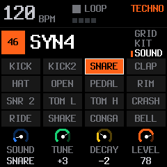

# Upstream 2.7.1 integration

## Integrated result

Fresh production-UI framebuffer capture of the added SOUND page.

MerthSloop 2.7.1.19 merges upstream `4ec1ac8`. Native grooves and custom sequences,
independent note editing, eighth swing, held modulation, visualizers and Android
extensions remain. Upstream adds dual-core audio and safe timeout fallback, drum
tune/decay, sample held loops/tails, QUANT OFF/overdub continuations, arp modes,
keyboard HOLD, favorites, themes, knob acceleration, MIDI remote/clock controls,
and expanded web LIVE/song tools.

Canonical upstream FUN6 files round-trip byte-for-byte through import, apply and
save. The fixture in `tests/fixtures/upstream271.fun6` was generated by compiling
`upstream271_project.c` against untouched upstream source at `4ec1ac8`, including
its original drum-table generator. It exercises arp IDs, all four continuation
bits, drum tune/decay, nudges, locks and fills. No old-fork migration was added.

Settings retain upstream's word and 80-byte side-record prefix. An eight-byte
MRS1 extension stores scale lights, incoming MIDI scale mapping, eighth swing and
fork-only visualizers. Save change detection includes those extension flags.
DSYN 72–76 and LIVE 77 retain upstream IDs; fork commands move to 85–89 under INFO protocol 15.
Android validates upstream continuation flags and held-loop slot metadata.

The scratch/history/undo section is explicitly inside zeroed ordinary RAM, with
checked bounds, separate from core 1 code, stacks and low-RAM renderer buffers.
Lossless factory ROM packing fits the combined feature set; see
[optimization measurements](OPTIMIZATION.md). It changes neither sample-slot nor
song formats. Each voice/grain owns its cache, avoiding cross-core mutable state.

Verification includes 182 audio renders identical to the uncompressed build,
every factory byte plus 100,000 random reads, upstream file conformance, threaded
render splits with chaos/timeouts, native UI/audio/protocol regressions, browser
audio parity and 31 Android domain runners. Android UI sources also typecheck against
the installed Android reference assemblies. The ARM64 APK builds successfully using matched project-local workload manifests. Physical dual-core,
USB and flash/update testing remains to be done on hardware.

## Repository state

Local main and origin/main are fast-forwarded to upstream/main at
`4ec1ac829fd2bdf2c571ea215fb3d62477d01220` (SLOOP 2.7.1).
The preceding shared upstream checkpoint was `8fad1a1`. Three new upstream commits
cover installer/editor port discovery, the 2.7 feature release and its second-core
hold/crash fix. Main is a clean upstream mirror. The integration is on merthsloop.

Source references: [2.7 feature commit](https://github.com/isod89/sloop-fm1/commit/ba54ba5),
[2.7.1 core-hold fix](https://github.com/isod89/sloop-fm1/commit/4ec1ac8),
[upstream source](https://github.com/isod89/sloop-fm1/tree/4ec1ac829fd2bdf2c571ea215fb3d62477d01220).

## Recommended scope

Most user-facing additions are useful. Integrate the release in tested stages,
retaining our native/Android workflows and choosing one implementation for overlaps.

| Area | Recommendation | Integration work |
| --- | --- | --- |
| UI_SMALL size annotations | Bring in early | It is clang minsize on cold UI/storage functions; measure on our toolchain and keep audio helpers outside it. |
| Core startup/hold and diagnostics | Take 2.7.1, not the earlier 2.7 core-hold path | Dual-core must include power, guard, stack, timeout and loader/reboot handling together. |
| Dual-core audio and low RAM | High value; separate integration stage | Retain live wah/pan/vibrato/tremolo, USB return, voice telemetry and our guarded flash-driver scratch. |
| Existing PR111 RAM reductions | Reconcile, do not duplicate | We already have nibble routing, DRAWBAR arena, XIP preset banks and shared main-loop/OTA scratch. |
| Drum tune/decay and stronger synth kicks | Take | Preserve groove/SHAPE pages, preview, per-song/section settings and reset behavior. Review intended audio golden changes. |
| Sample loop/loop-tail support | Take | Carry loop metadata and playback through firmware, web and Android's sampler/protocol; retain our simple recording/chopping workflow. |
| QUANT OFF and recording over held notes | Take after continuation-format reconciliation | Complements our independent editing and separate recording SNAP; these controls have different purposes. |
| New arp modes, stopped swing, KBD HOLD | Combine | Adopt upstream mode values; retain expressive velocity, sequencer-fed ARP, modifier toggles and held ARP/SEL latch gestures. |
| MIDI FX/REMOTE/DR MAP/CLOCK OUT and engine CC74 | Take | Keep USB/TRS ownership, generic MIDI mode and app capabilities; stop/disconnect/panic tests must cover remote-held buttons. |
| Favorites, knob acceleration option, level/pan glide | Take | Keep instrument browsing's effect/LEGATO preferences and easy reset; preserve scale/piano handoff LEDs. |
| Themes and USB RATE | Take | Use upstream settings plus a fork extension; keep current palettes/assets and MerthSloop branding. USB duplex/resampling/OTA tests are required. |
| Expanded web LIVE/editor/song files/playlist | Take | Retain installer identity, Pages workflow, local audio preview and our protocol extensions. Native Android stays supported. |
| SAVE SECTION terminology | Adapt carefully | Native A-D sections already coexist with our song library and undo-load recovery; do not remove those workflows. |

## Compatibility gates

Upstream compatibility is the user's priority. Existing MerthSloop songs,
exports and settings do not require backward compatibility or migration.
Use upstream's representation as canonical; retain fork features around it.

### Continuation flags

Our `SF_TIE(k)` occupies bits 2–5; upstream `SF_CONT(k)` occupies bits3–6 and
reserves bit2 for the user-preset pattern's legacy TIE marker. Both use FUN6,
so untagged saved notes with overlapping bits cannot be identified by magic alone.
Adopt upstream's flags and FUN6 interpretation without an old-fork migration layer.
Update our selected-voice length/delete controls, slot metadata compaction,
full-pattern undo, Android library and web extensions to that representation.
Verify upstream files round-trip without changing their note semantics.

### Arp mode IDs

The first six modes match. Our indices6+ begin OUTIN/SHUF/ROOTALT; upstream's
begin REPEAT/DNUP/UP+8. Even common names such as WALK have different indices.
Adopt upstream's numeric meanings. Append useful fork-only modes without
renumbering upstream modes, and update Android enum negotiation and web descriptors.
Old MerthSloop mode numbers do not need migration.

### Settings word

Our word uses visualizer bits17–21, scale lights22, MIDI-scale23, eighth swing24,
channel routing26–30 and a format marker31. Upstream uses channel routing21–25,
core-off26, acceleration27, USB rate28–29, theme30 and quant-off31.
Adopt upstream's word layout and side-record behavior. Store fork-only preferences
in a separate extension without consuming upstream-owned bits. No old-fork decoder
is required. Test upstream and new settings, samples, kits, favorites and calibration;
do not treat permission to break old-fork saves as permission to erase device storage.

### Memory and audio ownership

Upstream's .lowram covers SRAM we already partly use under a flash-driver reserve.
Rebuild one linker map with disjoint regions and checked stacks; reported memory
savings from the two branches cannot be added. Audit every fork modulation state,
random generator and UI note-telemetry buffer across the split render. Keep host
one-core/threaded/delayed/timeout equivalence tests and the 2.7.1 safe-hold fix.
Hardware checks should include worst-case audio, USB duplex, flash saves, OTA,
reboot and timeout fallback before claiming target performance.

## Original integration plan (completed except physical validation)

1. Commit the verified local tie-display, custom-progression and eighth-swing work.
2. Establish size controls and settings/project/arp compatibility tests.
3. Integrate musical, recording, sample, drum, MIDI and UI features in reviewable groups.
4. Reconcile the memory map and dual-core renderer with 2.7.1 recovery behavior.
5. Integrate the web editor and update Android capabilities/controls where needed.
6. Run the combined native, browser, protocol and firmware-budget checks, then
   hardware validation and a newly branded installer package.

The integrated package is MerthSloop 2.7.1.19, continuing the independent build
counter. Demo-generation tools remain outside the release commit, as requested.
Fork-only device preferences remain local when importing upstream settings; the
standard upstream backup does not transfer the MRS1 side-record extension.
