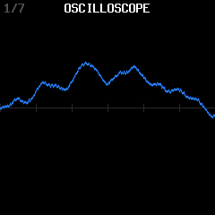
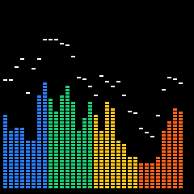
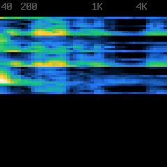
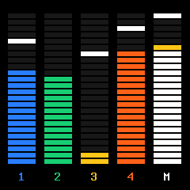

# FM1 visualizers

MerthSloop provides seven styles: four retained upstream analyzers and three
fork additions. On TRACKS, tap HOME to open, turn SELECT to cycle in either
direction, and tap HOME or a page button to close. Keys, PLAY and REC still work;
a held performance layer temporarily shows its controls. Knobs 1–4 do not edit
the hidden TRACKS page; hold GLO and turn SELECT for tempo.

| # | Style | Framebuffer capture | What it shows |
| --- | --- | --- | --- |
| 1 | Oscilloscope |  | Mix waveform. |
| 2 | Spectrum |  | 32 frequency bands and falling caps. |
| 3 | Spectrogram |  | Scrolling frequency history. |
| 4 | VU Meters |  | Four tracks and master, with peak holds. |
| 5 | Note Trails |  | Played/held synth pitches and drum lanes; delay tails excluded. |
| 6 | Groove |  | Grid, swing, microtiming, levels and ratchets. |
| 7 | Song Journey |  | Song order or quick chain, active entry and bars remaining; READY when idle. |

The selector shows 1/7 through 7/7. Selection persists with settings, deferred
until stopped. Retained styles preserve their historical on-disk IDs even though
the menu is compact; removed/unknown IDs fall back to Oscilloscope. The canonical
upstream word keeps upstream analyzer IDs; fork-only modes use the side record.

## Rendering and verification

The screenshots are fresh 240×240 host captures of the actual production
renderer in `tests/ui_pages_test.c`, using a four-track fixture with chords,
drums, locks and microtiming. They are not camera photos. The waveform is
captured before MASTER attenuation, so turning MASTER to zero does not freeze it.
Rendering uses existing audio snapshots in the main loop; this is not a claim
of zero UI processing cost or measured hardware timing.

Tests cover all seven styles, forward/backward wrapping, old and current saved
IDs, removed-ID fallback, shared waveform/trail storage, MASTER-at-zero,
hidden-knob isolation, held layers and 20,000 random UI frames. The obsolete
renderers and their animation/history state are removed from the firmware.

## Note Trails capture and contrast

Trails capture synth note attacks between display updates, as well as held
voices. Released voices and delay tails do not extend note strokes. The master
punch GATE effect cuts the current synth/drum column during its fully wet closed
phase; partially wet gate retains the audible dry path. Attacks consumed while
closed are not replayed when it opens. This follows display-frame timing, not
sample-level audio analysis. Attack bits accumulate across the skipped UI frame and are consumed once,
so short notes and voice stealing do not erase a hit before it appears. All MIDI
pitches 0–127 are included; muted/solo-excluded parts are suppressed. The three
synth colors occupy offset stripes so coincident pitches remain visible. Each
stroke spans a full time column, so held chords form continuous lines without
artificial gaps; this is checked pixel by pixel for all three synth tracks. The live
cursor sits outside those stripes. Drum hits use white on black for high contrast.
Histories still clear when entering the style and share bounded scratch storage.
