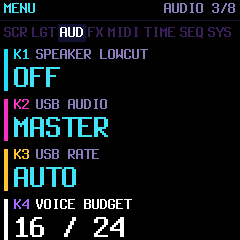

# Shared voice budget and drone recovery

**Current normal build:** .77 restores the standard About credits while retaining
the 95% wall-time guard, automatic eligible-part core balancing and saved
24–48-unit budget selector. `--audio-diag` now controls only the optional counter
screen; audio policy is independent of it. Historical configurations/captures
below describe the investigation, not a requirement to run a diagnostic build.
The reported five-drone/DRIFT workload is audibly clean; its residual DMA misses
remain unresolved, so full device deadline qualification is still pending.

## Controls

Hold **HOME**, turn **SELECT** to **AUDIO**, then use **knob 4 — VOICE BUDGET**:

| Setting | Shared admission | Normal engines | LOFI / WHEEL |
| --- | --- | --- | --- |
| **8 / 12** | 24 units; factory default | up to 8 voices | up to 12 voices |
| **10 / 15** | 30 units; experimental | up to 10 voices | up to 15 voices |
| **12 / 18** | 36 units; experimental | up to 12 voices | up to 18 voices |
| **14 / 21** | 42 units; experimental | up to 14 voices | up to 21 voices |
| **16 / 24** | 48 units; experimental | up to 16 voices | up to 24 voices |

Normal voices cost three units; LOFI/WHEEL cost two. Mixed populations share
the same total. These are shared limits, not per-track polyphony settings.
Physical slots remain eight per synth track; GRAIN remains three, VOICE four,
FM6 eight, and other engine-specific caps remain intact. Drums are separate.
Released and sustained tails still count until they end or enter steal-fade.
Lowering the setting does not panic existing notes; subsequent new admissions
use the lower limit. CPU overload shedding remains enabled at every setting.

Turn right/left to step through the five settings, stopping at the ends. OCT+
cycles through them. Higher admission allows more notes but does not reduce the
CPU cost of rendering them. Try 12 / 18 for the GRAIN/VOICE/LOFI scene;
raise further if tails or additional drone pitches still cause stealing.

This setting is saved with device preferences when the HOME menu closes.
During playback, the write waits until transport stops. Fork-side settings
bits 5–7 store the level without changing upstream project/settings fields,
presets or application protocol IDs. Older records default to 8 / 12; invalid
levels clamp to 16 / 24. The existing verified commit/retry path is reused.

## Reproduced problem

With three GRAIN notes, four VOICE notes and three LOFI drone notes, demand is
`3×3 + 4×3 + 3×2 = 27` units. The original 24-unit policy necessarily steals
notes even with spare CPU. A running two-part sequencer plus drums reproduces
missing sequenced and drone notes identically with Vinyl OFF or ON, with zero
host CPU-shedding calls. The 30-unit setting admits the complete scene.

The device CPU display is a smoothed render-load estimate. Admission is a
separate limit; the display also cannot prove that no short deadline peak occurs.
The larger setting is available for hardware evaluation, not a claim that every
patch/FX/USB combination meets its deadline.

## Recovery behavior

Audio-owned pending-pitch flags remember a stolen native drone note independently
of its former voice slot. Both cross-track fade-steals and same-track in-place
replacement are covered. Fresh attacks supersede pending generations of the same
pitch. A bounded 384-byte map covers all MIDI pitches on all three synth tracks.

After a quarter-second without another steal, recovery can restart **one** still
latched POLY drone pitch per control block. It requires an inactive slot inside
the current engine cap and enough admission units. It never steals a note to
recover another. Muted tracks, sound transitions and non-POLY modes do not recover.
Each new steal resets the cooldown, including overload shedding. Normal source
removal, STOP, panic and engine adoption prevent stale recovery. Naturally ended
one-shots have no steal marker and do not become automatic repeats.

Recovery restarts the local instrument's attack at the native drone's velocity
100. It does not resume an oscillator/sample at its former position. It bypasses
input/MIDI/recording producers: no new MIDI note-on/off, new recorded gate or
logical latch owner is generated. Native captured pitches/channels remain intact.

Overload and admission now share bass/lead protection and victim categories:
quiet released voices first for overload, then extra UNISON voices before eligible
held POLY voices. Existing fades and overload triggering remain intact.

## Size and verification

The normal target is **584,296 / 584,336 B**, leaving **40 B flash**. Main static
RAM is **90,336 / 98,304 B** (7,968 B free); low RAM remains **28,928 / 29,496 B**
and audio pool **331,852 / 344,064 B**, including the unchanged 8,192-byte pool
reserve. Compared with the pre-experiment build: +92 B flash and +400 B main RAM.
No additional physical voice slots, sample decoder or audio history buffer.

Space comes partly from the prior audit's ordered native clamp. Its two signed
min/max instructions live in `firmware/hal/fm1_math.h`; only compile-time ordered
bounds use them. Dynamic/inverted bounds retain the original C contract; host
and WASM builds retain portable C. Early-clobber prevents operand aliasing. The
maintained target test compiles the real helper and interprets the emitted
register operations against boundary/random signed inputs. This is instruction
verification, not device execution or timing qualification.

`tests/drone_recovery_test.c` covers the actual GRAIN/VOICE/LOFI scene with drums,
Vinyl parity, exact heavy/cheap boundaries at all five settings, live budget changes, no-steal recovery,
cooldown, same-track reuse, superseded attacks, STOP/removal, natural sample ends,
unchanged outgoing MIDI and the native menu. The maintained suite also retains
portable clamp contracts, allocation, sustain, sequencing ownership, multi-core
and timeout parity, audio goldens, UI fuzz and target DSP checks. Hardware CPU
peaks, deadline counters, stack high-water and listening remain to be evaluated.

## On-device dropout diagnostics

The historical local .75 package was built with `--audio-diag` (`FELUCCA_AUDIO_DIAG=1`).
This temporarily replaces ABOUT credits with a compact snapshot. It also trials
95% wall-time shedding and automatic synth-work selection for core 1. Normal
builds retain the original 85% threshold, fixed track-3/drums split and credits
until the trial has been qualified and its normal-release space is addressed.
Admission, recovery timing, patch settings and saved formats are unchanged.
The browser preview uses the normal configuration.

1. Install .75, restart, and select HOME → AUDIO → VOICE BUDGET → 16 / 24.
2. Open HOME → SYSTEM → ABOUT: select ABOUT with PRESETS and press OCT+.
3. Record the baseline LATE and SHEDS values. Return with OCT- and reproduce the
   five-note drone workload alongside the GRAIN/VOICE/drum tracks.
4. Open ABOUT **while playback continues**. OCT+ refreshes; OCT- returns. Record
   SHEDS, RESTORE, MAX US, LATE and C1MASK after several minutes, without rebooting.

| Field | Meaning |
| --- | --- |
| STEALS | Total explicitly stolen voices, including per-track replacement and CPU shedding |
| SHEDS | Subset of STEALS requested by the hardware overload protection |
| RESTORE | Native drone voices restarted through stolen-note recovery |
| MAX US | Maximum full-half render wall time, including nested timer work |
| LATE | Existing DMA deadline misses since boot |
| C1MASK | Last dispatched core-1 unit mask: 9 = synth 1 + drums, 10 = synth 2 + drums, 12 = synth 3 + drums, 8 = drums only, 0 = no worker job |

The earlier .73/.74 snapshots also showed current gates/latches, units and core
state/timeouts. Those rows were replaced by the compact list to fund this trial;
original captures below retain their historical field names. C1MASK is a live
last-block observation, not a maximum or a log. After stopping it may return to
12 because idle estimates tie. Capture it while the heavy tracks are sounding.

At 44.1 kHz one half is about 5,805 microseconds. Normal protection requests
shedding after two consecutive halves above 85%; this diagnostic trial uses 95%
(about 5,514 microseconds). The CPU percentage smooths render-only time and
excludes nested timer work. Compare counters on the same boot; a nonzero startup
LATE count alone does not establish misses during the workload.

The diagnostic target measures **584,316 / 584,336 B** (20 B free), main static
**90,368 / 98,304 B** (7,936 B free), low RAM **28,928 / 29,496 B**, pool
**331,852 / 344,064 B** with its existing 8,192-byte reserve. A normal .75 build
also passes: 584,300 B (36 B free), main static 90,336 B. The local installer
contains the diagnostic configuration. No musical features or voice slots were
removed; credit rendering is temporarily replaced in diagnostic builds only.

## Hardware capture and threshold trial

The .73 device captures showed:

| Boot-cumulative field | Before | After reproduction |
| --- | ---: | ---: |
| Selected admission limit | 48 | 48 |
| STEALS | 0 | 31 |
| CPU SHEDS | 0 | 20 |
| RESTORES | 0 | 10 |
| PEAK WALL US | 4,011 | 5,373 |
| LATE HALVES | 7 | 7 |
| CPU1 STATE/ERR | 3 / 0 | 3 / 0 |

This confirms CPU shedding occurred, despite no additional recorded DMA misses.
The peak is about 92.6% of one half: above the original 85% guard, below the
actual deadline. Ten drone recoveries confirm the stolen-note restart path ran.
The other eleven steals are not classified by this capture; per-track engine
caps/replacement can still apply. Both photographs were silent snapshots, so
the zero gate/latch counts do not establish the active population during playback.

The .74 diagnostic build changes only the guard's threshold to 95%, retaining
its two-consecutive-half rule and victim selection. Normal builds still use 85%.
It does not turn overload protection off. The remaining nominal margin is about
290 microseconds at the trial threshold; hardware qualification remains pending.
Compare baseline and post-reproduction counters on the same boot. A stable
LATE HALVES count and reduced CPU SHEDS/RESTORES, together with listening, are
the acceptance criteria for this workload. If late counts or audible glitches
increase, revert the threshold trial and address render cost rather than
continuing to raise it. Existing startup late counts must not be confused with
new misses during reproduction.

`tests/audio_shed_timing_test.c` runs the real audio ISR/mixer with injected
hardware time/DMA readings: the reported peak sheds under the original guard
and not under the trial; exact thresholds, consecutive versus isolated spikes,
nested timer time, real voice eviction and deadline counters are covered. The
trial also passes UBSan. These are logic tests, not device timing measurements.
The .74 diagnostic target remains 584,264 B (72 B free), with unchanged RAM.

## Core-balancing trial after the longer hardware run

The .74 follow-up rose from 9 to 17 LATE on the same boot, with 2 CPU sheds and a
6,039-us wall-time peak. Thus a later guard alone did not qualify the workload:
the measured peak exceeded the half-buffer deadline and new misses accumulated.

The historical automatic split always assigned synth part 3 plus drums to core 1.
With GRAIN and VOICE on parts 1 and 2 and LOFI drones on part 3, both expensive
synth parts remained on core 0 alongside the master FX buses. The .75 diagnostic
trial instead chooses the estimated heaviest **eligible** synth part plus drums.
Weights are intentionally small relative estimates, not measured cycle costs:
GRAIN/FM6 6, PHYS 5, PHASE/VOICE/TRIO/WHEEL 3, LOFI 1, remaining engines 2.
The score is weight times the preceding block's rendered-voice count, including
released/fading voices. The mixer already computes this count; a bounded 12-byte
per-part cache reuses it without rescanning voices. Selection reacts one block
after a population change. The measured diagnostic main-RAM increase is 32 B
including cache, last-mask observation and layout effects; normal builds do not
include the trial cache.

LFO-wrap/global-RNG, PHYS layout/model and multiple-FORMANT shared-noise exclusions
still take precedence. Selection chooses a runner-up if the heaviest part is
ineligible; equal scores retain the historical last-part preference. Explicit
manual masks, one-core operation and worker-timeout fallback are unchanged.
The barrier already used to join each worker job precedes the next cache read;
each render writes only its own part's cell. Master FX buses remain on core 0.
The heuristic does not profile actual patch/insert cost or promise optimal balance.

`tests/auto_split_test.c` covers selection for the reported population, release
tails, idle ties, manual masks and safety exclusions. `tests/mix_split_test.c`
adds GRAIN/VOICE/five LOFI drones with DRIFT, drums and Vinyl, plus explicit masks
9 and 10. Eight scenes across thirteen splits match unsplit audio, including
chaotic two-core scheduling and forced worker timeout. All 200 audio goldens,
allocation/recovery/sustain checks, UI fuzz and focused sanitizer checks pass.
After isolating the trial behind its build flag, quick split matrices separately
cover normal and diagnostic configurations. These checks establish behavior
parity; the new split still requires the same-boot hardware deadline/listening
comparison described above.

## Core-balancing hardware follow-up

The user tested .75 with the same sequenced GRAIN/VOICE and LOFI drone setup and
reported **no audible drone dropouts**, explicitly confirming DRIFT was ON.
The maintained five-drone split-parity scene also enables DRIFT.
The supplied same-boot baseline and
follow-up captures show:

| Field | Baseline | Follow-up |
| --- | ---: | ---: |
| STEALS | 0 | 289 |
| SHEDS | 0 | 1 |
| RESTORE | 0 | 0 |
| MAX US | 4,066 | 5,856 |
| LATE | 19 | 26 |
| C1MASK | 12 | 10 |

C1MASK 10 means synth part 2 plus drums at the instant captured; selection can
change as parts' rendered populations change. The 288 non-CPU steals are not
classified by this capture; in-place per-track replacements also increment that
counter, so it is not a count of audible dropouts. No native stolen-drone recovery
occurred in this run. The audible symptom is resolved for this reported workload,
but seven additional DMA misses and a peak just over the approximately 5,805-us
half deadline mean timing qualification remains incomplete. Run durations were
not supplied, so this does not establish an improvement in the rate of deadline
misses versus .74. Keep this distinction when deciding whether to promote the
trial's split and guard into a normal build. Further work should reduce render
peaks or improve scheduling rather than increase the shedding threshold again.

## About restored and audio settings retained

Normal .76 restores the original credit text, layout, colors, version/author and
hardware/core information. Credit rows share a single drawing loop. The audio
policy no longer depends on `FELUCCA_AUDIO_DIAG`: both normal and optional counter
builds retain automatic balancing and the 95% two-half threshold. Admission still
resets to 24 units at power-on; the persistent-budget recommendation is not yet
implemented. Engine caps, overload protection and recovery timing remain intact.

This build also adds EVOLVE octave bounds. Sharing cold runtime-field metadata
and keeping the keyboard/evolution event handlers as explicit functions funds the
controls and restored About without sound/asset cuts or startup decoding changes.
The full normal target is **584,296 / 584,336 B** (40 B free), main static
**90,336 / 98,304 B** (7,968 B free), low RAM **28,928 / 29,496 B**, pool
**331,852 / 344,064 B** with the existing reserve. Treat these as combined linked
totals, not sums of earlier isolated experiments. Event-helper call boundaries
are outside per-sample engine loops; DSP/ownership/golden and target checks still
apply. Hardware deadline qualification remains incomplete.

## LOFI-triggered Flute Dust chord loss (.86 → .87)

Device .86 counters before/after enabling master LOFI were STEALS 31→56,
SHEDS 3→12, RESTORE 0→0, MAX US 5933→6159, LATE 6→12, C1MASK 12→12.
All LOFI types trigger the reported thinning and OFF restores the sound.
The nine new CPU sheds confirm intentional voice cuts during this interval;
the remaining steal delta is not independently diagnosed. Run duration and
baseline counter history are unknown, so these are not event rates.

Mask 12 places synth track 3 and drums on the worker. The previous scheduler
always coupled drums to its chosen synth. With one heavy GRAIN track, that
serializes both sources while core 0 has no synth work to overlap. The .87
scheduler retains the heaviest eligible synth choice, sums all estimated synth
work including ineligible parts and assigns drums to the lighter synth workload.
Idle ties retain the historical preference. Manual masks and RNG/LFO/PHYS/MORPH
exclusions are unchanged. The guard remains two consecutive halves above 95%.
For the reported isolated track-3 workload, the expected steady mask is 4.

This is a scheduling improvement, not proof of enough hardware headroom: global
LOFI and shared buses still run after the worker join. Diagnostic .87 retains
the temporary About counters for before/after device qualification. Image
583,692 B (644 free); RAM totals match .86. Host tests preserve Flute Dust
4411 chord gates across all master LOFI types without allocation kills; host
rendering does not simulate deadlines. The split suite adds a Flute Dust/LOFI
scene for exact audio parity under core masks and timeout recovery.

## GRAIN and master LOFI render work (.88)

The .87 device follow-up still thinned chords: cumulative counters were STEALS
142, SHEDS 62, RESTORE 0, MAX US 6333, LATE 66, C1MASK 2. These are not a timed
rate comparison. A LOFI-engine instrument did not reproduce the dropout. The
new mask indicates the revised split is active, but it did not solve the load.
The 95% guard and voice admission policy remain unchanged in the next trial.

Three exact-output changes target avoidable render work:

- Master LOFI is outlined from the large mixer, and shared stereo filter/dropout
  control arithmetic is evaluated once per frame. Removing an inner repeated
  TAPE-mode test does not change its branch behavior. Alias qualifiers produced
  identical target code and were discarded. A frozen-reference check matches
  all samples and complete effect state over 14,000 changing-mode/control blocks.
- GRAIN's IMA magnitude replaces three conditional additions with a multiply
  and an eight-byte rounding-correction table. All 524,288 15-bit step/nibble
  combinations match exactly. Static target GRAIN render cost changes from
  1,711 to 1,693 in the existing estimator; this is not measured hardware speed.
- GRAIN stores 448 half-segment predictor/index checkpoints in previously unused
  shared engine-arena capacity. A valid covered seek skips at most 127 decodes
  instead of 255. The flute source has 246 entries, so all its segments fit.
  Checkpoints are produced during the existing index build without extra source
  decoding; the next full entry must exist before a midpoint can be used. Cold
  startup, uncovered entries and the last unbuilt half keep the original path.
  Index capacity, readiness, sample bytes, grain density and RNG are unchanged.

The target main/low/pool occupancy is unchanged from .87. The additional 1,344
logical bytes per GRAIN state fit inside the already allocated PHYS-sized union;
a static assertion prevents silently growing that arena. Tests compare 19,283
seek/boundary states across all built-in sources and reused storage, including
8,476 midpoint hits that each avoid 128 decodes, under UBSan. No extra static
PCM cache or per-track buffer is allocated. Device deadline improvement remains
unverified until the next hardware run. Diagnostics remain available in About.
